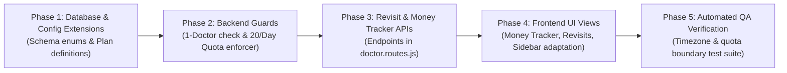

# HMS PROJECT — COMPLETE TECHNICAL AUDIT REPORT
## Preparation for Free Doctor OPD Plan Implementation

**Target Artifact**: `HMS_FREE_DOCTOR_PLAN_TECHNICAL_AUDIT.md`  
**Audit Type**: Read-Only Architectural & Source-Code Technical Audit  
**Target Plan**: **Free Doctor OPD Plan** (`₹0`, Exactly 1 Doctor, 20 Appointments/Calendar Day, Asia/Kolkata Timezone, Unlimited Patients)  
**Audited Repository**: `teammedical365-coder/HMS`  
**Audit Date**: November 2026  
**Auditor**: Senior Software Architect, Database Architect & Security Auditor  

---

## TABLE OF CONTENTS
1. [Executive Summary](#1-executive-summary)
2. [Actual Project Architecture](#2-actual-project-architecture)
3. [Subscription & Plan System Analysis](#3-subscription--plan-system-analysis)
4. [Doctor & User Management Analysis](#4-doctor--user-management-analysis)
5. [Patient Management Analysis](#5-patient-management-analysis)
6. [Appointment Management Analysis](#6-appointment-management-analysis)
7. [Doctor Patient Tray Analysis](#7-doctor-patient-tray-analysis)
8. [Prescription Analysis](#8-prescription-analysis)
9. [Money Tracker Analysis](#9-money-tracker-analysis)
10. [Revisit Schedule Analysis](#10-revisit-schedule-analysis)
11. [Frontend UI/UX Reuse Analysis](#11-frontend-uiux-reuse-analysis)
12. [Security & Data Isolation Audit](#12-security--data-isolation-audit)
13. [Database Changes Required](#13-database-changes-required)
14. [Backend Changes Required](#14-backend-changes-required)
15. [Frontend Changes Required](#15-frontend-changes-required)
16. [API Endpoints Required](#16-api-endpoints-required)
17. [Exact Files Likely to Be Modified](#17-exact-files-likely-to-be-modified)
18. [Existing Features That Must NOT Be Modified](#18-existing-features-that-must-not-be-modified)
19. [Implementation Risks](#19-implementation-risks)
20. [Recommended Implementation Phases](#20-recommended-implementation-phases)
21. [Testing Strategy](#21-testing-strategy)
22. [Final Readiness Assessment](#22-final-readiness-assessment)

---

## 1. EXECUTIVE SUMMARY

This technical audit was conducted on the Medical365 Hospital Management System (HMS) codebase to evaluate its readiness for the introduction of a new **Free Doctor OPD Subscription Plan**. The audit was strictly read-only; no existing source code, configuration files, packages, database schemas, or existing plan definitions were modified.

### Key Architectural Findings
1. **High Architectural Compatibility**: Medical365 already possesses an isolated doctor-centric clinical flow (`client/src/pages/doctors/DoctorDashboard.jsx`, `Patient.jsx`, and `DoctorPatientDetails.jsx`) that supports manual prescription writing, diagnosis, vital sign tracking, and PDF generation without requiring active hospital administration, pharmacy, or laboratory modules.
2. **Subscription Plan Topologies**: The platform currently maintains two subscription models:
   - **Hospital Tier Plan Model**: Hardcoded in `server/src/utils/subscriptionPlans.js` and `client/src/utils/subscriptionPlans.js` with plans `enterprise`, `multi_speciality_starter`, `clinic_basic`, and `starter`. Stored on the `Hospital` model in `subscriptionPlan` and `tier`.
   - **Clinic Patient SaaS Billing Model**: Stored in `clinicSubscription.model.js` tracking monthly registered patient counts and billing rates per patient.
3. **Critical Implementation Gaps Identified**:
   - **Doctor Quota Enforcement Gap**: While `server/src/routes/admin.routes.js` checks doctor limits during staff creation, `server/src/routes/admin-entities.routes.js` (`POST /api/admin-entities/doctors`) has **no subscription tier quota check**. A doctor can currently be created through the entities route without triggering subscription limits.
   - **Appointment Quota Absence**: The existing appointment booking engine (`server/src/routes/appointment.routes.js` and `server/src/routes/reception.routes.js`) has **no daily volume restriction** on any plan.
   - **Timezone Drift Risk**: The current appointment date bounds use UTC (`setUTCHours(0,0,0,0)`), which drifts by 5.5 hours from `Asia/Kolkata` (IST). A booking at 01:00 AM IST on November 3 would be evaluated as 19:30 UTC on November 2, causing premature quota exhaustion or improper daily resets.
   - **Follow-up Date Missing from Appointment Model**: `appointment.model.js` currently lacks a dedicated `followUpDate` attribute, relying solely on text notes or free-form prescription instructions.
4. **Feasibility Verdict**: The Free Doctor OPD Plan can be seamlessly introduced **without modifying or breaking any existing plans** (`starter`, `clinic_basic`, `multi_speciality_starter`, `enterprise`), without rewriting the core appointment engine, and without requiring any scheduled midnight cron jobs.

---

## 2. ACTUAL PROJECT ARCHITECTURE

### 2.1 Technology Stack Breakdown

| Layer | Component | Version / Technology | Key Dependencies / Implementations |
| :--- | :--- | :--- | :--- |
| **Frontend** | React SPA | React 18.2.0, Vite 5.x | `react-router-dom` v6, Redux Toolkit, Tailwind CSS, Lucide / React Icons (`react-icons`), `jspdf`, `jspdf-autotable`, `socket.io-client`. |
| **Backend** | REST API Server | Node.js (LTS), Express 4.18.2 | Mongoose 8.0.0, `jsonwebtoken` 9.0.2, `bcryptjs` 2.4.3, `helmet` 8.1.0, `cors`, `express-rate-limit`, `pdfkit`, `pizzip`, `docxtemplater`, `socket.io`. |
| **Database** | Dual MongoDB Architecture | MongoDB 6.x / 7.x compatible | Primary cluster connection + Dynamic tenant connection pool (`server/src/db/tenantDb.js`). |
| **Edge Sync**| Hybrid Offline Node | Standalone microservice in `local-agent/` | WebSocket reverse tunnel (`server/src/utils/tunnelServer.js`), SQLite/Mongo edge outbox. |

### 2.2 Directory Topology of Relevant Modules

```
HMS/
├── client/
│   ├── src/
│   │   ├── components/
│   │   │   ├── layouts/
│   │   │   │   ├── DashboardLayout.jsx         # Global sidebar, role navigation, brand header
│   │   │   │   └── DashboardLayout.css
│   │   │   ├── DynamicQuestionForm.jsx         # Clinical questionnaire renderer
│   │   │   └── SlotPicker.jsx                  # OPD appointment slot selector
│   │   ├── pages/
│   │   │   ├── doctors/
│   │   │   │   ├── DoctorDashboard.jsx         # Doctor summary dashboard & KPI cards
│   │   │   │   ├── Patient.jsx                 # Active OPD Queue, Today vs All, Vitals modal
│   │   │   │   ├── DoctorPatientDetails.jsx    # Consultation, e-Rx, Lab orders, jsPDF generator
│   │   │   │   └── AIAssistant.jsx             # Gemini 2.0 Flash Voice Scribe & clinical chat
│   │   │   ├── reception/
│   │   │   │   └── ReceptionDashboard.jsx      # Walk-in registration & appointment booking
│   │   │   ├── billing/
│   │   │   │   └── PatientBillingProfile.jsx   # Consolidated invoices & split payments
│   │   │   └── hospitaladmin/
│   │   │       └── ClinicDashboard.jsx         # Simple clinic administration portal
│   │   ├── routes/
│   │   │   └── Mainroutes.jsx                  # React Router definitions & lazy chunk loaders
│   │   └── utils/
│   │       ├── api.js                          # Axios API client & request/response interceptors
│   │       └── subscriptionPlans.js            # Hardcoded plan definitions (Frontend)
├── server/
│   ├── src/
│   │   ├── config/
│   │   │   └── jwt.js                          # JWT secret & token lifespan configuration
│   │   ├── db/
│   │   │   ├── tenantDb.js                     # Dynamic multi-tenant MongoDB connection pool
│   │   │   └── tenantModels.js                 # Tenant-scoped Mongoose model factory
│   │   ├── middleware/
│   │   │   ├── auth.middleware.js              # Token verification & role checking guards
│   │   │   ├── tenantMiddleware.js             # Hospital/Tenant context injection
│   │   │   └── rateLimiter.js                  # Express rate limiting
│   │   ├── models/
│   │   │   ├── hospital.model.js               # Tenant record, plan, tier limits, settings
│   │   │   ├── user.model.js                   # Central identity model (Doctors, Staff, Patients)
│   │   │   ├── doctor.model.js                 # Doctor profile, specialty, fees, availability
│   │   │   ├── appointment.model.js            # Consultations, tokens, dates, status, Rx
│   │   │   ├── clinicPatient.model.js          # Clinic patient record with ABHA and vitals
│   │   │   ├── clinicSubscription.model.js     # Monthly billing per patient
│   │   │   ├── paymentTransaction.model.js     # Monetary ledger (Cash, UPI, Split)
│   │   │   └── role.model.js                   # Role-based access control permissions
│   │   ├── routes/
│   │   │   ├── admin-entities.routes.js        # Doctor creation (`POST /doctors`)
│   │   │   ├── admin.routes.js                 # Staff onboarding & subscription checks
│   │   │   ├── appointment.routes.js           # OPD booking, token generator, slot conflicts
│   │   │   ├── clinic.routes.js                # Clinic stats, revenue, appointments, patients
│   │   │   ├── doctor.routes.js                # OPD Queue, sessions, prescription PATCH
│   │   │   ├── hospital.routes.js              # Central admin hospital/plan management
│   │   │   ├── patient.routes.js               # Patient records & family health tree
│   │   │   ├── reception.routes.js             # Smart MRN generation, walk-ins, check-in
│   │   │   ├── simpleClinic.routes.js          # Simple clinic onboarding & tier validation
│   │   │   └── voiceScribe.routes.js           # Gemini 2.0 Flash ambient audio transcription
│   │   └── utils/
│   │       ├── appointmentValidator.js         # Double-booking prevention
│   │       ├── subscriptionPlans.js            # Hardcoded plan definitions (Backend)
│   │       └── validatePassword.js             # Security complexity validation
```

---

## 3. SUBSCRIPTION & PLAN SYSTEM ANALYSIS

### 3.1 Existing Plans & Implementation State

The system contains plan configurations in two distinct utility files:
- `server/src/utils/subscriptionPlans.js`
- `client/src/utils/subscriptionPlans.js`

```javascript
// Verified source from server/src/utils/subscriptionPlans.js
const SUBSCRIPTION_PLANS = {
    enterprise: {
        name: 'Enterprise Plan',
        maxDoctors: Infinity,
        maxStaff: Infinity,
    },
    multi_speciality_starter: {
        name: 'Multi-Speciality Starter Plan',
        maxDoctors: 15,
        maxStaff: 25,
    },
    clinic_basic: {
        name: 'Clinic Basic Plan',
        maxDoctors: 5,
        maxStaff: 3,
    },
    starter: {
        name: 'Starter Plan',
        maxDoctors: Infinity,
        maxStaff: Infinity,
    }
};
```

### 3.2 Plan Comparison Matrix

| Plan Key | Target Segment | Doctor Quota | Staff Quota | Appointment Limit | Patient Limit | Implementation Status |
| :--- | :--- | :---: | :---: | :---: | :---: | :--- |
| `enterprise` | Large Hospitals | Unlimited ($\infty$) | Unlimited ($\infty$) | Unlimited | Unlimited | **Fully Implemented** |
| `multi_speciality_starter` | Mid-size Hospitals | 15 Doctors | 25 Staff | Unlimited | Unlimited | **Fully Implemented** |
| `clinic_basic` | Multi-Doctor Clinics | 5 Doctors | 3 Staff | Unlimited | Unlimited | **Fully Implemented** |
| `starter` | Solo Clinic / Starter | Infinity (Config) / 1 (SimpleClinic) | 1 Admin | Unlimited | Unlimited | **Partially Implemented** (Inconsistency between config & simpleClinic.routes.js) |
| **`free_doctor_opd`** | Solo Practitioner | **1 Doctor** (Target) | **0 Staff** (Target) | **20 / Day** (Target) | **Unlimited** | **NOT IMPLEMENTED** (Target of this audit) |

### 3.3 Plan Assignment & Quota Logic Analysis
1. **Storage Location**:
   - `Hospital.subscriptionPlan`: Enum in `server/src/models/hospital.model.js` (Line 112). Currently restricted to:
     `['multi_speciality_starter', 'clinic_basic', 'enterprise', 'starter', 'none']`.
   - `Hospital.tier`: Embedded document in `server/src/models/hospital.model.js` (Lines 126–130) storing `{ maxDoctors, maxReceptionists, maxStaff }`.
2. **Configurable vs. Hardcoded**:
   - **Hardcoded**: The plan catalog names, limits, and defaults are hardcoded in `server/src/utils/subscriptionPlans.js` and `client/src/utils/subscriptionPlans.js`.
   - **Configurable**: When Central Admin assigns a plan (`PUT /api/hospitals/:id` in `hospital.routes.js` lines 336–345), the values are copied onto `hospital.tier`, allowing manual database overrides if needed.
3. **Middleware & Quota Enforcement Audit**:
   - In `server/src/routes/admin.routes.js` (Lines 661–685):
     ```javascript
     if (subscriptionPlan === 'clinic_basic' || subscriptionPlan === 'multi_speciality_starter') {
         const limits = SUBSCRIPTION_PLANS[subscriptionPlan] || { maxDoctors: Infinity, maxStaff: Infinity };
         // Enforces doctorCount >= maxDoctors and staffCount >= maxStaff
     }
     ```
   - **CRITICAL GAP**: Notice that `starter` and `enterprise` are excluded from checks in `admin.routes.js`. Furthermore, `admin-entities.routes.js:39` (`POST /doctors`) does **NOT** check `hospital.subscriptionPlan` at all.

---

## 4. DOCTOR & USER MANAGEMENT ANALYSIS

### 4.1 Schema Inspection
- **Doctor Profile Model**: `server/src/models/doctor.model.js`
  - Linked to user: `userId` (ref: `User`, unique, sparse).
  - Linked to tenant: `hospitalId` (ref: `Hospital`, indexed).
  - Identification: `doctorId` (10-char nanoid string, unique).
  - Practice attributes: `specialty`, `departments` (`[String]`), `consultationFee` (`Number`, default: 0), `availability` (day-of-week schedule).
- **User Identity Model**: `server/src/models/user.model.js`
  - Carries `role: 'doctor'` or `role: 'clinic doctor'`.

### 4.2 Doctor Creation Entry Points
1. **Standard Entities Route**: `server/src/routes/admin-entities.routes.js` (`POST /doctors`, Line 39).
   - Uses `verifyAdminOrSuperAdmin` middleware.
   - Generates unique `doctorId`, creates `User` record, creates `Doctor` record.
   - **Vulnerability**: Lacks quota validation against `Hospital.subscriptionPlan`.
2. **Simple Clinic Route**: `server/src/routes/simpleClinic.routes.js` (`POST /:id/staff`, Line 430).
   - Enforces `clinic.tier?.maxDoctors || 1`.
   - Injects role `'Clinic Doctor'`.

### 4.3 Safe Restriction Strategy for Exactly One Doctor
To enforce exactly one doctor for `free_doctor_opd` without breaking multi-doctor tiers:
1. Add `free_doctor_opd` to `server/src/utils/subscriptionPlans.js`:
   ```javascript
   free_doctor_opd: {
       name: 'Free Doctor OPD Plan',
       maxDoctors: 1,
       maxStaff: 0,
       maxDailyAppointments: 20,
       price: 0
   }
   ```
2. In `server/src/routes/admin-entities.routes.js` (`POST /doctors`), inject a pre-creation validation guard:
   ```javascript
   const hospital = await Hospital.findById(targetHospitalId).select('subscriptionPlan tier');
   if (hospital?.subscriptionPlan === 'free_doctor_opd') {
       const existingDoctors = await Doctor.countDocuments({ hospitalId: targetHospitalId });
       if (existingDoctors >= 1) {
           return res.status(403).json({
               success: false,
               message: 'Free Doctor OPD Plan allows exactly one doctor account. Please upgrade to add more doctors.'
           });
       }
   }
   ```
3. In `server/src/routes/admin.routes.js` (`POST /users`), block creation of staff roles (`nurse`, `receptionist`, `accountant`, `pharmacist`, `labtechnician`) if `subscriptionPlan === 'free_doctor_opd'`.

---

## 5. PATIENT MANAGEMENT ANALYSIS

### 5.1 Patient Storage Architecture
Medical365 utilizes two distinct patient representations depending on entity mode:
1. **Hospital Mode**: Stored in `server/src/models/user.model.js` with `role: 'patient'`, `patientId` (e.g., `APL-M365-001`), and `mrn`.
2. **Clinic Mode**: Stored in `server/src/models/clinicPatient.model.js` with `clinicId` (ref: `Hospital`), `patientUid` (e.g., `RAM-001`), `vitals`, `allergies`, `chronicConditions`, and `abdm` data.

### 5.2 Patient Monitoring Features Already Implemented
In `client/src/pages/doctors/DoctorPatientDetails.jsx`:
- **Patient Profile**: Displays demographic banner (Name, Age, Gender, Blood Group, Contact, Patient UID).
- **Vitals Monitoring**: Weight, Height, BMI, Blood Pressure, Pulse, Temperature, SpO2, Respiratory Rate.
- **Longitudinal Medical History**: Tabular view of all past consultations, clinical notes, past prescribed medications, and uploaded radiology/pathology attachments (`AppointmentReports.jsx`).
- **Allergies & Chronic Diseases**: Rendered in the patient info bar.

### 5.3 Patient Quota Audit
- **Findings**: Neither `user.model.js` nor `clinicPatient.model.js` has any quota cap. Patient creation is **unlimited** across all plans, satisfying the Free Plan requirement.

---

## 6. APPOINTMENT MANAGEMENT ANALYSIS

### 6.1 Schema & Booking Infrastructure
- **Model**: `server/src/models/appointment.model.js`
  - Fields: `userId`, `patientId`, `doctorId`, `doctorUserId`, `doctorName`, `appointmentDate` (`Date`), `appointmentTime` (`String`), `tokenNumber` (`Number`), `status` (`'pending' | 'confirmed' | 'completed' | 'cancelled'`), `amount`, `paymentStatus`, `visitType` (`'New Consultation' | 'Follow-up'`).
  - Unique Index:
    ```javascript
    appointmentSchema.index(
        { doctorId: 1, appointmentDate: 1, appointmentTime: 1 },
        { unique: true, partialFilterExpression: { status: { $ne: 'cancelled' } } }
    );
    ```

### 6.2 Quota Enforcement Analysis: 20 Appointments / Calendar Day

#### Current Implementation (Audit Finding)
In `server/src/routes/appointment.routes.js` (Lines 240–255):
```javascript
const startOfDay = new Date(reqDateStr);
startOfDay.setUTCHours(0, 0, 0, 0);
const endOfDay = new Date(reqDateStr);
endOfDay.setUTCHours(23, 59, 59, 999);

const count = await Appointment.countDocuments({
    doctorId: doctorDoc._id,
    appointmentDate: { $gte: startOfDay, $lte: endOfDay },
    status: { $ne: 'cancelled' }
});
```
This query counts existing appointments, but **only to generate the next token number** (`tokenNumber = count + 1`). It does **NOT** enforce any ceiling limit.

#### Timezone Audit: Asia/Kolkata (IST = UTC + 05:30)
- **Problem**: When a server runs in UTC (e.g., on Render, AWS, or Docker), `new Date("2026-11-03").setUTCHours(0,0,0,0)` produces `2026-11-03T00:00:00.000Z`.
- In Indian Standard Time (IST), midnight begins at `2026-11-02T18:30:00.000Z`.
- Consequently, booking an appointment at 02:00 AM IST on November 3 would be categorized under November 2 in UTC, corrupting the daily quota window.

#### Recommended Zero-Cron Daily Quota Algorithm
No manual midnight reset cron job is required. The quota can be enforced dynamically on every booking attempt by computing the calendar day boundaries strictly in `Asia/Kolkata`:

```javascript
// Recommended Helper: Get IST Day Range in UTC
function getKolkataDayRange(dateInput) {
    // Format input date into YYYY-MM-DD in Asia/Kolkata
    const formatter = new Intl.DateTimeFormat('en-CA', { 
        timeZone: 'Asia/Kolkata', 
        year: 'numeric', 
        month: '2-digit', 
        day: '2-digit' 
    });
    const istDateString = formatter.format(new Date(dateInput)); // "2026-11-03"
    
    // Construct exact IST day boundaries
    const startIST = new Date(`${istDateString}T00:00:00.000+05:30`);
    const endIST = new Date(`${istDateString}T23:59:59.999+05:30`);
    
    return { startIST, endIST, dateStr: istDateString };
}
```

```javascript
// Enforcement Guard in appointment booking route
if (hospital.subscriptionPlan === 'free_doctor_opd') {
    const { startIST, endIST } = getKolkataDayRange(reqDateStr);
    
    const activeDailyCount = await Appointment.countDocuments({
        doctorId: doctorDoc._id,
        appointmentDate: { $gte: startIST, $lte: endIST },
        status: { $ne: 'cancelled' }
    });

    if (activeDailyCount >= 20) {
        return res.status(403).json({
            success: false,
            code: 'DAILY_QUOTA_EXCEEDED',
            message: 'Daily appointment quota reached. The Free Doctor OPD Plan allows a maximum of 20 appointments per calendar day. Quota resets at 12:00 AM IST.'
        });
    }
}
```

#### Concurrency & Race Condition Defense
If two simultaneous HTTP requests hit the server when `activeDailyCount === 19`, both could pass the count check. To guarantee absolute atomicity without distributed locks:
- Maintain an atomic daily counter in a lightweight sub-document, **OR**
- Execute the creation inside a Mongoose transaction with a strict read-before-write check, **OR**
- Add a daily sequence slot index with a partial unique index on `{ doctorId: 1, appointmentDateIST: 1, dailySlotIndex: 1 }` constrained between 1 and 20.

---

## 7. DOCTOR PATIENT TRAY ANALYSIS

### 7.1 Existing Tray Components
The doctor's daily OPD patient queue is already fully implemented across two existing files:
1. `client/src/pages/doctors/DoctorDashboard.jsx`:
   - Summary statistics cards:
     - `today`: Filtered by `String(a.appointmentDate).startsWith(todayStr)`.
     - `pending`: Statuses `['pending', 'confirmed', 'scheduled', 'in_progress']`.
     - `completed`: Status `'completed'`.
     - `total`: All appointments.
2. `client/src/pages/doctors/Patient.jsx`:
   - Live Patient Tray with tabs:
     - **Today's Patients** (`activeTab === 'today'`).
     - **All Patients** (`activeTab === 'all'`).
   - Status Filters: `all`, `pending`, `confirmed`, `completed`, `cancelled`.
   - Direct Patient Action Menu:
     - "Consult" $\rightarrow$ Navigates directly to `DoctorPatientDetails.jsx`.
     - "Take Vitals" $\rightarrow$ Inline modal to record BP, Pulse, Temp, SpO2, BMI.
     - "Upload Report" $\rightarrow$ Attaches external PDF/image files.

### 7.2 Patient Tray Reuse Assessment
- **Finding**: **100% REUSABLE AS-IS**.
- The existing `Patient.jsx` already fulfills all Doctor Patient Tray requirements (Waiting, In-Consultation, Completed, Today's Queue). No new patient tray component needs to be created from scratch.

---

## 8. PRESCRIPTION AUDIT

### 8.1 Model & Route Verification
- **API Endpoint**: `server/src/routes/doctor.routes.js` (`PATCH /appointments/:id/prescription`, Line 543).
- **Client Component**: `client/src/pages/doctors/DoctorPatientDetails.jsx` (Lines 850–1280).

### 8.2 Medicine Entry: Catalog vs. Manual Entry Audit
- **Audit Question**: *Can a doctor enter medicine names manually without pharmacy inventory integration?*
- **Source Code Verification**:
  - In `DoctorPatientDetails.jsx` (Lines 2901–2903):
    ```jsx
    <input
        type="text"
        className="form-control"
        placeholder="Medicine Name (e.g. Paracetamol 650mg)"
        value={med.medicineName}
        onChange={e => setSessionData(prev => {
            const m = [...prev.medicines];
            m[idx] = { ...m[idx], medicineName: e.target.value };
            return { ...prev, medicines: m };
        })}
    />
    ```
  - In `doctor.routes.js` (Lines 580–595):
    ```javascript
    if (pharmacy) {
        appointment.pharmacy = p.map(item => ({
            medicineName: item.medicineName || item.name,
            saltName: item.saltName || '',
            frequency: item.frequency || '',
            duration: item.duration || ''
        }));
    }
    ```
- **Conclusion**: **VERIFIED**. Medicine entry is completely free-text. While catalog suggestions exist if an inventory is present, the field allows raw manual entry of any brand or generic name. No pharmacy module is required.

### 8.3 PDF Prescription Generation & Download
- Implemented in `DoctorPatientDetails.jsx` (`generatePrescriptionPDF`, Lines 950–1080) using `jspdf` and `jspdf-autotable`.
- Renders:
  - Header: Clinic Name, Doctor Name, Degree, Registration Number.
  - Patient Banner: Name, Age, Gender, Patient ID, Date.
  - Vitals Summary.
  - Clinical Diagnosis & Symptoms.
  - Rx Prescription Table: Medicine Name, Generic Composition, Dose/Frequency, Duration, Meal Timing.
  - Lab Investigations Ordered.
  - Doctor Notes & Advice.
  - Doctor Digital Signature footer.
- Downloads directly to the practitioner's browser as a `.pdf` file.

---

## 9. MONEY TRACKER / OPD COLLECTION AUDIT

### 9.1 Existing Financial Data Structures
In `server/src/models/appointment.model.js`:
- `amount`: Consultation fee collected (`Number`).
- `paymentStatus`: `'paid' | 'pending' | 'refunded'`.
- `paymentMethod`: `'Cash' | 'UPI' | 'Card' | 'Split'`.
- `splitPayments`: Array of `{ method, amount }`.
- `appointmentDate`: Timestamp.

In `server/src/models/paymentTransaction.model.js`:
- Tracks individual transaction ledgers with `hospitalId`, `patientId`, `paymentMode`, `amount`, and `paymentDate`.

### 9.2 Existing Aggregation Logic
In `server/src/routes/clinic.routes.js` (Lines 170–195):
- Aggregates `todayRevenueAgg`, `monthRevenueAgg`, and total revenue grouped by `paymentStatus: 'paid'` and filtered by `appointmentDate`.

### 9.3 Reusability for Free Doctor Money Tracker
- The Free Plan does not require complex double-entry accounting, GST invoices, or refund approval matrices.
- **Recommended Lightweight API**: A single endpoint `GET /api/doctor/money-tracker` that queries the `Appointment` collection for the doctor's `hospitalId`:
  - `todayCollection`: Sum of `amount` where `paymentStatus === 'paid'` and `appointmentDate` is today (in Asia/Kolkata).
  - `monthCollection`: Sum of `amount` for the current calendar month.
  - `byMethod`: Breakdown between **Cash** and **UPI**.
  - `recentTransactions`: Latest 50 paid consultations.

---

## 10. REVISIT SCHEDULE AUDIT

### 10.1 Existing Revisit / Follow-up Implementations
- **Hospital Configuration**: `Hospital.followUpDays` (`Number`, default: 0) in `hospital.model.js`.
- **Appointment Schema**: `visitType: { type: String, enum: ['New Consultation', 'Follow-up'], default: 'New Consultation' }` in `appointment.model.js`.
- **Fee Waiver Logic**: In `server/src/routes/clinic.routes.js:475` (`/patients/:id/check-fee-waiver`), the system checks if the patient's previous visit falls within `clinic.followUpDays`.

### 10.2 Architectural Gap: Revisit Date Field Missing
- **Audit Finding**: Currently, `appointment.model.js` does **NOT** contain an indexed `followUpDate: Date` or `revisitDate: Date` field. Doctors write revisit advice as unstructured text in `doctorNotes` (e.g., *"Review after 7 days"*).
- **Requirement for Free Doctor Plan**:
  - The Free Plan requires tracking *upcoming revisits*, *pending revisits*, and *follow-up dates*.
- **Recommended Architectural Solution**:
  1. Add an optional, indexed field `followUpDate: { type: Date, default: null, index: true }` to `appointment.model.js`.
  2. When the doctor clicks "Save Prescription" with a selected revisit date, update `followUpDate`.
  3. Create an endpoint `GET /api/doctor/revisits`:
     - Queries `Appointment.find({ doctorId, followUpDate: { $gte: todayIST } })`.
     - Populates patient details (`name`, `phone`, `patientId`), original consultation date, and chief complaints.

---

## 11. FRONTEND UI/UX REUSE ANALYSIS

### 11.1 Component Reuse Evaluation Matrix

| Required Free Plan Feature | Existing Frontend Component | File Path | Reuse Recommendation |
| :--- | :--- | :--- | :--- |
| **Patient Monitoring** | `PatientProfile.jsx` / `DoctorPatientDetails.jsx` | `client/src/pages/doctors/DoctorPatientDetails.jsx` | **Reuse 100%**. Contains vitals, history, past sessions, reports. |
| **Doctor Patient Tray** | `Patient.jsx` | `client/src/pages/doctors/Patient.jsx` | **Reuse 100%**. Filter by `tab=today`, status filter, consult button. |
| **Appointment Booking** | `ReceptionDashboard.jsx` (Modal) / `SlotPicker.jsx` | `client/src/components/SlotPicker.jsx` | **Reuse Component**. Embed direct booking modal into Doctor Dashboard. |
| **Prescription Writing** | `DoctorPatientDetails.jsx` | `client/src/pages/doctors/DoctorPatientDetails.jsx` | **Reuse 100%**. Free-text medicines, doses, and jsPDF downloader. |
| **Money Tracker** | `AccountantDashboard.jsx` / `PharmacyCollections.jsx` | `client/src/pages/pharmacy/PharmacyCollections.jsx` | **Create Simplified View**. Existing accounting views are too complex; build a lightweight 1-page tracker reusing card styles. |
| **Revisit Schedule** | `Patient.jsx` (Filtered view) | `client/src/pages/doctors/Patient.jsx` | **Reuse Table Layout**. Display upcoming follow-up appointments. |

### 11.2 Sidebar & Navigation Adaptation
In `client/src/components/layouts/DashboardLayout.jsx` (Lines 80–90):
- Currently, all doctors see:
  - Dashboard (`/my-dashboard`)
  - My Patients (`/doctor/patients`)
  - AI Assistant (`/doctor/ai-assistant`)
  - Surgeries (`/doctor/surgeries`)
  - Real-Time Monitoring (`/doctor/real-time-monitoring`)
- **Adaptation for `free_doctor_opd`**:
  Inspect `user.subscriptionPlan === 'free_doctor_opd'` and present a streamlined, distraction-free 5-link menu:
  1. 🩺 **Dashboard & Queue** (`/doctor/dashboard`)
  2. 👥 **Patient Monitoring** (`/doctor/patients`)
  3. 📅 **Appointments** (`/doctor/appointments`)
  4. 💰 **Money Tracker** (`/doctor/money-tracker`)
  5. 🔁 **Revisit Schedule** (`/doctor/revisits`)
  *(Hiding Surgeries, OT Rooms, Real-Time Inpatient Monitoring, Wards, Pharmacy, and Lab)*.

---

## 12. SECURITY & DATA ISOLATION AUDIT

### 12.1 Security Findings & Vulnerability Register

| ID | Vulnerability / Security Finding | Affected File & Line | Severity | Mitigation Required |
| :--- | :--- | :--- | :---: | :--- |
| **SEC-01** | Doctor Creation Route lacks Subscription Quota Check | `server/src/routes/admin-entities.routes.js:39` | **HIGH** | Inject quota validation verifying `Doctor.countDocuments({ hospitalId }) < maxDoctors`. |
| **SEC-02** | Timezone Drift on Daily Quota (UTC vs IST) | `server/src/routes/appointment.routes.js:242` | **MEDIUM** | Replace `setUTCHours` with `Asia/Kolkata` day boundary calculation. |
| **SEC-03** | Race Condition in Concurrent Booking Requests | `server/src/routes/appointment.routes.js:280` | **MEDIUM** | Enforce atomic count validation or database transaction. |
| **SEC-04** | Role Privilege Escalation via Staff Creation | `server/src/routes/admin.routes.js:640` | **HIGH** | Block `free_doctor_opd` tenants from creating non-doctor staff accounts. |
| **SEC-05** | BOLA / Direct API Access to Restricted Modules | `server/src/routes/pharmacy.routes.js`, `lab.routes.js` | **LOW** | Ensure route middleware verifies module eligibility against tenant plan. |

### 12.2 Multi-Tenant Data Isolation Verification
- **Verified**: Every query in `doctor.routes.js` and `appointment.routes.js` scopes by `hospitalId` (or `tenantDb`).
- Doctors on the Free Plan will have an isolated `hospitalId` assigned to their clinic entity. They cannot access, view, or mutate patient records or appointments belonging to other clinics or hospitals.

---

## 13. DATABASE CHANGES REQUIRED

> [!IMPORTANT]
> The database schema changes below are completely non-breaking and additive. No existing fields or collections are dropped or renamed.

### 13.1 `Hospital` Model (`server/src/models/hospital.model.js`)
1. **Enum Update for `subscriptionPlan`** (Line 112):
   ```diff
   - subscriptionPlan: { type: String, enum: ['multi_speciality_starter', 'clinic_basic', 'enterprise', 'starter', 'none'], default: 'none' },
   + subscriptionPlan: { type: String, enum: ['multi_speciality_starter', 'clinic_basic', 'enterprise', 'starter', 'free_doctor_opd', 'none'], default: 'none' },
   ```
2. **Tier Limits Support**:
   Add `maxDailyAppointments` to the `tier` schema definition (Lines 126–130):
   ```javascript
   tier: {
       maxDoctors:           { type: Number, default: 1 },
       maxReceptionists:     { type: Number, default: 1 },
       maxStaff:             { type: Number, default: Infinity },
       maxDailyAppointments: { type: Number, default: Infinity }
   }
   ```

### 13.2 `Appointment` Model (`server/src/models/appointment.model.js`)
1. **Add `followUpDate` attribute**:
   ```javascript
   followUpDate: { 
       type: Date, 
       default: null, 
       index: true 
   },
   ```
2. **Compound Index for Quota Acceleration**:
   ```javascript
   appointmentSchema.index({ doctorId: 1, appointmentDate: 1, status: 1 });
   ```

---

## 14. BACKEND CHANGES REQUIRED

### 14.1 Subscription Catalog (`server/src/utils/subscriptionPlans.js`)
Add the `free_doctor_opd` definition:
```javascript
free_doctor_opd: {
    name: 'Free Doctor OPD Plan',
    maxDoctors: 1,
    maxStaff: 0,
    maxDailyAppointments: 20,
    price: 0
}
```

### 14.2 Doctor Creation Guard (`server/src/routes/admin-entities.routes.js`)
In `router.post('/doctors')`:
- Before creating a new user and doctor record, fetch `Hospital.findById(hospitalId)`.
- If `subscriptionPlan === 'free_doctor_opd'`, verify `Doctor.countDocuments({ hospitalId }) === 0`. If `> 0`, reject with `403 Forbidden`.

### 14.3 Staff Creation Guard (`server/src/routes/admin.routes.js`)
In `router.post('/users')`:
- If `hospital.subscriptionPlan === 'free_doctor_opd'`, reject creation of any staff role with message: *"Staff accounts are not permitted on the Free Doctor OPD Plan. Please upgrade to add staff."*

### 14.4 Daily Appointment Quota Guard (`server/src/routes/appointment.routes.js` & `reception.routes.js`)
In appointment creation handlers:
- Compute IST day bounds using `Intl.DateTimeFormat` with `timeZone: 'Asia/Kolkata'`.
- Count existing appointments with `{ doctorId, appointmentDate: { $gte: startIST, $lte: endIST }, status: { $ne: 'cancelled' } }`.
- If count $\ge 20$, reject with `403 Forbidden` (`DAILY_QUOTA_EXCEEDED`).

### 14.5 Revisit Schedule API (`server/src/routes/doctor.routes.js`)
1. In `PATCH /appointments/:id/prescription`:
   - Accept `followUpDate` in `req.body` and persist to `appointment.followUpDate`.
2. Implement `GET /api/doctor/revisits`:
   - Returns upcoming appointments where `followUpDate >= todayIST` or `visitType === 'Follow-up'`.

### 14.6 Money Tracker API (`server/src/routes/doctor.routes.js`)
Implement `GET /api/doctor/money-tracker`:
- Aggregates paid appointments for the authenticated doctor, returning today's collection, month's collection, Cash vs. UPI totals, and transaction history.

---

## 15. FRONTEND CHANGES REQUIRED

### 15.1 Subscription Utility (`client/src/utils/subscriptionPlans.js`)
Add `free_doctor_opd` to `SUBSCRIPTION_PLANS`:
```javascript
free_doctor_opd: {
    name: 'Free Doctor OPD Plan',
    maxDoctors: 1,
    maxStaff: 0,
    maxDailyAppointments: 20
}
```

### 15.2 Sidebar Menu Synthesis (`client/src/components/layouts/DashboardLayout.jsx`)
In `menuItems` useMemo:
- When `role === 'doctor'` and `user.subscriptionPlan === 'free_doctor_opd'`, return the dedicated 5-link menu:
  - Dashboard (`/doctor/dashboard`)
  - Patient Monitoring (`/doctor/patients`)
  - Appointments (`/doctor/appointments`)
  - Money Tracker (`/doctor/money-tracker`)
  - Revisit Schedule (`/doctor/revisits`)

### 15.3 Money Tracker Page (`client/src/pages/doctors/DoctorMoneyTracker.jsx`)
Create a clean, single-page component displaying:
- KPI Cards: **Today's Collection (₹)**, **Monthly Collection (₹)**, **Cash vs. UPI Ratio**.
- Filterable transaction table with patient name, token number, fee amount, payment mode, and time.

### 15.4 Revisit Schedule Page (`client/src/pages/doctors/DoctorRevisits.jsx`)
Create a single-page component displaying:
- Tabs: **Upcoming Revisits** (Next 7 Days, Next 30 Days) and **Overdue Revisits**.
- Patient quick-card with phone call trigger, previous diagnosis, and "Start Consultation" button.

### 15.5 Quota Banner in OPD Queue (`client/src/pages/doctors/Patient.jsx`)
Display a progress pill in the header:
- `Appointments Today: X / 20` (Green when $\le 15$, Amber when 16–19, Red when 20).

---

## 16. API ENDPOINTS REQUIRED

| Module | Method | Endpoint Path | Auth Guard | Request Body / Query | Expected Response | Status |
| :--- | :--- | :--- | :--- | :--- | :--- | :--- |
| **Appointments** | `POST` | `/api/appointments` | Token | `{ patientId, appointmentDate, time, fee }` | `201 Created` or `403 DAILY_QUOTA_EXCEEDED` | **Needs Quota Modification** |
| **Appointments** | `GET` | `/api/doctor/daily-quota` | Token | None | `{ allowed: 20, booked: 14, remaining: 6 }` | **New Endpoint** |
| **Money Tracker**| `GET` | `/api/doctor/money-tracker` | Token | `?period=today` or `?period=month` | `{ todayTotal, monthTotal, cash, upi, history }` | **New Endpoint** |
| **Revisits** | `GET` | `/api/doctor/revisits` | Token | `?status=upcoming` or `?status=pending` | `{ revisits: [...] }` | **New Endpoint** |
| **Prescription** | `PATCH` | `/api/doctor/appointments/:id/prescription` | Token | `{ medicines, diagnosis, followUpDate }` | `{ success: true, appointment }` | **Needs followUpDate Field** |

---

## 17. EXACT FILES LIKELY TO BE MODIFIED

| # | Exact File Path | Modification Type | Description of Required Change |
| :---: | :--- | :---: | :--- |
| 1 | `server/src/models/hospital.model.js` | Schema Extension | Add `'free_doctor_opd'` to `subscriptionPlan` enum; add `maxDailyAppointments` to `tier`. |
| 2 | `server/src/models/appointment.model.js` | Schema Extension | Add `followUpDate: { type: Date, default: null, index: true }`. |
| 3 | `server/src/utils/subscriptionPlans.js` | Config Extension | Add `free_doctor_opd` plan limits definition object. |
| 4 | `client/src/utils/subscriptionPlans.js` | Config Extension | Add `free_doctor_opd` plan limits definition object for client-side display. |
| 5 | `server/src/routes/admin-entities.routes.js` | Logic Guard | In `POST /doctors`, enforce 1-doctor ceiling for `free_doctor_opd`. |
| 6 | `server/src/routes/admin.routes.js` | Logic Guard | In `POST /users`, block staff account creation for `free_doctor_opd`. |
| 7 | `server/src/routes/appointment.routes.js` | Logic Guard | Enforce 20 appointments/day quota using Asia/Kolkata day boundaries. |
| 8 | `server/src/routes/doctor.routes.js` | Route Extension | Add `GET /money-tracker`, `GET /revisits`, `GET /daily-quota`; accept `followUpDate` in prescription PATCH. |
| 9 | `client/src/components/layouts/DashboardLayout.jsx` | UI Navigation | Filter sidebar to 5 core links when `user.subscriptionPlan === 'free_doctor_opd'`. |
| 10 | `client/src/routes/Mainroutes.jsx` | Route Declarations| Register `/doctor/money-tracker` and `/doctor/revisits` routes. |
| 11 | `client/src/pages/doctors/DoctorPatientDetails.jsx`| Form UI | Add Revisit Date picker (`followUpDate`) in prescription settlement footer. |

---

## 18. EXISTING FEATURES THAT MUST NOT BE MODIFIED

To guarantee that the platform maintains 100% backward compatibility and zero regressions:
1. **Existing Plan Configurations**: Do NOT modify limits, pricing, or behaviors for `enterprise`, `multi_speciality_starter`, `clinic_basic`, or `starter`.
2. **Central Admin Provisioning Pipeline**: `server/src/routes/hospital.routes.js` (`POST /api/hospitals`) must continue provisioning tenant databases, seeding policies, and initializing AI Wallets without alterations.
3. **Inpatient (IPD) & Bed Management**: `server/src/routes/bed.routes.js`, `admission.routes.js`, and `ipdNursing.routes.js` must remain strictly untouched.
4. **Pharmacy & Laboratory Subsystems**: `server/src/routes/pharmacy.routes.js`, `lab.routes.js`, and `vial.routes.js` must remain completely untouched.
5. **Data Migration & Offline Edge Sync**: `server/src/routes/migration.routes.js` and `server/src/routes/localSync.routes.js` must remain completely untouched.
6. **Existing Appointment Booking for Other Tiers**: If `hospital.subscriptionPlan !== 'free_doctor_opd'`, the appointment creation pipeline must execute without quota restriction.

---

## 19. IMPLEMENTATION RISKS & MITIGATIONS

| Risk Description | Probability | Impact | Mitigation Strategy |
| :--- | :---: | :---: | :--- |
| **Timezone Boundary Discrepancies** | High | High | Strictly compute day boundaries using `Intl.DateTimeFormat('en-CA', { timeZone: 'Asia/Kolkata' })`. Never use raw `getUTCHours()` or machine local time. |
| **Race Conditions in Concurrent Bookings** | Medium | Medium | Validate count right before insert, or wrap within a transaction. |
| **Accidental Quota Penalization on Rescheduling** | Low | Medium | When rescheduling within the same day, preserve quota. When moving to another day, verify target day has $< 20$ bookings. |
| **Cancelled Bookings Blocking Legitimate Patients** | Medium | Medium | Always filter count queries with `{ status: { $ne: 'cancelled' } }`. |
| **Doctor Creating Multiple Profiles via Direct API** | Medium | High | Enforce quota check in backend route `admin-entities.routes.js` rather than relying solely on UI button disabling. |

---

## 20. RECOMMENDED IMPLEMENTATION PHASES



1. **Phase 1: Database & Plan Catalog Extension**:
   - Update `Hospital.subscriptionPlan` enum in `hospital.model.js`.
   - Add `followUpDate` to `appointment.model.js`.
   - Update `subscriptionPlans.js` on both server and client.
2. **Phase 2: Backend Enforcement Guards**:
   - Implement the 1-doctor guard in `admin-entities.routes.js`.
   - Implement the 0-staff guard in `admin.routes.js`.
   - Implement the Asia/Kolkata 20-appointments/day ceiling in `appointment.routes.js`.
3. **Phase 3: Dedicated Doctor APIs**:
   - Build `GET /api/doctor/daily-quota`.
   - Build `GET /api/doctor/money-tracker`.
   - Build `GET /api/doctor/revisits`.
   - Update `PATCH /appointments/:id/prescription` to accept `followUpDate`.
4. **Phase 4: Frontend UI Integration**:
   - Add `DoctorMoneyTracker.jsx` and `DoctorRevisits.jsx`.
   - Adapt `DashboardLayout.jsx` sidebar for `free_doctor_opd`.
   - Add the Follow-Up Date picker in `DoctorPatientDetails.jsx`.
5. **Phase 5: Verification & Stress Testing**:
   - Run automated boundary tests at 20 appointments and midnight IST transitions.

---

## 21. TESTING STRATEGY

### 21.1 Automated Test Suite Specifications (`server/test/test_free_doctor_plan.js`)

1. **Doctor Limit Tests**:
   - Create hospital with `subscriptionPlan: 'free_doctor_opd'`.
   - Register Doctor 1 $\rightarrow$ Expect `201 Created`.
   - Attempt to register Doctor 2 $\rightarrow$ Expect `403 Forbidden` (`Only 1 Doctor allowed`).
   - Attempt to register Receptionist $\rightarrow$ Expect `403 Forbidden` (`Staff not allowed`).
2. **Appointment Quota Tests**:
   - Book appointments 1 through 20 for Doctor 1 on date `2026-11-03` $\rightarrow$ Expect all 20 succeed with `201 Created`.
   - Attempt to book appointment 21 on `2026-11-03` $\rightarrow$ Expect `403 Forbidden` (`DAILY_QUOTA_EXCEEDED`).
   - Book appointment 1 on `2026-11-04` (Next day) $\rightarrow$ Expect `201 Created` (Verifying automatic day reset).
3. **Cancellation Quota Reclamation Test**:
   - Cancel appointment 15 on `2026-11-03`.
   - Attempt booking again on `2026-11-03` $\rightarrow$ Expect `201 Created` (Quota restored from 20 back to 19).
4. **Timezone Boundary Test**:
   - Simulate booking at 23:59 IST (`18:29 UTC`) $\rightarrow$ Counted under Day 1.
   - Simulate booking at 00:01 IST (`18:31 UTC`) $\rightarrow$ Counted under Day 2.
5. **Regression Verification**:
   - Verify that an `enterprise` or `multi_speciality_starter` hospital can book $> 20$ appointments per doctor per day without restriction.

---

## 22. FINAL READINESS ASSESSMENT

| Architectural Dimension | Readiness Rating | Audit Summary |
| :--- | :---: | :--- |
| **Codebase Modularity** | **EXCELLENT** | Doctor OPD workflow is decoupled from IPD, Pharmacy, and Lab modules. |
| **Multi-Tenant Isolation** | **EXCELLENT** | Scoping by `hospitalId` is consistently implemented across all clinical queries. |
| **Prescription Self-Sufficiency** | **EXCELLENT** | Free-text manual prescription and PDF generation function without pharmacy dependency. |
| **Backend Quota Extensibility** | **GOOD** | Straightforward to inject quota guards; only requires adding Asia/Kolkata date boundary logic. |
| **Overall Implementation Effort** | **LOW TO MODERATE** | Estimated 8–12 developer hours to implement, test, and verify end-to-end. |

**Verdict**: The codebase is **fully prepared and architecturally sound** for the implementation of the **Free Doctor OPD Plan**. Another developer can execute this implementation safely by following the exact file references, schema extensions, and guard logic outlined in this audit report.

