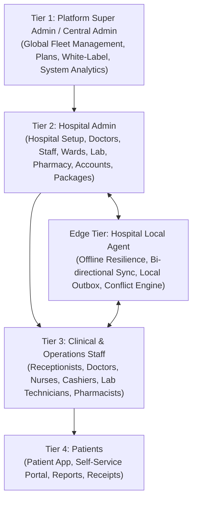

# 00 — Medical365 HMS: Executive Summary & System Overview

## 1. Executive Summary

**Medical365 Hospital Management System (HMS)** is an enterprise-grade, multi-tenant, cloud-and-local hybrid healthcare operations and clinical management platform designed to serve clinics, diagnostic centers, multi-specialty hospitals, and healthcare networks.

The system is architected to solve four foundational challenges in modern healthcare IT:
1. **Multi-Tenant Scalability & White-Label Isolation**: Central administration can provision isolated hospitals, diagnostic clinics, and health networks under custom domains (`apollo.medical365.in` or `www.customhospital.com`), with dedicated branding (logos, color palettes, favicons, custom document headers), discrete tenant databases, and isolated RBAC controls.
2. **Clinical & Operational Comprehensiveness**: End-to-end management spanning patient registration, multi-specialty OPD consultations with standardized Question Libraries, IPD ward & bed allocation, OT scheduling & surgical planning, sample collection & laboratory workflows, pharmacy inventory & dispense tracking, billing & cashier reconciliation, and consent form lifecycle automation.
3. **Hybrid Cloud-Edge Synchronization (Offline Resilience)**: A proprietary bi-directional synchronization engine (`local-agent` + `localSync`) enabling hospital clinics to continue registering patients, conducting consultations, and dispensing medications during internet blackouts via local MongoDB instances, automatically queuing mutations and reconciling conflicts upon cloud reconnection.
4. **Clinical AI Automation & Quota Management**: Native integration with Google Gemini generative models for medical report explanation, multi-modal diagnostics comparison, and voice consultation scribing (converting physician-patient conversations into structured clinical SOAP records), governed by hospital-level prepaid AI Wallets with token-level accounting.

---

## 2. Key System Metrics & Topology

---

## 3. High-Level Technology Stack

| Layer | Technologies & Libraries | Architectural Role |
| :--- | :--- | :--- |
| **Frontend Framework** | React 18, Vite, React Router v6, Tailwind CSS | Single Page Application (SPA) with code-splitting via `React.lazy` |
| **State & Data Flow** | Redux Toolkit (`store/`), Custom Contexts (`BrandingContext`) | Global state for auth, notifications, offline sync status, and dynamic styling |
| **UX & Layouts** | Lenis Smooth Scroll, Lucide React, FontAwesome, React Hot Toast | Responsive clinical desktop & mobile web experience |
| **Backend Runtime** | Node.js v18-v24, Express.js 4.x | RESTful API server, middleware pipeline, static downloads, WebSocket server |
| **Database & ODM** | MongoDB 6.x / 7.x, Mongoose 8.x | Central cluster + dynamic tenant database connections (`tenantDb.js`) |
| **Real-Time Layer** | Socket.io 4.x, WebSocket (`ws`) | Live notifications, AI wallet updates, sync heartbeats, tunnel proxy |
| **Document Processing** | Docxtemplater, PizZip, LibreOffice Convert, PDFKit, PDF-Parse | Automated placeholder injection for patient consent forms & bills |
| **AI Runtime** | `@google/genai`, `@google/generative-ai` (Gemini 2.0 Flash) | Multi-modal report interpretation, Voice Scribe clinical notes |
| **Security & Auth** | JSON Web Tokens (`jsonwebtoken`), bcryptjs, crypto, Helmet, Rate-Limit | Dual-layer auth (Bearer + OTP), single-session enforcement, CSRF/CORS guards |
| **Edge Synchronization** | Custom Node.js Sync Worker, SQLite / Local Mongo, WebSocket Relay | Offline outbox mutation queue, version vectors, field-level 3-way merge |

---

## 4. Platform Tiering & Tenant Separation

Medical365 enforces a strict multi-tier hierarchy:

1. **Central Admin / Super Admin (Tier 1)**:
   - Root URL: `/supremeadmin` (or `admin.medical365.in`).
   - Scope: Platform wide. Creates hospitals and clinics, selects subscription plans, edits white-label settings, compiles mobile apps (Android APK/AAB via GitHub Actions), configures global clinical question templates, uploads consent master files, and monitors tenant database cluster connectivity.
2. **Hospital Admin (Tier 2)**:
   - Root URL: `https://<hospital-slug>.medical365.in/hospitaladmin` or custom domains.
   - Scope: Strictly isolated to their assigned `hospitalId`. Manages staff, assigns RBAC roles, provisions doctors and consulting fees, manages beds and ICU wards, oversees pharmacy stock and department transfers, manages biological sample/vial storage movements, tracks AI wallet balances, and reviews refund requests.
3. **Clinical Staff & Department Operators (Tier 3)**:
   - Scoped access governed by granular permissions (`patient_create`, `visit_intake`, `visit_diagnose`, `lab_manage`, `pharmacy_manage`, `billing_manage`, etc.).
   - Includes dedicated dashboards: Reception (`/reception/dashboard`), Doctor (`/doctor/patients`), Nurse Command Center (`/nurse/dashboard`), IPD Center (`/nurse/ipd`), Laboratory (`/lab/dashboard`), Pharmacy (`/pharmacy/inventory`), and Cashier/Billing (`/cashier/billing`).
4. **Patients (Tier 4)**:
   - Patient portal (`/patient/dashboard` and `/patient/login`), receiving automated SMS/email OTPs, appointment confirmation emails, and real-time access to digital lab reports and billing receipts.

---

## 5. Summary of Modules Analyzed in this Documentation

The following documentation suite provides a deep, line-by-line verification of the Medical365 codebase across 30 dedicated documents:

1. **System Architecture**: Core network, server lifecycle, middleware stack, multi-tenant database connection pooling, and real-time topologies.
2. **Super Admin Management**: Central admin authentication, dashboard telemetry, fleet actions, and database monitoring.
3. **Question Library**: Global and hospital-scoped clinical questionnaires, department filtering, and clinical assessment integration.
4. **Consent Management**: Docx template uploading, dynamic token replacement (`{patient_name}`, `{hospital_name}`), PDF conversion, and nurse/IPD printing.
5. **Roles & Permissions**: Fine-grained RBAC engine, custom permission sets, automated sidebar navigation generation, and backend middleware guards.
6. **Plan Management**: Technical verification of the 4 subscription tiers (`starter`, `clinic_basic`, `multi_speciality_starter`, `enterprise`), quotas, and enforcement logic.
7. **Hospital Onboarding**: End-to-end hospital creation flow, automated tenant DB provisioning, default policy seeding, and initial AI budget injection.
8. **White-Label Engine**: Dynamic CSS token injection, favicon/title manipulation, hostname resolution, and mobile application generation.
9. **Hospital Admin Authentication**: Credential validation, SHA-256 hashed OTP generation, single active session enforcement, and rate limiting.
10. **Hospital Admin Dashboard**: Complete inspection of the 10 management tabs, analytics charts, and operational controls.
11. **Vial Management & Movement**: Detailed analysis of sample intake, cryogenic/rack location tracking, move/return/discard lifecycles, and chronological audit histories.
12. **Staff & Doctor Management**: Staff onboarding, doctor consultation scheduling, OPD token modes, and doctor quota limits.
13. **Hospital Overview & Departments**: Department creation, consultation fee modeling, and doctor-to-department routing.
14. **Bed, Room, ICU & Ward Management**: Ward hierarchies, bed statuses (`AVAILABLE`, `OCCUPIED`, `MAINTENANCE`), inter-ward patient transfers, and segmented billing.
15. **Laboratory Management**: Test catalogs, specimen processing, report uploading, and billing integration.
16. **Accounts & Payment Management**: Multi-counter UPI mapping (`DepartmentUpi`), split payments, cashier reconciliation, and transaction auditing.
17. **AI Module & Voice Scribe**: Generative clinical assistance, prompt engineering, multi-modal analysis, audio transcription, and ₹2,000 AI Wallet debiting.
18. **Refund Management**: 4-stage refund lifecycle (`PENDING_APPROVAL` -> `APPROVED` -> `PROCESSING` -> `REFUNDED`), role segregation, and financial safety invariants.
19. **Package Management**: Fixed-price clinical packages, frozen patient snapshots, extra charge calculators, and service usage logs.
20. **Data Migration**: Multi-format data onboarding (CSV/Excel/JSON), AI entity detection, column mapping, relationship resolution, and batch insertion.
21. **Local Data Sync**: Hybrid edge architecture, WebSocket tunnel relays, outbox queues, vector versioning, and non-destructive rebuilds.
22. **Complete End-to-End Workflow**: Step-by-step master sequence tracking a healthcare system from initial platform signup to daily clinical operations.
23. **Database & API Reference**: Exhaustive Mongoose schema reference and API route catalog.
24. **Role-Based Access Matrix**: Tabular matrix mapping every platform role against all system permissions and endpoints.
25. **Security & Tenant Isolation**: Audit of authentication controls, cryptographic token blacklists, path traversal defenses, and cross-tenant BOLA prevention.
26. **Implementation Status & Gap Analysis**: Precise categorization of verified, partial, UI-only, and backend-only features with line numbers and file paths.

