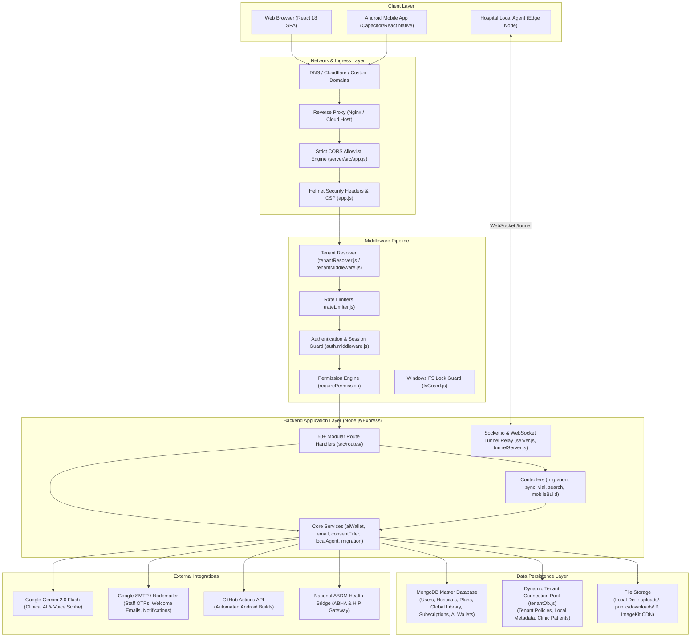
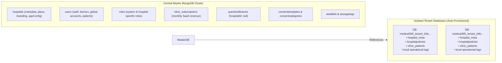

# 01 — System Architecture & Technical Foundation

## 1. Architectural Overview

Medical365 HMS is built as a modular, distributed, multi-tenant healthcare application. It utilizes a decoupled Single Page Application (SPA) frontend, an Express.js REST API and WebSocket backend, a dual MongoDB architecture (shared master database + dynamically provisioned tenant databases), and a hybrid local edge synchronization subsystem.

---

## 2. Frontend Architecture & Technology Stack

### 2.1 Framework & Core Libraries
- **Framework**: React 18.2 with Vite as the build bundler (`client/package.json`).
- **Routing**: `react-router-dom` v6.20 with route-level code splitting using `React.lazy()` and `Suspense` (`client/src/routes/Mainroutes.jsx`).
- **State Management**:
  - Redux Toolkit (`@reduxjs/toolkit` 2.0) managing authentication state (`store/slices/authSlice.js`) and live notifications (`store/slices/notificationSlice.js`).
  - React Context API: `BrandingContext.jsx` for runtime white-label theme injection and CSS token overrides.
- **Styling Architecture**:
  - Tailwind CSS combined with modular CSS files (`CentralAdminDashboard.css`, `HospitalAdminDashboard.css`, `PatientBillingProfile.css`, `VialManagement.css`).
  - Dynamic CSS Variables on `:root` driven by `applyBrandingToCSS()` in `BrandingContext.jsx`.
- **UX & Utilities**:
  - **Lenis Smooth Scroll**: Initialized in `App.jsx` with intelligent exclusion checks for modals, dropdowns, and overflowing textareas.
  - **Modal Scroll Lock**: `initModalScrollLock()` in `utils/modalScrollLock.js` to freeze the background document when modals or popups are active.
  - **Socket.io Client**: Real-time room subscriptions by `userId`, `hospitalId`, and `role` (`utils/socket.js`).
  - **IndexedDB & Sync Engine**: `offlineDb.js` and `syncEngine.js` for client-side offline action buffering.

### 2.2 Frontend Entry Point & Routing Structure
The frontend application boots in `client/src/main.jsx`, wrapped in `Provider` (Redux), `BrandingProvider`, `BrowserRouter`, and `App.jsx`.

`Mainroutes.jsx` acts as the traffic controller, organizing routes into clear tiers:
1. **Public & User**: Home (`/`), Services (`/services`), Doctors (`/doctors`), Online Appointment (`/appointment`), Lab Reports (`/lab-reports`), Patient Login (`/login`, `/patient/login`).
2. **Central Admin (Tier 1)**: `/supremeadmin` (Dashboard), `/supremeadmin/login` (Auth), `/supremeadmin/revenue` (Platform Financial Analytics).
3. **Hospital Admin (Tier 2)**: `/hospitaladmin` (Unified Dashboard), `/hospitaladmin/login`, `/hospitaladmin/question-library`, `/hospitaladmin/vials`, `/hospitaladmin/packages`, `/hospitaladmin/data-migration`, `/hospitaladmin/local-sync`, `/hospitaladmin/refunds`.
4. **Clinical Portals (Tier 3)**:
   - Reception: `/reception/dashboard`, `/reception/patients`.
   - Doctor: `/doctor/dashboard`, `/doctor/patients`, `/doctor/ai-assistant`, `/doctor/surgeries`.
   - Nurse & IPD: `/nurse/dashboard`, `/nurse/workspace`, `/nurse/opd-queue`, `/nurse/ipd`.
   - Laboratory: `/lab/dashboard`, `/lab/assigned`, `/lab/completed`.
   - Pharmacy: `/pharmacy/inventory`, `/pharmacy/orders`, `/pharmacy/invoices`, `/pharmacy/returns`, `/pharmacy/departments`.
   - Cashier & Billing: `/cashier/billing`, `/accountant/dashboard`, `/accountant/refunds`.
   - Operation Theatre: `/ot/dashboard`, `/ot/planned`, `/ot/schedule`, `/ot/rooms`, `/ot/pre-op`, `/ot/in-progress`, `/ot/post-op`, `/ot/completed`.

---

## 3. Backend Architecture & Server Lifecycle

### 3.1 Server Initialization Sequence (`server/server.js`)
When `node server.js` is executed:
1. **Windows FS Guard Installation (`src/utils/fsGuard.js`)**: Wraps Node's native `fs.readFileSync` and `fs.readFile` with a spin-wait retry loop (up to 15 attempts) to intercept transient Windows file lock errors (`errno: -4094`, `EBUSY`, `EPERM`).
2. **Global Crash Handlers**: Intercepts `uncaughtException` and `unhandledRejection` to log errors without aborting the process.
3. **Environment & Database Connection (`src/db/db.js`)**: Loads `.env` via `dotenv` and connects to the primary MongoDB cluster via Mongoose (`mongoose.connect(process.env.MONGODB_URI)`).
4. **HTTP & WebSocket Server Creation**: Creates an `http.Server(app)` and binds `Socket.io`, configuring CORS rules for native apps, localhost, and `.medical365.in` subdomains.
5. **WebSocket Tunnel Relay (`src/utils/tunnelServer.js`)**: In cloud mode, attaches a WebSocket listener at `/tunnel` to accept persistent agent connections from hospital edge servers.
6. **Port Binding & Post-Startup Services**: Listens on `0.0.0.0:PORT` (default 3000). A 3-second delayed timer initiates background initialization:
   - `aiWalletService.ensureAllHospitalsHaveWallets()`: Ensures every hospital has an active AI Wallet with its initial credit.

### 3.2 Express Middleware Pipeline (`server/src/app.js`)
Every incoming HTTP request traverses the following ordered middleware pipeline:
1. **Compression**: Gzip/deflate response compression (`compression()`) for responses > 1KB.
2. **CORS Allowlist Engine**: Evaluates origin against `ALLOWED_EXACT_ORIGINS` (`https://medical365.in`, `https://www.medical365.in`, `https://hms-react-native-app.vercel.app`), dynamic subdomains (`*.medical365.in`), and verified custom domains stored in an in-memory TTL cache (`verifiedDomainCache`). Rejects invalid preflights immediately.
3. **Reverse Proxy Configuration**: `app.set('trust proxy', 1)` to accurately extract client IP addresses behind cloud load balancers.
4. **Security Headers (Helmet v8)**:
   - Content Security Policy (CSP) allowing Tailwind CDN, Google Fonts, ImageKit, and WebSocket connections.
   - Cross-Origin Opener Policy (`same-origin-allow-popups`).
   - HSTS (`maxAge: 31536000`, `includeSubDomains: true`, `preload: true`).
   - Frameguard (`sameorigin`), X-Content-Type-Options (`nosniff`), Strict Referrer Policy.
5. **Body Parsing & Sanitization**:
   - `express.json({ limit: '50mb' })` and `express.urlencoded({ extended: true, limit: '50mb' })`.
   - `express-mongo-sanitize`: Strips dangerous MongoDB query keys (`$` and `.`) from user input to block NoSQL injection.
   - `hpp()`: HTTP Parameter Pollution protection.
   - `cookieParser()`: Cookie parsing for token fallbacks.
6. **Static File Handlers & Protections**:
   - `/uploads`: Static upload directory.
   - `/downloads/apks` and `/downloads/aabs`: Protected by `authenticateBuildDownload` middleware (FINDING-19 remediation), preventing unauthenticated or cross-tenant APK/AAB retrieval.
7. **API Route Mounting**: Over 50 modular route files mounted under `/api/*`.
8. **Frontend Static Distribution**: If `client/dist` exists, serves compiled production assets with cache headers, redirecting all non-API paths to `index.html`.
9. **Global Error Boundary**: Catch-all error middleware masking internal stack traces in production and returning standardized `{ success: false, message }` JSON.

---

## 4. Multi-Tenancy Architecture

Medical365 employs a **Hybrid Multi-Tenant Architecture** that balances shared catalog management with strict data isolation:

### 4.1 Master Database vs. Tenant Database Division
1. **Master Database**:
   - Houses global entities: `Hospital`, `User`, `Role`, `QuestionLibrary` (global master), `ConsentCategory`, `ConsentTemplate`, `HospitalPackage`, `Vial`, `Bed`, `Admission`, `PaymentTransaction`, `AIWallet`.
   - Each tenant-scoped record contains a mandatory `hospitalId: ObjectId` field indexed for query performance and tenant separation.
2. **Tenant Databases (`server/src/db/tenantDb.js` & `tenantModels.js`)**:
   - When a hospital is created via `POST /api/hospitals`, the server automatically provisions a separate MongoDB database named `medical365_tenant_<hospitalId>` using a dynamic connection pool.
   - Writes an initial seed record to `hospital_meta` and auto-provisions hospital policies.
   - Stores clinic patients and tenant-specific policies, isolating sensitive patient records for specialized clinic workflows.

### 4.2 Tenant Resolution Mechanism (`server/src/middleware/tenantResolver.js`)
On every request requiring tenant isolation, the tenant is resolved through server-controlled methods:
1. **Subdomain Resolution**: Extracts the leading segment of `req.headers.host` (e.g. `apollo.medical365.in` -> slug `apollo`).
2. **Custom Domain Resolution**: Queries `Hospital.findOne({ customDomain: host })` using an in-memory domain cache (`domainToTenantMap`) with a 5-minute TTL.
3. **Authenticated User Scoping**: For authenticated routes, `req.user.hospitalId` is the ultimate authoritative source. Client-supplied tenant headers are strictly validated against the user's cryptographically signed JWT.

---

## 5. Authentication & Authorization Subsystem

### 5.1 Authentication Mechanism
- **Primary Auth**: JSON Web Tokens (JWT) signed with `JWT_SECRET` (HS256).
- **Two-Step Login with OTP (`server/src/routes/emailOtp.routes.js`)**:
  1. User enters Email and Password.
  2. Server verifies password via `bcrypt.compare`.
  3. Server generates a cryptographically secure 6-digit numeric OTP (`crypto.randomInt(100000, 999999)`).
  4. OTP is hashed using SHA-256 (`crypto.createHash('sha256')`) and saved to `LoginOtp` model with a 10-minute expiration and an attempt counter (max 5).
  5. Server returns a signed `preAuthToken` containing `{ userId, email, hospitalId, purpose: 'otp_verification' }`.
  6. OTP is dispatched to user's registered email via Nodemailer SMTP.
  7. Client submits `preAuthToken` + plain OTP to `/api/auth/otp/verify`.
  8. Server validates hash, marks OTP as used, creates a `Session` record, and issues an authoritative application JWT.
- **Single Active Session Enforcement**:
  - Each JWT contains a unique `sessionId` (UUIDv4) and `jti`.
  - On every authenticated request, `auth.middleware.js` verifies that the `Session` document is active in MongoDB. If logged in from another device, the old session is marked inactive and the previous token is rejected with HTTP 401 (`sessionExpired: true`).
- **Token Invalidation (Logout & Revoke All)**:
  - Explicit logout writes the token's `jti` to `TokenBlacklist` with a TTL index matching the JWT expiration.
  - "Revoke all sessions" bumps `user.tokenVersion`, causing `auth.middleware.js` to reject any token whose embedded `tv` claim is less than the current version.

### 5.2 Authorization & RBAC Engine
- **Role Scoping (`server/src/models/role.model.js`)**:
  - Global roles (`hospitalId: null`): `centraladmin`, `superadmin`.
  - Hospital-specific roles (`hospitalId: ObjectId`): Roles created by Hospital Admin exist only within that hospital.
- **Permission Checking (`auth.middleware.js`)**:
  - SuperAdmins have wildcard permission `*`.
  - Middleware `requirePermission('perm_a', 'perm_b')` ensures the calling user has at least one of the specified permissions.
  - Endpoints enforce strict checks: `verifySuperAdmin` (Central Admins only), `verifyAdminOrSuperAdmin` (Central Admin or Hospital Admin with `admin_manage_roles`), and `verifyToken` (all authenticated users).

---

## 6. External Integrations Architecture

### 6.1 Clinical AI & Generative Intelligence
- **Provider**: Google Gemini API via `@google/genai` and `@google/generative-ai` (`gemini-2.0-flash`).
- **Capabilities**:
  - Medical Report Text Extraction & OCR.
  - Clinical Report Summarization & Red Flag Identification.
  - Multi-Modal Comparative Analysis (comparing historical vs current scans).
  - Voice Scribe: Audio transcription and conversion into structured SOAP consultation notes.
- **Quota & Cost Governance (`src/services/ai/aiWallet.service.js`)**:
  - Every hospital has an `AIWallet` with balance in Indian Rupees (INR).
  - Usage deductions calculate exact API token costs converted to INR, updating hospital balance and recording detailed audit logs (`aiusagelogs`).
  - Automatic safeguards: warning alerts when balance < ₹200, hard lock when balance reaches ₹0.

### 6.2 National ABDM Bridge Integration (`server/src/modules/abdm/`)
- Integrates with Ayushman Bharat Digital Mission (ABDM) M1/M2/M3 standards:
  - ABHA creation, validation, and Aadhaar OTP verification.
  - Health Information Provider (HIP) service for care-context linking.
  - Cryptographic key exchange (ECDH with curve `prime256v1`) and AES-256-GCM encryption for secure health record transfer.
  - Asynchronous webhook callback processing with signature and timestamp verification.

### 6.3 White-Label Mobile Pipeline (`server/src/controllers/mobileBuild.controller.js`)
- Triggers GitHub Actions workflow dispatches to automated React Native build pipelines.
- Generates white-labeled Android APKs and AABs branded with the tenant's application name, unique package ID (`com.medical365.<hospitalcode>`), custom logo, and color theme.
- Webhook callbacks securely report build status (`BUILDING`, `COMPLETED`, `FAILED`) and upload binaries to protected server storage.

---

## 7. Environment Configuration Reference

The system relies on structured environment variables configured in `server/.env`:

| Variable Category | Keys | Purpose |
| :--- | :--- | :--- |
| **Server & Runtime** | `PORT`, `NODE_ENV`, `DEPLOYMENT_MODE` | Port binding, environment mode, and cloud vs. local deployment flag |
| **Database** | `MONGODB_URI`, `TENANT_DB_URI_PREFIX` | Master MongoDB cluster connection string and tenant DB URI builder |
| **Authentication** | `JWT_SECRET`, `JWT_EXPIRES_IN`, `CORS_ALLOWED_ORIGINS` | Token signing secret, duration (e.g. 7d), and additional CORS origins |
| **Email & SMTP** | `SMTP_HOST`, `SMTP_PORT`, `SMTP_SECURE`, `SMTP_USER`, `SMTP_PASS`, `MAIL_FROM` | Gmail / SMTP credentials for OTP delivery and welcome emails |
| **Clinical AI** | `GEMINI_API_KEY`, `GEMINI_MODEL` | Google Gemini API authorization key and default model identifier |
| **Mobile Pipeline** | `GITHUB_PAT`, `GITHUB_OWNER`, `GITHUB_MOBILE_REPO`, `GITHUB_WEBHOOK_SECRET` | GitHub Actions dispatch authentication and build webhook validation |
| **ABDM Gateway** | `ABDM_CLIENT_ID`, `ABDM_CLIENT_SECRET`, `ABDM_BASE_URL` | National ABDM health gateway credentials |
| **Media & CDN** | `IMAGEKIT_PUBLIC_KEY`, `IMAGEKIT_PRIVATE_KEY`, `IMAGEKIT_URL_ENDPOINT` | ImageKit credentials with local disk storage fallback |

