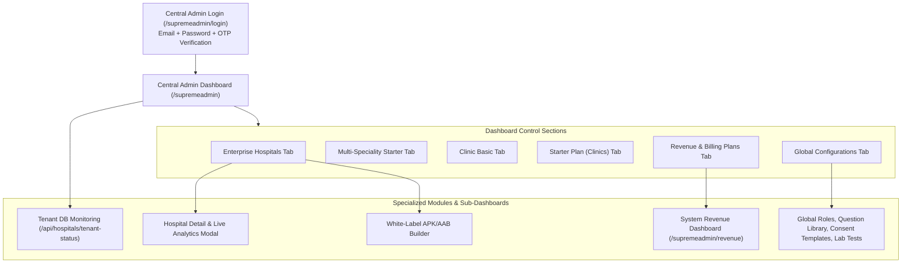
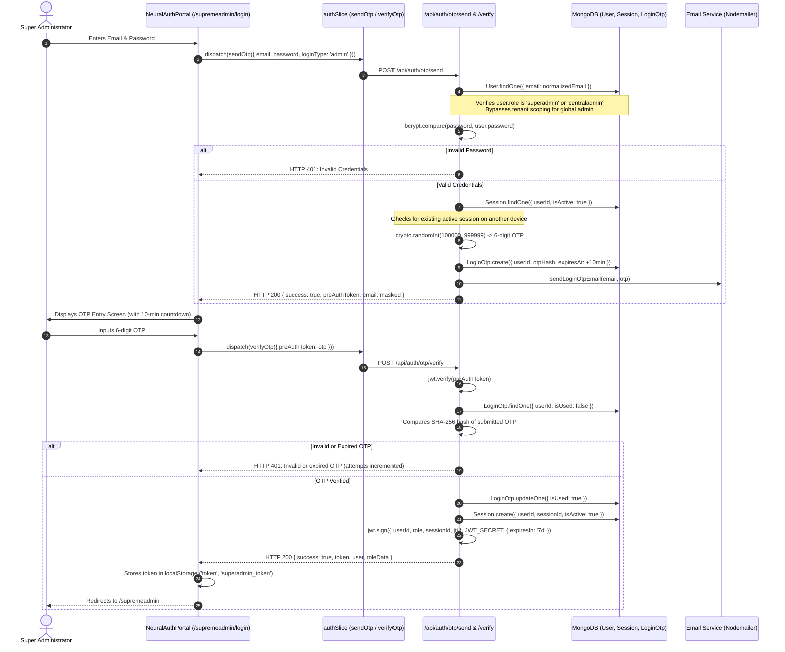

# 02 — Super Admin & Central Admin Management

## 1. Module Overview & Core Responsibilities

The **Super Admin / Central Admin** module is the central command center of the Medical365 platform. Accessible via the route `/supremeadmin`, this module provides complete oversight over all onboarded hospitals, subscription plans, platform revenue models, white-label configurations, tenant databases, and global master catalogs.



---

## 2. Super Admin Login & Authentication Flow

### 2.1 Entry Point & Route
- **URL**: `/supremeadmin/login` (React Component: `client/src/pages/centraladmin/CentralAdminLogin.jsx`).
- **Styling / Presentation**: Implemented via `NeuralAuthPortal.jsx` configured with `portalType="admin"`, styled with dark futuristic branding ("Supreme Portal — Access Medical365 central system administration core").

### 2.2 Credentials Required
1. **Administrator Email**: Must match a `User` record where `role` is `'superadmin'` or `'centraladmin'`.
2. **Password**: Plaintext password checked against bcrypt hash.
3. **6-Digit OTP**: Received via administrator email (or console output during local development).

### 2.3 Authentication Lifecycle & Step-by-Step Flow



### 2.4 Handling Active Sessions & Conflict Resolution (`force-login`)
If an active session already exists for the Super Admin on another workstation or IP:
- `POST /api/auth/otp/send` returns `{ activeSessionExists: true, currentSession: { ipAddress, browser, os, lastActive } }`.
- `NeuralAuthPortal` displays a warning modal asking the admin whether to terminate the older session.
- Submitting `forceLogin({ preAuthToken })` triggers `POST /api/auth/otp/force-login`, which invalidates the prior session in `Session.updateMany({ userId, isActive: false })`, increments `tokenVersion`, and generates a new authenticated session.

---

## 3. Super Admin Dashboard Sections & Controls

The Central Admin Dashboard (`CentralAdminDashboard.jsx`) is structured around a top telemetry header and 6 primary operational tabs:

### 3.1 Top Platform Telemetry Bar
Displays real-time network-wide KPIs calculated on mount via `fetchSystemAnalytics()`:
- **Total Entities**: Count of hospitals and clinics across the network.
- **Active Plans Distribution**: Breakdown of institutions on Enterprise, Multi-Speciality Starter, Clinic Basic, and Starter tiers.
- **Total Registered Doctors**: Aggregated count across all hospitals.
- **Total System Patients**: Aggregated patient volume.
- **Live Search & Plan Filter**: Search box filtering by hospital name, slug, or city, with direct jump to that hospital's analytics card.

---

### 3.2 Tab 1: Enterprise Hospitals (`id: 'hospitals'`)
- **Target Category**: Large multi-specialty hospitals, medical colleges, and healthcare networks.
- **Quota Configuration**: Uncapped doctors (`maxDoctors: Infinity`), uncapped staff (`maxStaff: Infinity`).
- **Features Displayed**:
  - Grid of Hospital Cards showing hospital logo, name, slug, city, phone, number of departments, doctor count, and active status.
  - Action Buttons on each card:
    - **View Analytics**: Opens the Hospital Detail slide-over panel with patient trends, revenue summaries, department distribution, and staff rosters.
    - **Edit**: Pre-fills the Hospital Form for updating contact details, domains, and branding.
    - **Delete**: Prompts a safety modal warning that all tenant collections, records, and files will be permanently purged.
  - **White-Label Mobile App Builder Widget**: Embedded directly on each hospital card (see Section 5 below).

---

### 3.3 Tab 2: Multi-Speciality Starter Plan (`id: 'multi-speciality'`)
- **Target Category**: Medium hospitals, polyclinics, and diagnostic surgical centers.
- **Quota Enforcement**: Up to **15 Doctors** and **25 Staff Members**.
- **Backend Model Constraints**: Enforced during doctor and staff creation in `server/src/routes/admin.routes.js`:
  ```javascript
  if (subscriptionPlan === 'multi_speciality_starter') {
      const limits = SUBSCRIPTION_PLANS['multi_speciality_starter']; // maxDoctors: 15, maxStaff: 25
      if (staffCount >= limits.maxStaff) {
          return res.status(403).json({ success: false, message: 'Staff limit reached for Multi-Speciality Starter Plan (Max: 25)' });
      }
  }
  ```

---

### 3.4 Tab 3: Clinic Basic Plan (`id: 'clinic-basic'`)
- **Target Category**: Growing clinics with a core team of medical specialists.
- **Quota Enforcement**: Up to **5 Doctors** and **3 Staff Members**.
- **Enforcement**: Hard limits checked on both frontend (`AdminDoctors.jsx`, `Admin.jsx`) and backend (`admin.routes.js`).

---

### 3.5 Tab 4: Starter Plan / Simple Clinics (`id: 'simple-clinics'`)
- **Target Category**: Single-doctor outpatient clinics, solo GP practices.
- **Features**:
  - Simplified clinic creation via `POST /api/simple-clinics`.
  - Default OPD appointment modes: Token-based vs Slot-based appointments.
  - Minimalist workflow hiding advanced IPD, OT, and Cryogenic Vial tabs.

---

### 3.6 Tab 5: Revenue Plans & Monetization (`id: 'revenue-plans'`)
Controls the platform SaaS billing model for each hospital or clinic:
- **Available Models (`Hospital.revenueModel`)**:
  1. `per_patient`: Hospital pays a fixed fee per registered patient (tracked via `ClinicSubscription` collection).
  2. `fixed_monthly`: Flat recurring subscription fee billed monthly.
  3. `per_login`: Pay-per-use model based on active authenticated doctor/staff logins.
- **Available Actions**:
  - Modal form allowing Central Admin to adjust `ratePerPatient`, `monthlyFee`, `ratePerLogin`, and `billingCycle` (`monthly` vs `quarterly`).
  - Link to open the full **System Revenue Dashboard** (`/supremeadmin/revenue`).

---

### 3.7 Tab 6: System Configurations (`id: 'configurations'`)
A master launchpad giving Super Admin direct control over global medical and operational catalogs:
- **Roles & Permissions (`/admin/roles`)**: Construct global system roles and custom matrix permissions.
- **Question Library (`/admin/question-library`)**: Configure standardized clinical questionnaires for all medical departments.
- **Lab Tests (`/admin/lab-tests`)**: Global diagnostic test catalog, reference ranges, and default prices.
- **Test Packages (`/admin/test-packages`)**: Bundle multiple laboratory tests into discounted wellness profiles.
- **Medicine Catalog (`/admin/medicines`)**: Master pharmaceutical directory (generic names, brands, salt compositions).
- **Services Catalog (`/admin/services`)**: Clinical and facility service catalog with default rates.
- **Consent Management (`/admin/consent`)**: Upload and manage Word (`.docx`) legal consent templates.
- **Labs (`tab: 'labs'`)**: Direct access to `<AdminLabs />`.
- **Pharmacy (`tab: 'pharmacy'`)**: Direct access to `<AdminPharmacy />`.

---

## 4. Hospital Detail Panel & Analytics View

Clicking any hospital card in `CentralAdminDashboard.jsx` opens the comprehensive Hospital Analytics View (`selectedHospital`):
1. **Overview KPIs**: Total doctors, total staff, total patients, total appointments, total revenue, and occupancy rate.
2. **Interactive Charting**: Line and bar visualizations filtering patient throughput and billing over `last_month`, `this_month`, and `this_year`.
3. **Staff Roster Table**: Displays all users linked to that `hospitalId` (`name`, `role`, `email`, `phone`, `status`), with actions to deactivate accounts or reset passwords.
4. **Tenant Database Telemetry**: Shows the exact tenant database name (`medical365_tenant_<id>`), connection status (`connected` vs `not-loaded`), and storage metrics.
5. **AI Wallet Controls**: Real-time display of the hospital's remaining AI credit in INR, total tokens consumed, and an instant credit top-up button.

---

## 5. White-Label Mobile App Builder Workflow

Embedded in each hospital card is the White-Label Mobile Builder widget (`WhiteLabelBuilder`):
1. **Status Indicator**: Displays current Android build state (`NOT_BUILT`, `BUILDING`, `COMPLETED`, `FAILED`).
2. **Build Action**: Clicking **Build Android App** executes:
   - `POST /api/superadmin/hospitals/:id/trigger-mobile-build`
   - Invokes `triggerMobileBuild` in `mobileBuild.controller.js`.
   - Validates hospital details, generates deterministic application ID `com.medical365.<hospitalcode>` via `applicationId.util.js`, and extracts branding theme colors and logo URLs.
   - Dispatches a workflow event to GitHub Actions (`react-native-build.yml`) using `GITHUB_PAT`.
   - Updates `hospital.appConfig.rnBuildStatus = 'BUILDING'`.
3. **Automated Polling**: While in `BUILDING` state, the frontend polls `GET /api/superadmin/hospitals/:id/build-status` every 15 seconds.
4. **Download Links**: Upon completion, displays direct download buttons for:
   - **Download APK** (`GET /api/superadmin/hospitals/:id/download/rn-apk`)
   - **Download AAB** (`GET /api/superadmin/hospitals/:id/download/rn-aab`)
5. **Build Reset**: If a build fails or hangs, the **Reset** button issues `POST /api/superadmin/hospitals/:id/reset-build` to restore the status to `NOT_BUILT`.

---

## 6. Tenant DB Monitoring (`/api/hospitals/tenant-status`)

The Central Admin dashboard includes a real-time cluster health check powered by `server/src/db/tenantDb.js`:
- Inspects all open Mongoose database connections in the connection pool.
- Maps each registered `Hospital` to its tenant database name.
- Returns:
  ```json
  {
    "success": true,
    "totalHospitals": 14,
    "activeConnections": 8,
    "report": [
      {
        "hospitalId": "66f1...",
        "hospitalName": "Apollo Specialty",
        "city": "Hyderabad",
        "tenantDb": "medical365_tenant_66f1...",
        "connectionStatus": "connected",
        "readyState": 1
      }
    ]
  }
  ```
- Allows Central Admins to detect cold or dropped tenant connections before hospital staff report latency.

---

## 7. Security Controls & Central Admin Restrictions

1. **Strict Role Verification**: Every Super Admin endpoint enforces `verifyCentralAdmin`:
   ```javascript
   const verifyCentralAdmin = async (req, res, next) => {
       await verifyToken(req, res, () => {
           const role = req.user?.role;
           if (role === 'centraladmin' || role === 'superadmin') return next();
           return res.status(403).json({ success: false, message: 'Central Admin access required' });
       });
   };
   ```
2. **Server-Side Identity Trust**: Client headers such as `x-tenant-id` or `x-hospital-id` are never trusted to elevate permissions; role privileges are strictly verified from the verified JWT token and database user record.
3. **Audit Trail**: Destructive actions (hospital deletion, database purging, manual plan overrides) trigger automatic entries into the `AuditLog` collection.

