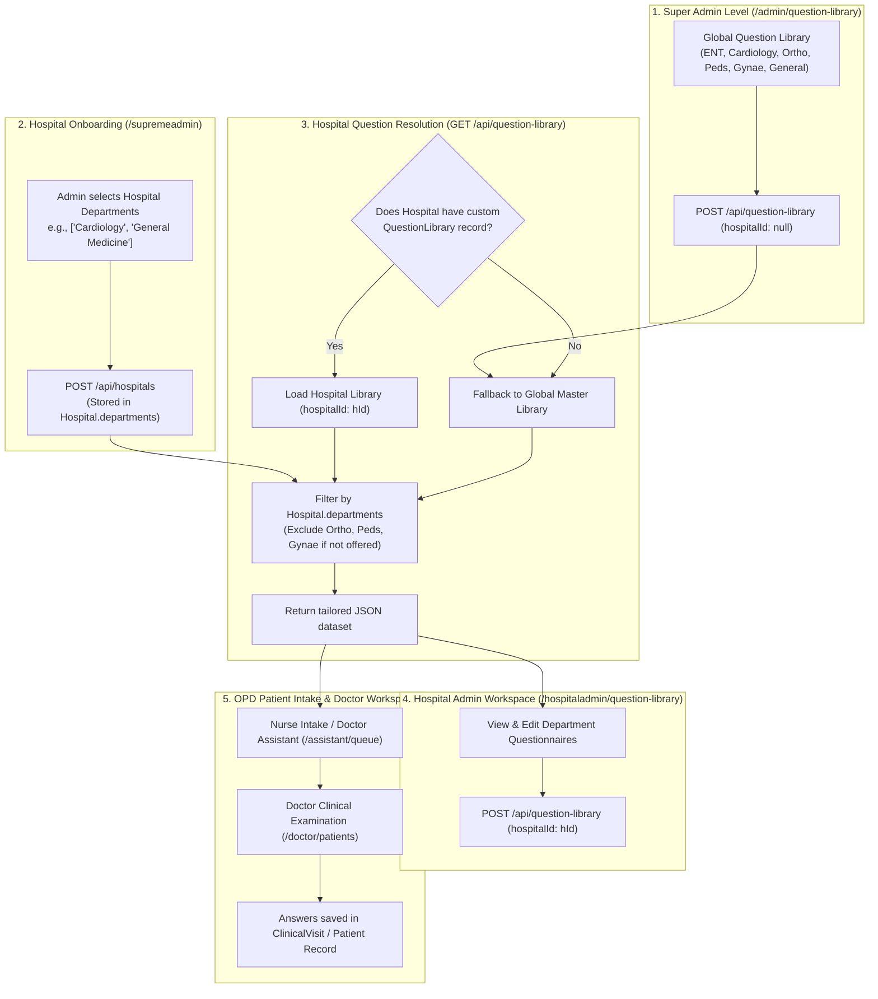

# 03 — Question Library & Clinical Assessment Architecture

## 1. Module Overview & Clinical Purpose

The **Question Library** is Medical365's standardized clinical assessment engine. In outpatient (OPD) and inpatient (IPD) clinical workflows, physicians and nursing triage staff require structured clinical history intake questionnaires tailored to specific medical disciplines (e.g., Cardiology, ENT, Orthopedics, Pediatrics, Gynecology, General Medicine).

The system ensures:
1. **Standardized Clinical History Intake**: Captures structured symptoms, previous surgical history, active medications, family history, and constitutional symptoms before the physician begins the examination.
2. **Global Governance & Hospital Customization**: Super Admin maintains the global master question templates, while individual hospitals can refine or extend questionnaires for their approved clinical departments without affecting other institutions.
3. **Multi-Lingual Localization**: Built-in support for multiple Indian regional languages via `questionLibraryI18n.js`.
4. **Integration with Doctor Assistant & OPD Registration**: Questions appear automatically during patient triage and doctor consultation workspaces.

---

## 2. Question Library Data Architecture

### 2.1 Database Schema (`server/src/models/questionLibrary.model.js`)
```javascript
const questionLibrarySchema = new mongoose.Schema({
    data: {
        type: mongoose.Schema.Types.Mixed,
        required: true
    },
    version: {
        type: Number,
        default: 1
    },
    hospitalId: {
        type: mongoose.Schema.Types.ObjectId,
        ref: 'Hospital',
        default: null,
        index: true
    }
}, { timestamps: true });
```

### 2.2 Global vs. Hospital-Specific Library Storage
- **Global Master Library (`hospitalId: null`)**:
  - Maintained exclusively by Super Admin via `/admin/question-library`.
  - When no custom library exists for a newly created hospital, the system falls back to this global library or `server/src/config/masterQuestionLibrary.js`.
- **Hospital-Specific Library (`hospitalId: ObjectId`)**:
  - Saved when Hospital Admin edits questions via `/hospitaladmin/question-library`.
  - Every update creates a new revision with `version: latestLibrary.version + 1`, maintaining an append-only historical audit trail.
  - Queries for a hospital always retrieve `QuestionLibrary.findOne({ hospitalId }).sort({ version: -1 })`.

---

## 3. Data Structure & Question Schema

The `data` field is stored as a hierarchical nested JSON object:
`Department -> Assessment Category -> Array of Questions`

```json
{
  "Cardiology": {
    "Cardiac Symptoms & Risk Profile": [
      {
        "q": "When did you first notice the chest discomfort, heaviness, or palpitations?",
        "type": "select",
        "options": [
          "Today (Sudden Onset)",
          "Past 2-3 Days",
          "Past 1-2 Weeks",
          "More than 1 Month",
          "Intermittent / Occasional"
        ]
      },
      {
        "q": "Have you ever had an ECG, 2D Echo, Angiography, or TMT test done before?",
        "type": "yes-no",
        "options": ["Yes", "No"]
      },
      {
        "q": "List all ongoing heart or BP medications and dosages",
        "type": "textarea",
        "options": []
      },
      {
        "q": "Associated symptoms observed currently",
        "type": "checkbox-group",
        "options": [
          "Shortness of breath on exertion",
          "Radiating pain to left arm or jaw",
          "Profuse cold sweating",
          "Dizziness or syncopal episodes",
          "Bilateral ankle swelling"
        ]
      }
    ]
  }
}
```

### 3.1 Supported Input Types
| Type | Rendered UI Control | Behavior & Value Type |
| :--- | :--- | :--- |
| `text` | Single-line input (`<input type="text">`) | Short alphanumeric string (e.g. durations, LMP dates). |
| `textarea` | Multi-line text field (`<textarea>`) | Extended clinical notes, medication lists, dosages. |
| `yes-no` | Radio toggle buttons (Yes / No) | Boolean flag; triggers conditional clinical follow-ups. |
| `select` | Dropdown menu (`<CustomSelect>` or native select) | Single-choice selection from predefined `options` array. |
| `checkbox-group` | Multi-select checkboxes | Multiple symptoms or risk factors selected simultaneously. |

---

## 4. End-to-End Pipeline: Global to Hospital



---

## 5. Department Filtering & Isolation Logic

When a hospital user (or Hospital Admin) fetches the question library, `server/src/routes/questionLibrary.routes.js` executes strict filtering:
```javascript
router.get('/', verifyToken, async (req, res) => {
    const hospitalId = req.user.hospitalId || null;
    let library = null;

    if (hospitalId) {
        library = await QuestionLibrary.findOne({ hospitalId }).sort({ version: -1 });
    }

    let allowedDepartments = null;
    if (hospitalId) {
        const hospital = await Hospital.findById(hospitalId);
        if (hospital?.departments?.length > 0) {
            allowedDepartments = hospital.departments;
        }
    }

    // Fallback to global master if no custom hospital library exists
    if (!library || !library.data) {
        library = await QuestionLibrary.findOne({ hospitalId: null }).sort({ version: -1 });
    }

    const fullData = { ...defaultQuestionLibraryData, ...(library.data || {}) };

    if (hospitalId && allowedDepartments) {
        const filteredData = {};
        for (const dept of allowedDepartments) {
            filteredData[dept] = fullData[dept] || defaultQuestionLibraryData[dept] || {};
        }
        return res.json({ success: true, data: { ...library, data: filteredData }, allowedDepartments });
    }

    return res.json({ success: true, data: library, allowedDepartments });
});
```

### Isolation Guarantees:
1. **Hospital A cannot see or modify Hospital B's questions**: Edits are written with the caller's authenticated `req.user.hospitalId`.
2. **Department Integrity**: A specialized eye clinic that does not offer Orthopedics will never see Orthopedic intake questions in its clinical queues.
3. **Historical Answer Protection**: Question Library updates create new versions; previously completed patient clinical visits retain their original answered question texts and snapshots.

---

## 6. Doctor Assistant & Clinical Intake Workflow

In `client/src/pages/assistant/DoctorAssistantQueue.jsx` and `DoctorAssistantPreparation.jsx`:
1. **Patient Selection**: When an OPD patient is called into the pre-consultation area, the nurse or doctor assistant opens the intake form.
2. **Dynamic Rendering**: The system reads the patient's assigned department (e.g. "Cardiology") and pulls the active questions from `QuestionLibrary`.
3. **Clinical History Capture**: The nurse records patient responses directly into the form.
4. **Physician Review**: When the doctor opens `/doctor/patients/:patientId`, the answered questionnaire is presented in the top summary banner, highlighting red flags, known drug allergies, and primary symptoms before prescribing medications.

