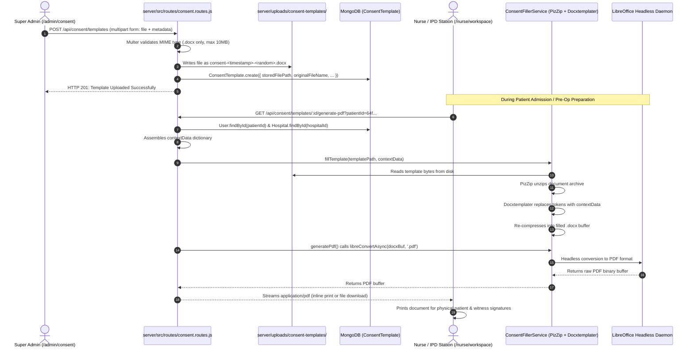

# 04 — Consent Management & Automated Document Lifecycle

## 1. Module Overview & Medical-Legal Context

In hospital, surgical, and procedural environments, collecting patient legal consent is mandatory before administering anesthesia, performing surgeries, conducting invasive diagnostic procedures, or initiating chemotherapy.

The **Consent Management** module solves paper document overhead by providing:
1. **Centralized Template Repository**: Super Admin uploads standardized legal consent documents in Microsoft Word format (`.docx`).
2. **Category Classification**: Categorizes templates by clinical department or surgical type (e.g., General Surgery, High-Risk Anesthesia, Blood Transfusion, Chemotherapy, Tele-consultation).
3. **Automated Placeholder Substitution**: Replaces standard template tokens (e.g., `{patient_name}`, `{doctor_name}`, `{hospital_name}`) with patient demographics and clinical context on demand.
4. **Dual Format Generation**: Generates filled `.docx` documents or converts them into high-resolution, print-ready PDF files via LibreOffice (`libreoffice-convert`).

---

## 2. Consent Database Models

### 2.1 Category Schema (`server/src/models/consentCategory.model.js`)
```javascript
const consentCategorySchema = new mongoose.Schema({
    name: { type: String, required: true, trim: true, unique: true },
    description: { type: String, default: '' },
    isActive: { type: Boolean, default: true },
    sortOrder: { type: Number, default: 0 }
}, { timestamps: true });
```

### 2.2 Template Schema (`server/src/models/consentTemplate.model.js`)
```javascript
const consentTemplateSchema = new mongoose.Schema({
    name: { type: String, required: true, trim: true },
    categoryId: { type: mongoose.Schema.Types.ObjectId, ref: 'ConsentCategory', required: true },
    description: { type: String, default: '' },
    originalFileName: { type: String, required: true },
    storedFilePath: { type: String, required: true },
    fileSize: { type: Number, default: 0 },
    mimeType: { type: String, default: 'application/vnd.openxmlformats-officedocument.wordprocessingml.document' },
    isActive: { type: Boolean, default: true },
    createdBy: { type: mongoose.Schema.Types.ObjectId, ref: 'User' },
    version: { type: Number, default: 1 },
    placeholders: {
        type: [String],
        default: ['patient_name', 'age', 'gender', 'address', 'phone', 'doctor_name', 'hospital_name', 'today', 'current_time']
    }
}, { timestamps: true });
```

---

## 3. Supported Placeholders & Replacement Tokens

When creating `.docx` templates, administrative teams use standard double-brace or single-brace variables:

| Placeholder Token | Resolved From | Sample Replacement Value |
| :--- | :--- | :--- |
| `{patient_name}` | `patient.name` | `"Mr. Rajesh Kumar"` |
| `{age}` | Calculated from `patient.dateOfBirth` | `"42"` |
| `{gender}` | `patient.gender` | `"Male"` |
| `{address}` | `patient.address` | `"Flat 402, Green Valley, Hyderabad"` |
| `{phone}` | `patient.phone` | `"9876543210"` |
| `{doctor_name}` | `doctor.name` (linked via `req.user` or visit) | `"Dr. Sunita Rao, MS (Ortho)"` |
| `{hospital_name}` | `hospital.name` (resolved from `req.user.hospitalId`) | `"Apollo Institute of Orthopedics"` |
| `{today}` | `new Date().toLocaleDateString()` | `"29/10/2026"` |
| `{current_time}` | `new Date().toLocaleTimeString()` | `"11:45:10 AM"` |

---

## 4. End-to-End Workflow & Document Processing



---

## 5. Super Admin Workspace (`client/src/pages/admin/ConsentManagement.jsx`)

Super Admin accesses `/admin/consent` from the Configurations tab:
1. **Metrics Cards**: Total categories, total templates, active templates, and inactive templates.
2. **Category Manager**: Create, rename, sort, or toggle categories (`General Surgery`, `High-Risk Consent`, `Anesthesia`, `Discharge Against Medical Advice`).
3. **Template Upload Modal**:
   - Template Name (`required`).
   - Category Dropdown (`required`).
   - Description (`optional`).
   - File Upload Drag-and-Drop (strictly enforces `.docx` file extension).
   - Active / Inactive Toggle.
4. **Template Management Table**: Displays filename, category, version number, upload date, file size in KB, and action buttons:
   - **Download Template**: Fetches raw unpopulated `.docx` file for local editing.
   - **Edit**: Updates metadata or replaces the underlying `.docx` binary (automatically increments `version`).
   - **Delete**: Unlinks record and deletes physical file from server storage.

---

## 6. Clinical Integration & IPD Patient Workspace

In `client/src/pages/nurse/NursePatientDocuments.jsx` and `client/src/pages/hospitaladmin/ClinicDashboard.jsx`:
- Staff select the patient from the ward roster.
- Select the required consent template from the dropdown list.
- Click **Print Consent Form** or **Download PDF**.
- The server auto-injects the patient's MRN, full name, age, primary doctor, and hospital address, generating a ready-to-sign legal document in under 1 second.

