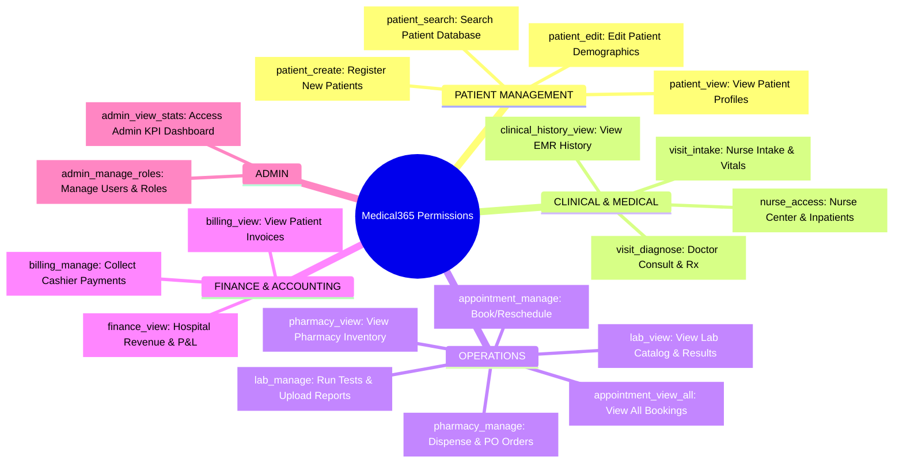

# 05 — Roles, Permissions & Access Control Architecture

## 1. Module Overview & RBAC Foundations

Medical365 implements a **Hierarchical Role-Based Access Control (RBAC)** architecture designed to balance platform-wide administrative governance with tenant-level autonomy. 

Key architectural principles:
1. **System vs. Custom Roles**: The platform ships with immutable system roles (e.g., `superadmin`, `centraladmin`, `hospitaladmin`, `patient`), alongside dynamic roles created by administrators.
2. **Hospital-Scoped Role Isolation**: Roles created by a Hospital Admin are strictly scoped to their `hospitalId`. They do not leak into or become visible to other hospitals.
3. **Automated Navigation Mapping**: When permissions are assigned to a role, the system automatically computes and synthesizes the user's sidebar and navigation links (`PERMISSION_NAV_MAP`).
4. **Dual Enforcement**: Role checks are performed on both the frontend (conditional routing and UI masking) and backend (Express authorization middleware).

---

## 2. Role Model Architecture (`server/src/models/role.model.js`)

```javascript
const navLinkSchema = new mongoose.Schema({
    label: { type: String, required: true },
    path: { type: String, required: true }
}, { _id: false });

const roleSchema = new mongoose.Schema({
    name: {
        type: String,
        required: true,
        trim: true
    },
    description: { type: String, default: '' },
    // null = platform-wide global role, ObjectId = hospital-specific role
    hospitalId: {
        type: mongoose.Schema.Types.ObjectId,
        ref: 'Hospital',
        default: null,
        index: true
    },
    // Array of granular permission strings
    permissions: [{ type: String, trim: true }],
    // Landing page after login
    dashboardPath: { type: String, default: '/' },
    // Computed navigation menu items
    navLinks: [navLinkSchema],
    // System roles (pre-seeded defaults)
    isSystemRole: { type: Boolean, default: false }
}, { timestamps: true });

// Compound unique index: Role name must be unique per hospital (null = global)
roleSchema.index({ name: 1, hospitalId: 1 }, { unique: true });
```

---

## 3. Standard Permission Keys & Functional Categories

The system defines 18 standardized permission strings grouped into 5 operational categories (`client/src/pages/admin/AdminRoles.jsx`):



---

## 4. Automated Navigation Synthesis (`PERMISSION_NAV_MAP`)

When an administrator creates or modifies a role in `AdminRoles.jsx`, the system automatically synthesizes navigation links without requiring manual URL entry:

| Permission Key | Derived Navigation Item | Target Route |
| :--- | :--- | :--- |
| `nurse_access` | Nurse Command Center | `/nurse/dashboard` |
| `patient_create` | Patient Registration | `/reception/dashboard` |
| `patient_search` | Patient Search | `/reception/patients` |
| `patient_view` | Patient Records | `/reception/patients` |
| `patient_edit` | Edit Patients | `/reception/patients` |
| `visit_intake` | Nurse Intake | `/nurse/opd-queue` |
| `visit_diagnose` | Consultations | `/doctor/patients` |
| `clinical_history_view` | Medical History | `/doctor/patients` |
| `appointment_manage` | Reception Hub | `/reception/dashboard` |
| `appointment_view_all` | All Appointments | `/reception/dashboard` |
| `lab_view` | Lab Dashboard | `/lab/dashboard` |
| `lab_manage` | Lab Tests | `/lab/tests` |
| `pharmacy_view` | Pharmacy Inventory | `/pharmacy/inventory` |
| `pharmacy_manage` | Pharmacy Orders | `/pharmacy/orders` |
| `admin_manage_roles` | Manage Users & Staff | `/admin/users` |
| `admin_view_stats` | Admin Dashboard | `/admin` |
| `finance_view` | Finance & Accounting | `/accountant/dashboard` |
| `billing_view` | Patient Billing | `/cashier/billing` |
| `billing_manage` | Patient Billing | `/cashier/billing` |

---

## 5. Backend Authorization Middleware Pipeline

Authorization is enforced at the route level via three middleware utilities in `server/src/middleware/auth.middleware.js`:

### 5.1 Generic Permission Guard (`requirePermission`)
```javascript
exports.requirePermission = (...requiredPermissions) => {
    return async (req, res, next) => {
        if (!req.user) return res.status(401).json({ success: false, message: 'Authentication required' });
        
        const roleData = req.user._roleData;
        if (!roleData) return res.status(403).json({ success: false, message: 'No role assigned' });

        // SuperAdmin wildcard '*' always bypasses checks
        if (roleData.permissions?.includes('*')) return next();

        // Check if user has at least ONE of the required permissions
        const userPerms = roleData.permissions || [];
        const hasPermission = requiredPermissions.some(perm => userPerms.includes(perm));

        if (!hasPermission) {
            return res.status(403).json({
                success: false,
                message: `Access denied. Required permission: ${requiredPermissions.join(' or ')}`
            });
        }
        next();
    };
};
```

### 5.2 Super Admin Guard (`verifySuperAdmin`)
Restricts access strictly to users whose `role` equals `'superadmin'` or `'centraladmin'`. Rejects all others with `403 Central Admin access required`.

### 5.3 Administrative Operation Guard (`verifyAdminOrSuperAdmin`)
Used on hospital administrative endpoints. Grants access if:
1. User is `superadmin` or `centraladmin`.
2. User is `hospitaladmin`.
3. User possesses `admin_manage_roles`, `admin_view_stats`, or wildcard `*`.

---

## 6. Implementation-Verified Role & Permission Matrix

| Module / Operation | Super Admin | Hospital Admin | Doctor | Nurse | Receptionist | Cashier / Accountant | Lab Technician | Pharmacist | Patient |
| :--- | :---: | :---: | :---: | :---: | :---: | :---: | :---: | :---: | :---: |
| **Global Hospital Management** | ✅ ALL | ❌ | ❌ | ❌ | ❌ | ❌ | ❌ | ❌ | ❌ |
| **Platform Revenue Plans** | ✅ ALL | ❌ | ❌ | ❌ | ❌ | ❌ | ❌ | ❌ | ❌ |
| **Hospital Staff & Roles** | ✅ ALL | ✅ ALL | ❌ | ❌ | ❌ | ❌ | ❌ | ❌ | ❌ |
| **Doctor Pricing & Quotas** | ✅ ALL | ✅ ALL | ❌ | ❌ | ❌ | ❌ | ❌ | ❌ | ❌ |
| **Patient Registration** | ✅ | ✅ | ❌ | ❌ | ✅ | ❌ | ❌ | ❌ | ❌ |
| **OPD Nurse Vitals Intake** | ✅ | ✅ | ❌ | ✅ | ❌ | ❌ | ❌ | ❌ | ❌ |
| **Doctor Consultations & Rx** | ✅ | ✅ | ✅ | ❌ | ❌ | ❌ | ❌ | ❌ | ❌ |
| **AI Assistant & Scribe** | ✅ | ✅ | ✅ | ❌ | ❌ | ❌ | ❌ | ❌ | ❌ |
| **Bed Allocation & Ward Move** | ✅ | ✅ | ❌ | ✅ | ✅ | ❌ | ❌ | ❌ | ❌ |
| **OT Scheduling & Surgery** | ✅ | ✅ | ✅ | ✅ | ❌ | ❌ | ❌ | ❌ | ❌ |
| **Lab Sample & Upload** | ✅ | ✅ | ❌ | ❌ | ❌ | ❌ | ✅ ALL | ❌ | ❌ |
| **Pharmacy Dispense & Stock** | ✅ | ✅ | ❌ | ❌ | ❌ | ❌ | ❌ | ✅ ALL | ❌ |
| **Cashier Billing & Invoicing** | ✅ | ✅ | ❌ | ❌ | ❌ | ✅ ALL | ❌ | ❌ | ❌ |
| **Refund Request Initiation** | ✅ | ✅ | ❌ | ❌ | ✅ Cash | ✅ Bank/UPI | ❌ | ❌ | ❌ |
| **Refund Approval / Reject** | ✅ | ✅ | ❌ | ❌ | ❌ | ❌ | ❌ | ❌ | ❌ |
| **Biological Sample / Vials** | ✅ | ✅ | ❌ | ❌ | ❌ | ❌ | ✅ | ❌ | ❌ |
| **View Personal Records** | ✅ | ✅ | ✅ | ✅ | ✅ | ✅ | ✅ | ✅ | ✅ Self |

---

## 7. Role Mutation & Impact Propagation

When a role or its permissions are updated via `PUT /api/admin/roles/:id`:
1. **Dynamic Database Update**: The `Role` document in MongoDB is updated with the new permissions array and synthesized `navLinks`.
2. **Real-Time Client Invalidation**: When an affected user executes their next API request, `auth.middleware.js` dynamically pulls the latest `Role` record from the database and attaches it to `req.user._roleData`.
3. **Session Continuity**: Active JWT sessions remain valid, but access to endpoints removed from the role is instantly blocked on the subsequent request with HTTP 403 Forbidden.

