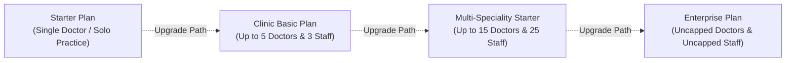
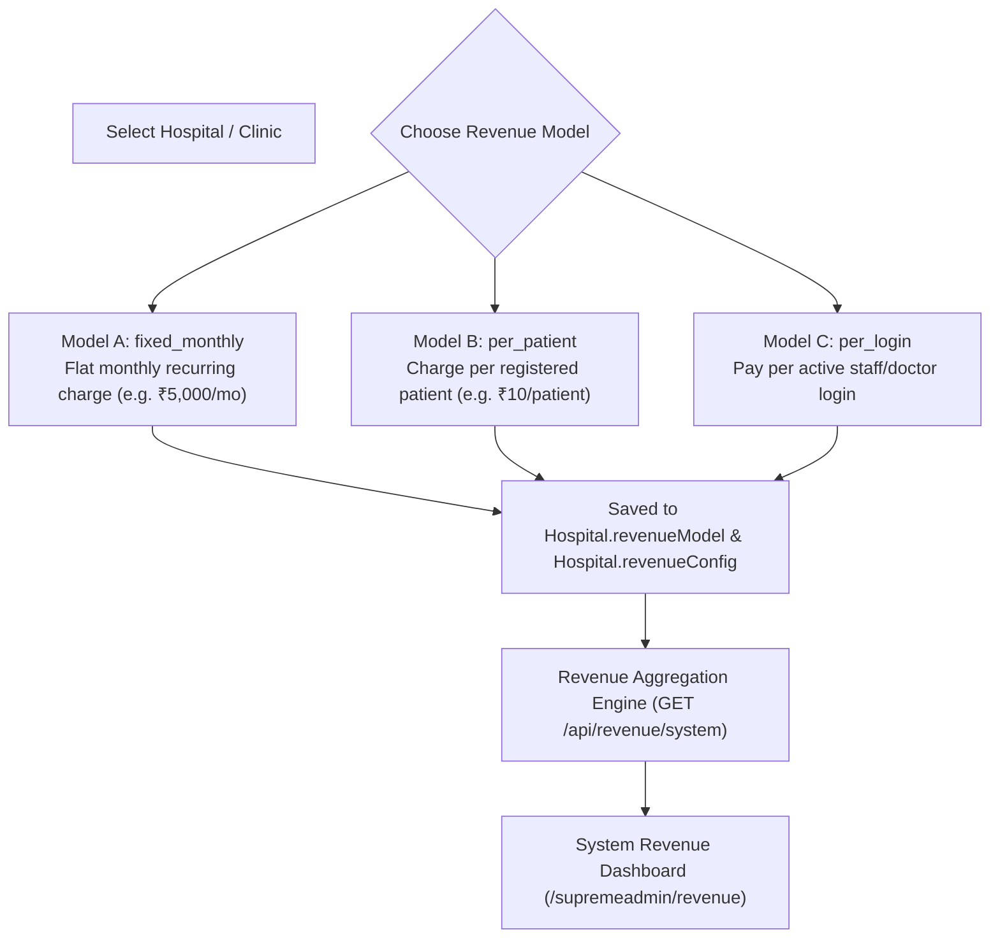

# 06 — Subscription Plans & Monetization Architecture

## 1. Overview & Subscription Philosophy

Medical365 employs a multi-tiered subscription model designed to scale across healthcare institutions ranging from single-physician outpatient clinics to multi-specialty hospital networks. 

The subscription engine governs:
1. **Capacity Quotas**: Hard limitations on the number of registered medical practitioners (Doctors) and operational employees (Staff).
2. **Clinical Module Availability**: Gating access to advanced hospital modules (such as Inpatient Wards, Operating Theatres, and Cryogenic Vial Sample Management).
3. **Platform Monetization**: Flexible commercial models spanning flat recurring SaaS fees (`fixed_monthly`), patient volume royalties (`per_patient`), and login-based licensing (`per_login`).

---

## 2. Technical Inventory of Implemented Plans

Based on verification of `server/src/utils/subscriptionPlans.js`, `server/src/models/hospital.model.js`, `server/src/routes/admin.routes.js`, and `client/src/utils/subscriptionPlans.js`, the platform implements **4 Distinct Subscription Plans**:



### 2.1 Formal Plan Specifications

#### 1. Enterprise Plan (`id: 'enterprise'`)
- **Target Category**: Large multi-specialty hospitals, medical colleges, and regional hospital chains.
- **Doctor Quota (`maxDoctors`)**: Uncapped (`Infinity`).
- **Staff Quota (`maxStaff`)**: Uncapped (`Infinity`).
- **Module Access**: Full access to all platform capabilities (OPD, IPD, OT, Vials, Pharmacy, Labs, Packages, Data Migration, Local Sync, AI Intelligence).
- **Backend Model Representation**: `subscriptionPlan: 'enterprise'`.

#### 2. Multi-Speciality Starter Plan (`id: 'multi_speciality_starter'`)
- **Target Category**: Medium-sized multi-specialty hospitals, surgical centers, and diagnostic polyclinics.
- **Doctor Quota (`maxDoctors`)**: **15 Doctors**.
- **Staff Quota (`maxStaff`)**: **25 Staff Members**.
- **Module Access**: Standard hospital clinical suite, full Question Library, multiple departments, billing, and lab integration.
- **Backend Model Representation**: `subscriptionPlan: 'multi_speciality_starter'`, `tier: { maxDoctors: 15, maxStaff: 25 }`.

#### 3. Clinic Basic Plan (`id: 'clinic_basic'`)
- **Target Category**: Group practices, multi-doctor specialty clinics (e.g. Dental/Eye/Pediatric clinics).
- **Doctor Quota (`maxDoctors`)**: **5 Doctors**.
- **Staff Quota (`maxStaff`)**: **3 Staff Members**.
- **Module Access**: Outpatient consultations, appointments, pharmacy dispense, basic billing, and standard doctor assistant features. Advanced IPD bed transfers and OT suites are restricted.
- **Backend Model Representation**: `subscriptionPlan: 'clinic_basic'`, `tier: { maxDoctors: 5, maxStaff: 3 }`.

#### 4. Starter Plan (`id: 'starter'`)
- **Target Category**: Solo practitioner outpatient clinics, general physicians.
- **Doctor Quota (`maxDoctors`)**: Uncapped in config (typically 1-2 doctors in solo clinic practice).
- **Staff Quota (`maxStaff`)**: Uncapped in config (typically 1 receptionist).
- **Module Access**: Streamlined clinic dashboard (`ClinicDashboard.jsx`), OPD appointments (Token/Slot mode), basic patient records. Advanced hospital modules (IPD, OT, Vials) are hidden from the navigation bar.
- **Backend Model Representation**: `clinicType: 'clinic'`, `subscriptionPlan: 'starter'`, `clinicPlan: 'starter'`.

---

## 3. Comprehensive Feature & Capacity Comparison Matrix

| Feature / Quota Dimension | Starter Plan | Clinic Basic Plan | Multi-Speciality Starter | Enterprise Plan |
| :--- | :---: | :---: | :---: | :---: |
| **Target Institution** | Solo Outpatient Clinics | Group Clinics | Medium Hospitals | Large Hospital Networks |
| **Max Doctors Quota** | 1 - 2 (Flexible) | **5 Doctors** | **15 Doctors** | **Unlimited** (`Infinity`) |
| **Max Staff Quota** | 1 - 2 (Flexible) | **3 Staff** | **25 Staff** | **Unlimited** (`Infinity`) |
| **OPD Appointments & Queue** | ✅ Yes | ✅ Yes | ✅ Yes | ✅ Yes |
| **Custom Question Library** | ✅ General | ✅ Custom Depts | ✅ Multi-Specialty | ✅ Full Global Catalog |
| **Consent Management** | ❌ | ✅ Standard | ✅ Full | ✅ Full with PDF Engine |
| **Pharmacy & Drug Dispense** | ✅ Basic | ✅ Full Inventory | ✅ Multi-Department | ✅ Multi-Department & POs |
| **Laboratory Catalog & Reports** | ❌ (or External) | ✅ Basic Tests | ✅ Full Catalog | ✅ Advanced Lab Profiles |
| **Inpatient (IPD) Beds & Wards** | ❌ Restricted | ❌ Restricted | ✅ Standard IPD | ✅ Multi-Ward & ICU |
| **Operation Theatre (OT) Suites**| ❌ Restricted | ❌ Restricted | ✅ Full OT Workflow | ✅ Advanced Surgery Hub |
| **Vial & Specimen Management** | ❌ Restricted | ❌ Restricted | ✅ Standard Vials | ✅ Cryogenic Rack System |
| **Clinical AI Wallet Initial** | ₹2,000 Provision | ₹2,000 Provision | ₹2,000 Provision | ₹2,000 Provision |
| **Voice Scribe AI Notes** | ✅ Supported | ✅ Supported | ✅ Supported | ✅ Supported |
| **Data Migration Tool** | ❌ | ❌ | ✅ Supported | ✅ Full Multi-Entity |
| **Edge Local Data Sync** | ❌ | ❌ | Optional | ✅ Bi-Directional Engine |
| **White-Label Android APK** | Optional | Optional | ✅ Included | ✅ Included |

---

## 4. Quota Enforcement Logic & Implementation

Quota enforcement occurs synchronously during staff and doctor creation. The backend treats quotas as hard system boundaries.

### 4.1 Staff Creation Quota Guard (`server/src/routes/admin.routes.js:660-700`)
```javascript
// Validation for Clinic Basic and Multi-Speciality Starter
if (subscriptionPlan === 'clinic_basic' || subscriptionPlan === 'multi_speciality_starter') {
    const limits = SUBSCRIPTION_PLANS[subscriptionPlan] || { maxDoctors: Infinity, maxStaff: Infinity };
    const maxStaff = limits.maxStaff;
    
    const existingStaffDocs = await User.find({ 
        hospitalId: assignedHospitalId,
        role: { $nin: ['patient', 'user', 'hospitaladmin', 'centraladmin', 'superadmin'] }
    }).populate('role', 'name').select('role').lean();

    let staffCount = 0;
    existingStaffDocs.forEach(u => {
        const rName = (typeof u.role === 'string' ? u.role : (u.role?.name || '')).toLowerCase();
        if (['patient', 'user', 'hospitaladmin', 'centraladmin', 'superadmin', 'doctor', 'clinic doctor'].includes(rName)) return;
        staffCount++;
    });

    if (staffCount >= maxStaff) {
        return res.status(403).json({
            success: false,
            message: `Staff limit reached for this hospital (${staffCount}/${maxStaff}). Please upgrade your plan.`
        });
    }
}
```

### 4.2 Doctor Creation Quota Guard (`server/src/routes/doctor.routes.js` & `AdminDoctors.jsx:340-355`)
- When creating a doctor via `POST /api/doctors` or viewing `/admin/doctors`:
- The system calculates active doctor records:
  ```javascript
  const docCount = await Doctor.countDocuments({ hospitalId, isActive: true });
  if (docCount >= limits.maxDoctors) {
      return res.status(403).json({
          success: false,
          message: `Doctor quota exceeded (${docCount}/${limits.maxDoctors}). Upgrade plan to add more doctors.`
      });
  }
  ```
- On the frontend (`AdminDoctors.jsx`), the **Add Doctor** button displays an amber badge `Quota Reached (5/5 Doctors)` and is disabled when the quota is satisfied.

---

## 5. Commercial Monetization Engine (`server/src/routes/revenue.routes.js`)

Central Admin configures platform monetization via `/supremeadmin` (Revenue Plans tab):



### 5.1 The `ClinicSubscription` Accounting Collection
For institutions on the `per_patient` model:
- Stored in `server/src/models/clinicSubscription.model.js`.
- Aggregates the volume of patient registrations per month:
  ```javascript
  {
    clinicId: ObjectId,
    month: 10,
    year: 2026,
    patientCount: 420,
    ratePerPatient: 10,
    totalAmount: 4200,
    status: 'PENDING' // 'PAID' | 'WAIVED'
  }
  ```
- Enables Central Admin to view historical 12-month billing breakdowns, quarterly trends, and outstanding dues across all onboarded institutions.

---

## 6. Plan Mutation & Data Preservation Guarantees

1. **Non-Destructive Upgrades**: Upgrading from Clinic Basic to Multi-Speciality Starter immediately raises quotas (`maxDoctors: 15`, `maxStaff: 25`) and unmasks restricted IPD/OT navigation tabs. Existing patient and doctor records are 100% preserved.
2. **Downgrade Safety**: If an administrator downgrades a plan that currently has more staff than the new quota allows, existing user accounts are **never** deleted. The system permits existing accounts to continue operating, but strictly blocks the creation of any *new* staff or doctors until the head count falls below the new limit.
3. **No Automatic Expiration Lockout**: In the current implementation, subscription plans do not hard-lock clinical workstations upon date expiry; commercial alerts appear in the Central Admin console while operational clinical workflows remain uninterrupted to safeguard emergency healthcare delivery.

