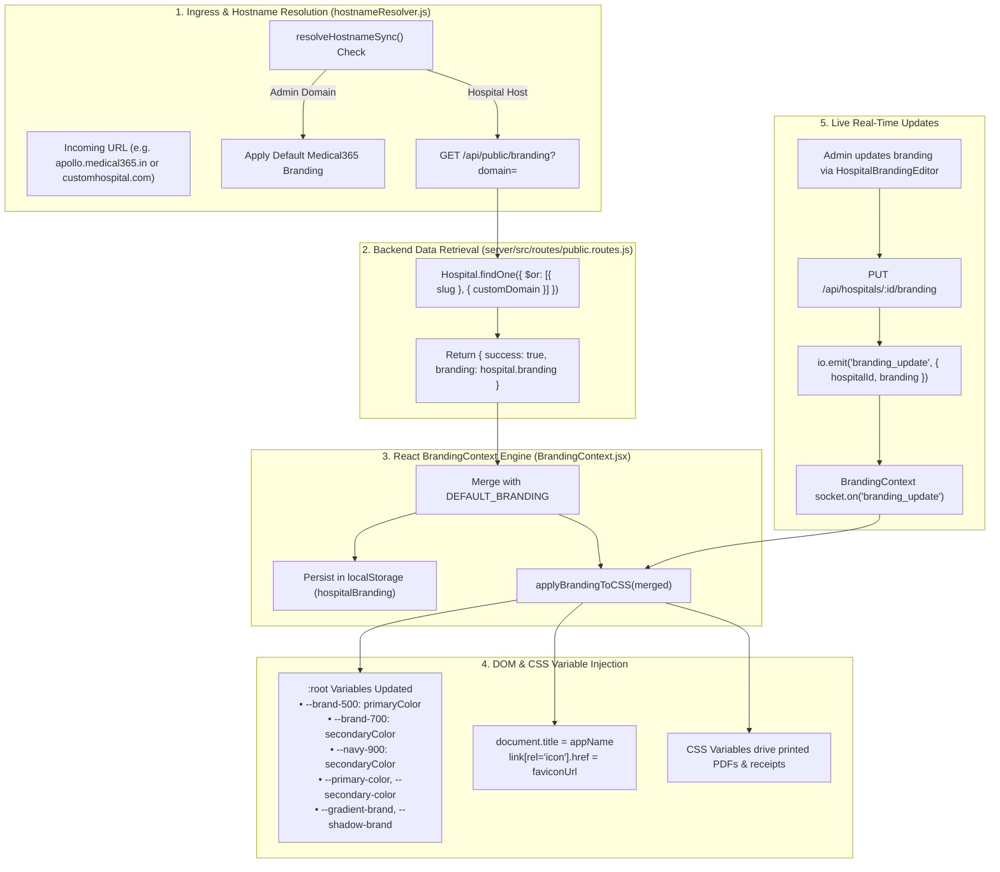

# 08 — White-Label Engine & Dynamic Tenant Branding

## 1. Overview & White-Label Philosophy

The **White-Label Engine** in Medical365 allows each hospital or diagnostic center to present a fully customized, branded digital healthcare identity across the web, mobile applications, printed prescriptions, automated emails, and patient invoices.

Unlike basic white-labeling that only replaces a logo, Medical365 provides:
1. **Dynamic CSS Token Invalidation**: Runtime injection of CSS custom properties directly onto `:root` driven by `BrandingContext.jsx`.
2. **Domain & Subdomain Routing**: Dynamic hostname resolution mapping custom domains (`www.cityhospital.in`) and subdomains (`apollo.medical365.in`) to tenant configurations.
3. **Automated Document Branding**: Automated rendering of hospital logos, official address footers, and color themes on PDF bills, discharge summaries, and OPD receipts.
4. **Real-Time Synchronous Theming**: WebSocket broadcasts (`branding_update`) propagate visual theme edits to all connected workstations instantly without browser refreshes.

---

## 2. White-Label Architecture Diagram



---

## 3. Configurable Branding Properties

Every property supported by `Hospital.branding` (`server/src/models/hospital.model.js:63`):

| Property Name | Form Label | Data Type | Default Fallback | Visual & Functional Impact |
| :--- | :--- | :--- | :--- | :--- |
| `appName` | App Display Name | String | `"Medical 365"` | Replaces navbar brand text, page title, login banner |
| `tagline` | Tagline | String | `"Healthcare Suite"`| Rendered below logo on login portal and patient portal |
| `logoUrl` | Hospital Logo URL | URL / Path | `"/assets/logo.png"`| Displayed on navbar, login cards, invoice headers |
| `faviconUrl` | Favicon URL | URL / Path | `"/assets/logo.png"`| Injected into `<link rel="icon">` in the browser tab |
| `primaryColor` | Primary Theme Color| Hex String | `"#14b8a6"` | Overrides `--brand-500`, primary buttons, badges, links |
| `secondaryColor`| Secondary Color | Hex String | `"#0a2647"` | Overrides `--navy-900`, dark headers, sidebar backgrounds |
| `accentColor` | Accent Color | Hex String | `"#6366f1"` | Highlighting badges, active tab markers |
| `successColor` | Success Color | Hex String | `"#10b981"` | Paid indicators, approved statuses, success alerts |
| `backgroundColor`| Surface / Background| Hex String| `"#f8fafc"` | Sets `--surface-1` and workspace background |
| `textColor` | Body Text Color | Hex String | `"#1e293b"` | Sets `--gray-900` typography color token |
| `emailDisplayName`| Email From Name | String | Hospital Name | From: name displayed in patient confirmation emails |
| `supportEmail` | Support Email | String | `""` | Rendered on invoice footers and help dropdowns |
| `supportPhone` | Support Helpline | String | `""` | Printed on emergency contact slips and patient bills |
| `address` | Physical Address | String | `""` | Rendered in official legal headers of printed PDFs |
| `websiteUrl` | Official Website | URL | `""` | Linked in patient portal footer and appointment slips |
| `footerText` | Receipt Footer Text | String | `""` | Disclaimer printed at the bottom of cashier bills |

---

## 4. CSS Custom Properties Injection Engine (`applyBrandingToCSS`)

The white-label engine dynamically calculates RGB color channels and applies custom styling directly to the browser DOM:

```javascript
function applyBrandingToCSS(branding) {
    const root = document.documentElement;

    const hex2rgb = (hex) => {
        const r = parseInt(hex.slice(1, 3), 16);
        const g = parseInt(hex.slice(3, 5), 16);
        const b = parseInt(hex.slice(5, 7), 16);
        return `${r}, ${g}, ${b}`;
    };

    const primary = branding.primaryColor || '#14b8a6';
    const secondary = branding.secondaryColor || '#0a2647';
    const bg = branding.backgroundColor || '#f8fafc';

    // Set core brand scales
    root.style.setProperty('--brand-500', primary);
    root.style.setProperty('--brand-600', primary);
    root.style.setProperty('--brand-700', secondary);
    root.style.setProperty('--brand-50',  `rgba(${hex2rgb(primary)}, 0.08)`);
    root.style.setProperty('--brand-100', `rgba(${hex2rgb(primary)}, 0.14)`);

    // Standard CSS properties
    root.style.setProperty('--primary-color', primary);
    root.style.setProperty('--secondary-color', secondary);
    root.style.setProperty('--bg-color', bg);

    // Gradients and shadows
    root.style.setProperty('--gradient-brand', `linear-gradient(135deg, ${primary} 0%, ${secondary} 100%)`);
    root.style.setProperty('--shadow-brand', `0 8px 24px rgba(${hex2rgb(primary)}, 0.28)`);

    // Dynamic browser title and favicon
    document.title = branding.appName || 'Medical 365';
    let fav = document.querySelector("link[rel*='icon']");
    if (fav) fav.href = branding.faviconUrl || branding.logoUrl || '/assets/logo.png';
}
```

---

## 5. Domain Resolution & Fallback Behavior

### 5.1 Hostname Resolution Hierarchy (`hostnameResolver.js`)
1. **Local Development Check**: If hostname is `localhost`, `127.0.0.1`, or LAN IP:
   - If subdomain exists (e.g. `apollo.localhost`), proceeds to server validation.
   - Otherwise, sets `PORTAL_TYPES.DEVELOPMENT` with default Medical365 branding.
2. **Platform Host Check**: If hostname equals `admin.medical365.in`, `medical365.in`, or `www.medical365.in`:
   - Sets `PORTAL_TYPES.ADMIN`.
   - Forces default platform branding (prevents hospital branding from leaking into Central Admin).
3. **Subdomain & Custom Domain Lookup**: Queries `GET /api/public/branding?domain=<hostname>`.
   - Backend queries `Hospital.findOne({ $or: [{ slug }, { customDomain }] })`.
   - Returns hospital-specific branding JSON.
4. **Resolution Failure / Unrecognized Hostname**:
   - If the hostname is unrecognized, sets `PORTAL_TYPES.INVALID`.
   - Routes user to `client/src/pages/InvalidPortalPage.jsx` ("Domain Not Configured — This hospital portal address has not been registered on Medical365").

---

## 6. Document & Receipt White-Labeling

In `PatientBillingProfile.jsx`, `Admission.jsx`, and `NursePatientDocuments.jsx`:
- Print routines compile HTML templates styled with the hospital's active branding.
- The invoice header renders:
  ```html
  <div class="invoice-header">
      
      <h2>${hospital.name}</h2>
      <p>${hospital.address} | Tel: ${hospital.phone} | Web: ${hospital.website}</p>
  </div>
  ```
- Primary accent bars, table header dividers, and summary totals use the hospital's `--primary-color`.
- Receipts generated by different hospitals maintain distinct visual styling, logos, and disclaimer footers.

