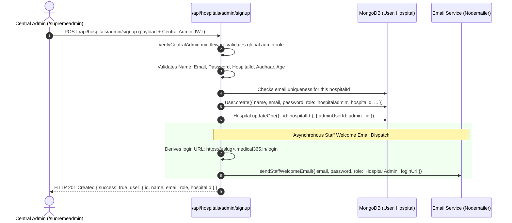
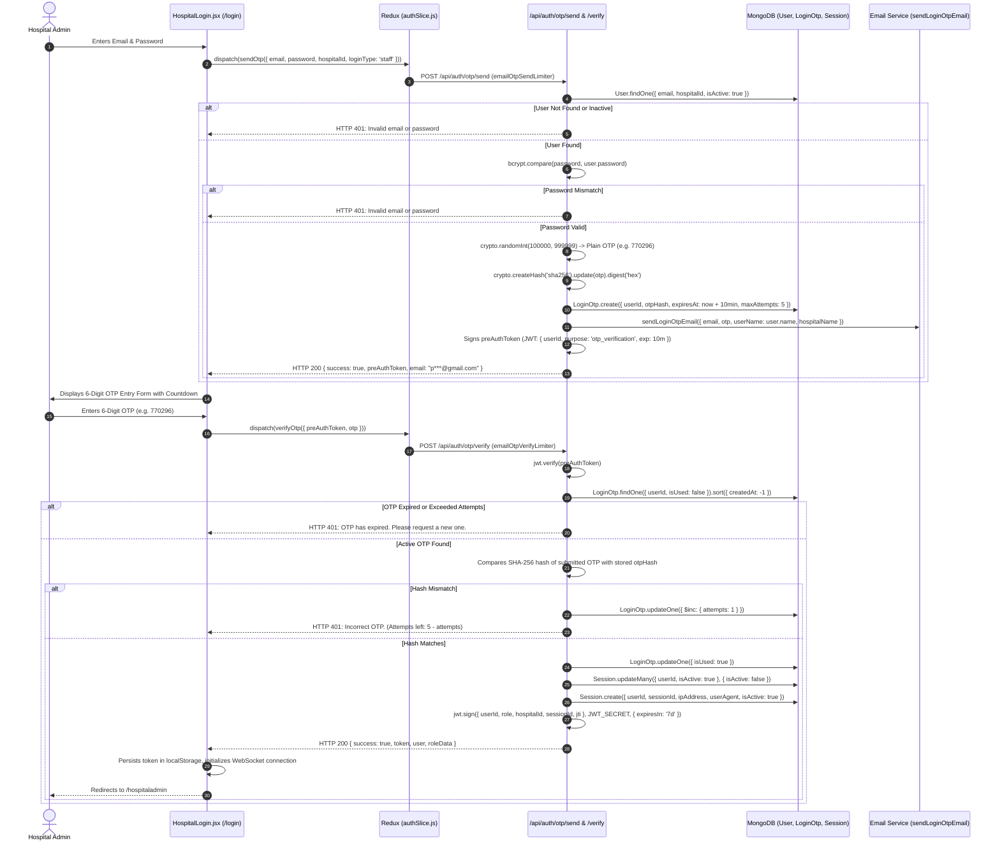

# 09 — Hospital Admin Lifecycle & OTP Authentication Subsystem

## 1. Overview & Operational Responsibilities

The **Hospital Admin** (Tier 2 Administrator) is the operational custodian of an individual hospital or clinic. Once onboarded by Central Admin, the Hospital Admin is responsible for configuring clinical departments, setting doctor consultation fees, onboarding nursing and reception staff, allocating inpatient wards and beds, managing pharmacy inventory and department stock transfers, overseeing laboratory pricing, and monitoring revenue reconciliation.

This document details:
1. **Hospital Admin Provisioning**: Account creation, validation, and credentials delivery.
2. **Hospital Portal URL Resolution**: How tenant subdomains route users to their dedicated hospital login portal.
3. **Two-Step Authentication with OTP**: The complete login lifecycle, cryptographic OTP generation, SHA-256 hashing, delivery via SMTP, and single-session enforcement.

---

## 2. Hospital Admin Provisioning (`server/src/routes/hospital.routes.js:452-520`)

Hospital Admins cannot self-register; they are created strictly by Central Admin via `/supremeadmin`:

### 2.1 Admin Creation Form Fields & Validation Rules

| Field Name | Type | Required? | Validation Rules | Target Model Property |
| :--- | :--- | :---: | :--- | :--- |
| `name` | Text | **Yes** | String, trimmed | `User.name` |
| `email` | Email | **Yes** | Valid email format, unique per hospital | `User.email` |
| `password` | Password | **Yes** | `validatePassword()`: Minimum 8 chars, 1 uppercase, 1 lowercase, 1 number, 1 special char | `User.password` (bcrypt hash) |
| `phone` | Text | Optional | 10-digit numeric string | `User.phone` |
| `hospitalId`| ObjectId | **Yes** | Valid existing hospital reference | `User.hospitalId` |
| `aadhaarNumber` | Text | Optional | Exactly 12 digits (`/^\d{12}$/`) | `User.aadhaarNumber` |
| `age` | Number | Optional | Integer between 1 and 999 | `User.age` |

---

## 3. Hospital URL Routing & Tenant Mapping

When a hospital is created, its administrative portal URL is derived:
- **Default Subdomain URL**: `https://<hospital-slug>.medical365.in/login` (or `/hospitaladmin`).
- **Custom Domain URL**: `https://<customDomain>/login` (e.g. `https://apollohospitals.org/login`).

### Tenant Resolution on Page Load (`client/src/utils/hostnameResolver.js`):
1. **Host Extraction**: When the browser navigates to `https://apollo.medical365.in/login`, the frontend extracts `hostname = "apollo.medical365.in"`.
2. **Subdomain Lookup**: Extracts the slug `"apollo"`.
3. **Public Branding API**: Calls `GET /api/public/branding?domain=apollo.medical365.in`.
4. **Visual Theming**: Loads Apollo's custom logo, hospital name, and primary/secondary colors into `BrandingContext`.
5. **Wrong URL Handling**: If an unrecognized subdomain is opened (e.g. `nonexistent.medical365.in`), the server returns HTTP 404, and the frontend renders `InvalidPortalPage.jsx` ("Domain Not Configured").

---

## 4. Complete Hospital Admin OTP Authentication Flow

Medical365 implements a **Two-Step Challenge-Response Authentication Protocol** (`server/src/routes/emailOtp.routes.js`):

---

## 5. Security Invariants & Defensive Controls

1. **Cryptographic OTP Hashing**: Plaintext OTPs are **never** stored in MongoDB. The database stores only the SHA-256 digest (`otpHash`), preventing exposure if the database is inspected.
2. **Rate Limiting**:
   - `emailOtpSendLimiter`: Limits requests to **5 OTP generation calls per 15 minutes** per IP/account.
   - `emailOtpVerifyLimiter`: Limits verification attempts to **10 calls per 15 minutes**; each individual OTP is invalidated after 5 failed verification attempts (`attempts >= maxAttempts`).
3. **Short-Lived Pre-Auth Tokens**: The `preAuthToken` generated in Step 1 contains a dedicated claim `purpose: 'otp_verification'` with a strict 10-minute expiration. It cannot be used to authenticate any general API routes.
4. **Single Active Device Enforcement (`Session` Model)**:
   - On successful OTP verification, all prior active sessions for that `userId` are invalidated (`isActive: false`).
   - Every authenticated request checks `Session.findOne({ sessionId, userId, isActive: true })`. If the admin logs in from a second laptop, the first device is automatically logged out on its next action with `sessionExpired: true`.
5. **Secure Logout & Token Revocation**:
   - Calling `POST /api/auth/logout` records the token's `jti` in `TokenBlacklist` with a TTL index matching the token expiration.
   - Any future presentation of that token is rejected immediately by `auth.middleware.js`.

