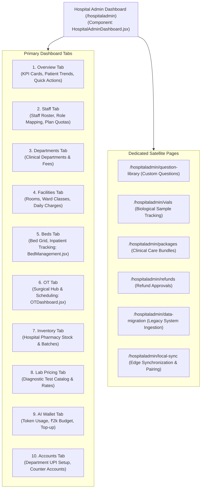

# 10 — Hospital Admin Dashboard & Navigation Architecture

## 1. Overview & Navigation Topography

The **Hospital Admin Dashboard** (`/hospitaladmin`) is the central operational workstation for the Tier 2 Hospital Administrator. It integrates all clinical departments, staff rosters, physical infrastructure, pharmaceutical inventory, diagnostic test pricing, financial reconciliation, and AI intelligence into a cohesive tabbed dashboard.

---

## 2. Detailed Inspection of Dashboard Tabs

### 2.1 Tab 1: Overview (`activeTab === 'overview'`)
- **Purpose**: Provides immediate operational visibility into hospital throughput, patient volume, bed occupancy, and daily revenue.
- **KPI Metrics Cards**:
  - *Total Doctors*: Active doctors associated with the hospital.
  - *Total Staff*: Total non-doctor staff members.
  - *Total Patients*: Unique registered patients in the EMR.
  - *Appointments Today*: Count of scheduled consultations for the current calendar day.
  - *Inpatient Bed Occupancy*: Percentage of active occupied beds across all wards.
  - *Total Revenue*: Net cashier collection aggregated for the current month.
- **Visual Analytics**: Interactive charting with time-scale selector (`this_month`, `last_month`, `this_year`).
- **Backend APIs**:
  - `GET /api/hospitals/my-hospital/stats`
  - `GET /api/billing/dashboard-summary`

---

### 2.2 Tab 2: Staff Management (`activeTab === 'staff'`)
- **Purpose**: Staff member onboarding, role assignment, and quota monitoring.
- **Plan Quota Indicator**: In `Clinic Basic` (max 3 staff) and `Multi-Speciality Starter` (max 25 staff) plans, a progress bar displays current headcount vs. plan capacity.
- **Roster Controls**: Search by staff name/email, filter by assigned role, and toggle account activation.
- **Staff Creation Form**:
  - Fields: Full Name, Email, Password, Phone Number, Role Dropdown, Department, Aadhaar Number, Age.
  - Doctor Safety Guard: Staff creation explicitly rejects assigning roles named "Doctor" or "Clinic Doctor". Doctors must be created through the dedicated Doctor Management portal (`/admin/doctors`).
- **Backend APIs**:
  - `GET /api/admin/users?hospitalId=<id>`
  - `POST /api/admin/users`
  - `PUT /api/admin/users/:id`
  - `DELETE /api/admin/users/:id`

---

### 2.3 Tab 3: Department Management (`activeTab === 'departments'`)
- **Purpose**: Configure clinical departments, map OPD consultation fees, and link to the Question Library.
- **Department Table**: Lists department name, head of department, active doctors count, standard consultation fee, and active status toggle.
- **Add / Edit Department Modal**:
  - *Department Name*: String, trimmed.
  - *Consultation Fee*: Number (INR). Serves as default consultation fee for doctors in this department who do not specify custom rates.
  - *Active Status*: Boolean flag.
- **Backend APIs**:
  - `GET /api/hospitals/my-hospital/departments`
  - `POST /api/hospitals/my-hospital/departments`
  - `PUT /api/hospitals/my-hospital/departments/:id`

---

### 2.4 Tab 4: Facilities & Room Categories (`activeTab === 'facilities'`)
- **Purpose**: Define room classes, ward categories, and daily facility tariffs.
- **Configurable Categories**:
  - General Ward (shared).
  - Semi-Private Room.
  - Private Deluxe Room.
  - Intensive Care Unit (ICU).
  - Neonatal Intensive Care Unit (NICU).
- **Tariff Modeling**: Sets `pricePerDay` used by the IPD billing engine during patient admission and bed transfer calculations.
- **Backend Model**: Embedded array `hospital.roomCategories` in `Hospital.model.js`.
- **Backend APIs**:
  - `GET /api/hospitals/my-hospital/facilities`
  - `PUT /api/hospitals/my-hospital/facilities`

---

### 2.5 Tab 5: Bed Management (`activeTab === 'beds'`)
- **Component**: `<BedManagement />` (`client/src/pages/hospitaladmin/BedManagement.jsx`).
- **Purpose**: Visual ward layout and real-time bed occupancy grid.
- **Key Actions**:
  - Add Bed: Ward name, bed number, bed type (`General`, `ICU`, `Private`, `Semi-Private`).
  - Real-Time Status Filter: `ALL`, `AVAILABLE` (green), `OCCUPIED` (red), `MAINTENANCE` (amber).
  - View Occupant: Displays admitted patient name, MRN, admission date, primary physician, and assigned nurses.
- **Backend Model**: `server/src/models/bed.model.js`.
- **Backend APIs**:
  - `GET /api/beds`
  - `POST /api/beds`
  - `PATCH /api/beds/:id/status`

---

### 2.6 Tab 6: Operation Theatre Hub (`activeTab === 'ot'`)
- **Component**: `<OTDashboard />` (`client/src/pages/ot/OTDashboard.jsx`).
- **Purpose**: Coordinates surgical suites, anesthetists, pre-op readiness, and recovery logs.
- **Sub-Views**:
  - *Planned Surgeries*: List of patients scheduled for surgical interventions.
  - *OT Schedule*: Multi-room timeline mapping surgeons and timeslots.
  - *Pre-Op Clearance*: Checklist tracking consent, fasting, blood cross-match, and anesthesia fitness.
  - *In-Progress Surgery*: Live status indicator for active operations.
  - *Post-Op Recovery & PACU*: Recovery vitals and ward transfer readiness.
- **Backend Model**: `server/src/models/surgeryPlan.model.js`, `otRoom.model.js`.

---

### 2.7 Tab 7: Pharmacy Inventory (`activeTab === 'inventory'`)
- **Purpose**: Pharmaceutical supply chain, stock monitoring, and batch expiry tracking.
- **Inventory Grid**: Displays medicine brand name, generic formulation, category, batch number, current stock quantity, unit cost price, selling price, and expiry date.
- **Low Stock & Expiry Alerts**: Automatically highlights batches nearing expiration (< 60 days) or items below minimum reorder thresholds.
- **Department Stock Transfers**: Issue medicines from central pharmacy store to specific departments (e.g. Emergency, OT, ICU).
- **Backend Models**: `inventory.model.js`, `departmentStock.model.js`, `departmentTransfer.model.js`.
- **Backend APIs**:
  - `GET /api/pharmacy/inventory`
  - `POST /api/pharmacy/inventory`
  - `POST /api/pharmacy/transfers`

---

### 2.8 Tab 8: Laboratory Pricing & Catalog (`activeTab === 'labpricing'`)
- **Purpose**: Manage the hospital's diagnostic test master and set customized local prices.
- **Catalog Table**: Lists test code, test name, category (`Biochemistry`, `Hematology`, `Microbiology`, `Radiology`), default platform price, and hospital custom price.
- **Price Override**: Hospital Admin can specify a custom price that overrides global catalog defaults for patient billing.
- **Backend Model**: `server/src/models/labTest.model.js`.
- **Backend APIs**:
  - `GET /api/lab-tests`
  - `PUT /api/lab-tests/:id/hospital-price`

---

### 2.9 Tab 9: AI Intelligence & AI Wallet (`activeTab === 'aiwallet'`)
- **Purpose**: Monitor clinical generative AI consumption and manage the prepaid AI Wallet.
- **Displayed Metrics**:
  - *Current Wallet Balance*: Real-time remaining budget in INR (initial complimentary balance: ₹2,000).
  - *Status Indicator*: `ACTIVE` (green), `LOW_BALANCE` (amber < ₹200), `EXHAUSTED` (red).
  - *Token Analytics*: Total prompt tokens, candidate completion tokens, and estimated cost in INR.
  - *Doctor-Wise Consumption*: Detailed breakdown showing which doctors are utilizing Voice Scribe or multi-modal report analysis.
- **Top-Up Actions**: Initiate prepaid wallet recharge via integrated payment gateway or offline credit request.
- **Backend Service**: `server/src/services/ai/aiWallet.service.js`.
- **Backend APIs**:
  - `GET /api/ai-wallet/wallet`
  - `GET /api/ai-wallet/doctor-tracking`
  - `POST /api/ai-wallet/topup`

---

### 2.10 Tab 10: Accounts & Department UPI (`activeTab === 'accounts'`)
- **Purpose**: Configure multi-counter UPI collection accounts for reception, pharmacy, and cashier desks.
- **Configured Accounts**: Lists staff user, role, UPI ID (`hospital.reception@okhdfcbank`), label, and active status.
- **Dynamic QR Integration**: When a patient pays at Reception or Cashier, the system queries active UPIs for that role (`GET /api/hospitals/department-upis/active-by-role`) to dynamically generate an exact amount UPI QR code on the payment screen.
- **Backend Model**: `server/src/models/departmentUpi.model.js`.
- **Backend APIs**:
  - `GET /api/hospitals/department-upis`
  - `POST /api/hospitals/department-upis`
  - `DELETE /api/hospitals/department-upis/:id`

---

## 3. Dedicated Satellite Modules Accessible via Navigation

In addition to the 10 internal dashboard tabs, the Hospital Admin navigation bar provides direct links to specialized standalone sub-systems:
1. **Hospital Question Library (`/hospitaladmin/question-library`)**: Refine clinical assessment questionnaires scoped to the hospital's approved departments.
2. **Vial & Sample Management (`/hospitaladmin/vials`)**: Complete biological specimen intake, cryogenic storage mapping, and movement audit trail.
3. **Package Management (`/hospitaladmin/packages`)**: Create fixed-price multi-service healthcare packages with frozen patient assignment snapshots.
4. **Refund Approvals (`/hospitaladmin/refunds`)**: Authorize or reject patient refund requests initiated by Cashier or Reception.
5. **Data Migration (`/hospitaladmin/data-migration`)**: Ingest legacy patient and clinical records from CSV/Excel via AI column mapping.
6. **Local Edge Sync (`/hospitaladmin/local-sync`)**: Pair and monitor the hospital's on-premise edge synchronization server for internet-blackout resilience.

