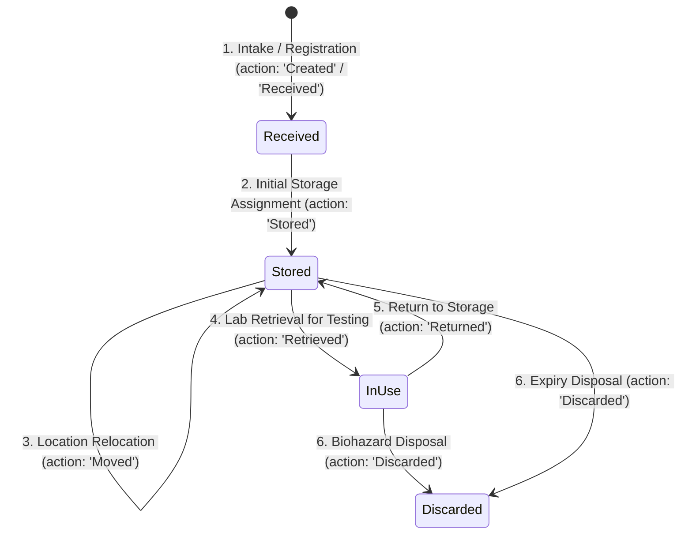

# 11 — Vial Management & Hospital Movement Workflows

## 1. Module Identification & Clarification

In the project specifications, this module is referred to as **"Valid Management / Hospital Movement Workflow"**. A comprehensive scan of the Medical365 codebase reveals that in actual code, this module is implemented as **Vial Management** (`client/src/pages/hospitaladmin/VialManagement.jsx`, `server/src/models/vial.model.js`, `server/src/controllers/vial.controller.js`, `server/src/routes/vial.routes.js`). The term "Valid" is a phonetic/autocorrect transcription of "Vial".

Additionally, the Medical365 platform implements two other movement workflows:
1. **Patient Bed Transfer Workflow** (`server/src/models/admission.model.js`, `server/src/routes/admission.routes.js`).
2. **Department Pharmaceutical Stock Transfer Workflow** (`server/src/models/departmentTransfer.model.js`, `server/src/routes/pharmacy.routes.js`).

This document provides a complete technical analysis of all three movement engines, with primary focus on the **Biological Sample & Cryogenic Vial Movement System**.

---

## 2. Vial Management & Specimen Storage Movement Architecture

### 2.1 Medical Purpose
In diagnostic pathology, reproductive medicine (IVF), oncology, and blood bank operations, biological samples (e.g. blood vials, tissue specimens, semen/oocyte cryogenic straws, biopsy fragments) must be tracked through physical storage hierarchies (Room -> Storage Unit/Freezer -> Rack -> Box -> Position). 

Every physical movement of a specimen—whether into storage, across freezers, retrieved for testing, returned, or safely incinerated/discarded—must maintain a permanent, tamper-evident chronological chain of custody.

---

### 2.2 Data Models (`server/src/models/vial.model.js`)

#### 1. Storage Location Schema (`storageLocationSchema`)
```javascript
const storageLocationSchema = new mongoose.Schema({
    room: { type: String, trim: true, default: '' },          // e.g. "Cryo Lab 2", "Cold Room B"
    storageUnit: { type: String, trim: true, default: '' },   // e.g. "Freezer -80C #1", "Liquid Nitrogen Tank 4"
    rack: { type: String, trim: true, default: '' },          // e.g. "Rack R-04"
    box: { type: String, trim: true, default: '' },           // e.g. "Box B-12"
    position: { type: String, trim: true, default: '' }       // e.g. "Well E07", "Slot 14"
}, { _id: false });
```

#### 2. Movement & Audit Record Schema (`vialMovementSchema`)
```javascript
const vialMovementSchema = new mongoose.Schema({
    action: {
        type: String,
        required: true,
        enum: ['Created', 'Received', 'Stored', 'Moved', 'Retrieved', 'Returned', 'Updated', 'Discarded']
    },
    timestamp: { type: Date, default: Date.now },
    performedBy: { type: mongoose.Schema.Types.ObjectId, ref: 'User' },
    performedByName: { type: String, default: 'Hospital Admin' },
    previousStatus: { type: String, default: null },
    newStatus: { type: String, default: null },
    previousLocation: { type: storageLocationSchema, default: () => ({}) },
    newLocation: { type: storageLocationSchema, default: () => ({}) },
    reason: { type: String, default: '' },
    notes: { type: String, default: '' }
}, { _id: true });
```

#### 3. Root Vial Schema (`vialSchema`)
- `vialId`: Sequential unique identifier (e.g. `VL-000001`, `VL-000002`) generated by `generateVialId()`.
- `hospitalId`: Reference to `Hospital` for strict multi-tenant isolation.
- `patientId`: Reference to `User` (patient) for clinical traceability.
- `vialType`: Enum (`Biological Sample`, `Specimen`, `Laboratory Sample`, `Medication`, `Reagent`, `Cryogenic Sample`, `Other`).
- `status`: Enum (`Received`, `Stored`, `In Use`, `Transferred`, `Discarded`).
- `currentLocation`: Embedded `storageLocationSchema`.
- `auditHistory`: Chronological array of `vialMovementSchema` records.

---

### 2.3 The 5 Core Movement Actions & State Machine



---

### 2.4 Movement Flow: Step-by-Step Technical Execution

```
Previous Location ──► Movement Request ──► Server Validation ──► New Location ──► History/Audit Record
```

#### Step 1: Initiating Movement
- **Who Can Initiate**: Hospital Admin or authorized Laboratory Technician (`vial.controller.js`).
- **Input Parameters**:
  - Target `id`: MongoDB ObjectId of the vial.
  - Destination Coordinates: `room`, `storageUnit` (mandatory), `rack`, `box`, `position`.
  - Operational Context: `reason` (e.g. "Freezer defrosting relocation", "Reorganized to Cryo Tank 2"), `notes`.

#### Step 2: Controller Execution (`server/src/controllers/vial.controller.js:660-705`)
1. **Tenant Verification**: Finds vial scoped strictly to `hospitalId: req.user.hospitalId`.
2. **Snapshot Previous Location**: Clones `vial.currentLocation` before modifying.
3. **Apply New Coordinates**: Updates `vial.currentLocation = newLocation`.
4. **Append Movement Audit Entry**:
   ```javascript
   vial.auditHistory.push({
       action: 'Moved',
       timestamp: new Date(),
       performedBy: req.user._id,
       performedByName: req.user.name || 'Hospital Admin',
       previousStatus: vial.status,
       newStatus: vial.status,
       previousLocation: oldLocation,
       newLocation: newLocation,
       reason: reason.trim(),
       notes: (notes || '').trim()
   });
   await vial.save();
   ```
5. **Real-Time Notification**: Emits `vial_updated` via Socket.io to refresh all lab workstations.

---

### 2.5 Real Implemented Movement Example

**Scenario**: Moving an IVF Cryogenic Sample from Room 1 Tank to Room 2 Backup Tank due to maintenance.

1. **Previous Location**:
   ```json
   {
     "room": "IVF Cryo Suite 101",
     "storageUnit": "Liquid Nitrogen Tank A",
     "rack": "Canister 3",
     "box": "Cane 12",
     "position": "Goblet 2 / Straw 4"
   }
   ```
2. **Movement API Call**:
   - `PUT /api/vials/66f1234a56b7890/move`
   - Request Body:
     ```json
     {
       "room": "Cryo Vault B",
       "storageUnit": "Liquid Nitrogen Tank 4",
       "rack": "Canister 1",
       "box": "Cane 05",
       "position": "Goblet 1 / Straw 1",
       "reason": "Tank A Scheduled Nitrogen Refill",
       "notes": "Verified temperature at -196C during transit"
     }
     ```
3. **Resulting Audit Record in `vial.auditHistory`**:
   - `action`: `"Moved"`
   - `performedByName`: `"Dr. Ananya Sen"`
   - `previousLocation`: `IVF Cryo Suite 101 -> Tank A -> Canister 3 -> Cane 12 -> Goblet 2`
   - `newLocation`: `Cryo Vault B -> Tank 4 -> Canister 1 -> Cane 05 -> Goblet 1`
   - `reason`: `"Tank A Scheduled Nitrogen Refill"`
   - `timestamp`: `"2026-10-30T10:45:00.000Z"`

---

## 3. Patient Bed Movement & Transfer Workflow

In inpatient admissions (`server/src/routes/admission.routes.js: /transfer-bed`), patients are moved between wards (e.g. Emergency Ward -> ICU -> General Ward).

### 3.1 Bed Movement Flow
```
From Ward/Bed ──► Bed Transfer Request ──► Occupancy Lock ──► To Ward/Bed ──► Tariff Segmentation & Audit
```

### 3.2 Key Steps & Financial Segment Calculation
1. **Validation**: Server verifies destination bed exists, is scoped to the same hospital, and has `status === 'AVAILABLE'`.
2. **Old Bed De-allocation**: Previous bed `status` reverts to `'AVAILABLE'`, unlinking `currentPatient` and `currentAdmission`.
3. **New Bed Allocation**: Target bed `status` updates to `'OCCUPIED'`, linking the active admission.
4. **Segment Duration & Tariff Recalculation**:
   - Calculates exact duration (hours and days) spent in the previous ward.
   - Computes `segmentAmount = durationDays * ratePerDay`.
   - Appends to `admission.transferHistory`:
     ```javascript
     {
       fromWard: "Emergency Ward",
       fromBedNumber: "EMG-04",
       toWard: "Intensive Care Unit (ICU)",
       toBedNumber: "ICU-02",
       transferDate: new Date(),
       ratePerDay: 5000,
       segmentAmount: 15000,
       transferredBy: req.user._id,
       notes: "Post-op critical vitals stabilization"
     }
     ```
5. **Billing Integration**: During final discharge, the cashier billing engine aggregates all segment amounts from `transferHistory` to generate an itemized facility statement.

---

## 4. Department Stock Movement Workflow

In pharmacy supply operations (`server/src/routes/pharmacy.routes.js: /transfers`), pharmaceutical stock is transferred between the Central Hospital Pharmacy and Department Dispensaries (e.g. OT, Emergency, Daycare).

1. **Movement Request**: Nurse or Pharmacist submits `fromDepartment = "Central Pharmacy"`, `toDepartment = "OT Room 1"`, `medicineId`, `batchNumber`, `quantity = 20`.
2. **Stock Verification**: Server ensures Central Pharmacy has >= 20 units available for that specific batch.
3. **Atomic Decrement/Increment**:
   - Decrements `quantity` from Central Pharmacy `Inventory`.
   - Increments (or inserts) `quantity` in `DepartmentStock` for OT Room 1.
4. **Audit Record**: Creates a `DepartmentTransfer` record logging `transferId`, `dispensedBy`, `receivedBy`, `timestamp`, and `batchNumber`.

