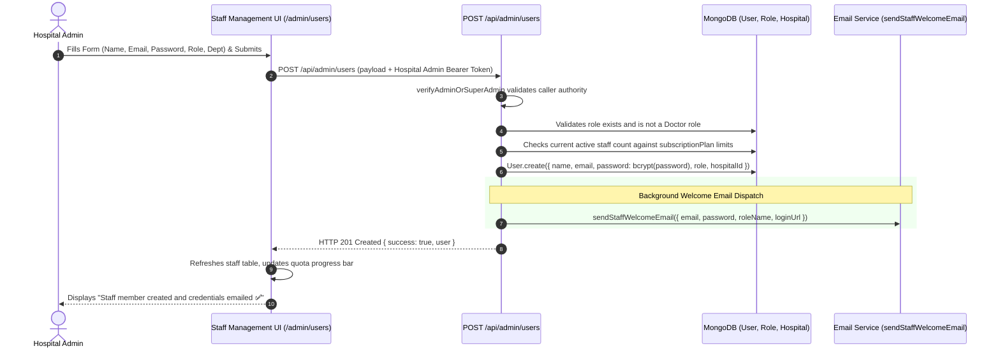

# 12 — Staff Management & Workforce Governance

## 1. Overview & Operational Scope

The **Staff Management** module (`client/src/pages/admin/Admin.jsx` and `HospitalAdminDashboard.jsx` Staff tab) provides complete lifecycle governance over the hospital's non-doctor clinical and operational workforce. This includes Receptionists, Nurses, Lab Technicians, Pharmacists, Cashiers, Accountants, and Operation Theatre Managers.

Key architectural boundaries:
1. **Separation of Doctors and Staff**: Medical practitioners (Doctors) are strictly excluded from the Staff Management interface and must be onboarded through the dedicated Doctor Management portal (`/admin/doctors`).
2. **Subscription Quota Enforcement**: Staff creation checks the hospital's subscription tier (`clinic_basic` allows up to 3 staff; `multi_speciality_starter` allows up to 25 staff; `enterprise` is uncapped).
3. **Automated Welcome & Credential Dispatch**: Creating a staff member generates an initial account and asynchronously sends a branded welcome email containing their login credentials and hospital portal URL.

---

## 2. Staff Creation Form & Validation Specifications

Located in `client/src/pages/admin/Admin.jsx` (lines 350–470) and `HospitalAdminDashboard.jsx`:

| Form Field Name | Input Type | Required? | Validation Rules | Target Model Property | Architectural Impact |
| :--- | :--- | :---: | :--- | :--- | :--- |
| `name` | Text | **Yes** | String, trimmed | `User.name` | Displayed on clinical intake notes, receipts, and handovers |
| `email` | Email | **Yes** | Unique per hospital, valid email format | `User.email` | Primary login identifier & OTP destination |
| `password` | Password | **Yes** | `validatePassword()`: 8+ chars, upper, lower, number, symbol | `User.password` (bcrypt hash) | Used for Step 1 authentication |
| `phone` | Text | Optional | 10-digit numeric string | `User.phone` | Contact on staff rosters and internal communication |
| `role` / `roleId` | Dropdown | **Yes** | Valid `Role._id` scoped to this hospital | `User.role` | Dictates permissions, navigation links, and API access |
| `department` | Dropdown | Optional | Active hospital department | `User.department` | Scopes staff to specific wards, labs, or pharmacy counters |
| `designation` | Text | Optional | Alphanumeric string (e.g. "Senior Triage Nurse") | `User.designation` | Displayed on digital signatures and staff badges |
| `employeeId` | Text | Optional | Alphanumeric code (e.g. "EMP-104") | `User.employeeId` | Internal HR identification |
| `aadhaarNumber` | Text | Optional | Exactly 12 digits (`/^\d{12}$/`) | `User.aadhaarNumber` | Legal KYC identity tracking |
| `age` | Number | Optional | Integer between 1 and 999 | `User.age` | Employee demographic records |
| `gender` | Dropdown | Optional | `Male`, `Female`, `Other` | `User.gender` | Profile attribute |
| `address` | Textarea | Optional | Alphanumeric text | `User.address` | Residential contact records |

---

## 3. Quota & Role Safety Controls (`server/src/routes/admin.routes.js:640-705`)

During staff creation (`POST /api/admin/users`), the server executes two critical safety checks:

### 3.1 Doctor Exclusion Guard
```javascript
const assignedRoleNameLower = (roleDoc.name || '').toLowerCase();
const isActualDoctor = (
    assignedRoleNameLower === 'doctor' || 
    assignedRoleNameLower === 'clinic doctor' || 
    (assignedRoleNameLower.includes('doctor') && !assignedRoleNameLower.includes('assistant'))
);

if (isActualDoctor) {
    return res.status(403).json({
        success: false,
        message: 'Doctors cannot be created from Staff Management. Please use the Doctors Feed.'
    });
}
```
*Note: Doctor Assistants (`role: 'doctor assistant'`) are explicitly permitted in Staff Management.*

### 3.2 Subscription Quota Calculation
```javascript
if (subscriptionPlan === 'clinic_basic' || subscriptionPlan === 'multi_speciality_starter') {
    const limits = SUBSCRIPTION_PLANS[subscriptionPlan];
    const maxStaff = limits.maxStaff; // 3 for basic, 25 for multi_speciality

    const existingStaff = await User.countDocuments({
        hospitalId: assignedHospitalId,
        role: { $nin: ['patient', 'user', 'hospitaladmin', 'centraladmin', 'superadmin', 'doctor', 'clinic doctor'] }
    });

    if (existingStaff >= maxStaff) {
        return res.status(403).json({
            success: false,
            message: `Staff limit reached for this hospital (${existingStaff}/${maxStaff}). Please upgrade your plan.`
        });
    }
}
```

---

## 4. End-to-End Staff Onboarding Lifecycle



---

## 5. Staff Role Assignment & Access Propagation

1. **Role Binding**: The staff user's `role` field stores the `ObjectId` of the assigned `Role` document.
2. **Permission Inheritance**: On login, `auth.middleware.js` populates `req.user._roleData` with the role's permissions array and dashboard path:
   - Receptionist (`permissions: ['patient_create', 'patient_search', 'appointment_manage']`) -> Lands on `/reception/dashboard`.
   - Nurse (`permissions: ['nurse_access', 'visit_intake']`) -> Lands on `/nurse/dashboard`.
   - Cashier (`permissions: ['billing_view', 'billing_manage']`) -> Lands on `/cashier/billing`.
   - Pharmacist (`permissions: ['pharmacy_view', 'pharmacy_manage']`) -> Lands on `/pharmacy/inventory`.
   - Lab Technician (`permissions: ['lab_view', 'lab_manage']`) -> Lands on `/lab/dashboard`.
3. **Dynamic Role Mutation**: If Hospital Admin edits a role's permissions, the update takes effect across all assigned staff users on their very next HTTP request without requiring token re-issuance.

---

## 6. Staff Management Operations

In `Admin.jsx` and `HospitalAdminDashboard.jsx`:
- **Live Search & Filter**: Search by staff name, email, or employee code, and filter by assigned role.
- **Edit Staff Modal**: Update staff name, phone, department, designation, and assigned role. Role changes take effect immediately.
- **Deactivate / Activate Account**: Toggle `isActive: false` on the `User` record. Deactivated staff are immediately rejected at login and their active sessions are revoked.
- **Delete Staff**: Permanently removes the staff user from the hospital database (provided they have no active locked financial batches).
- **Password Reset**: Hospital Admin can trigger a password reset for any staff member from the action menu.

