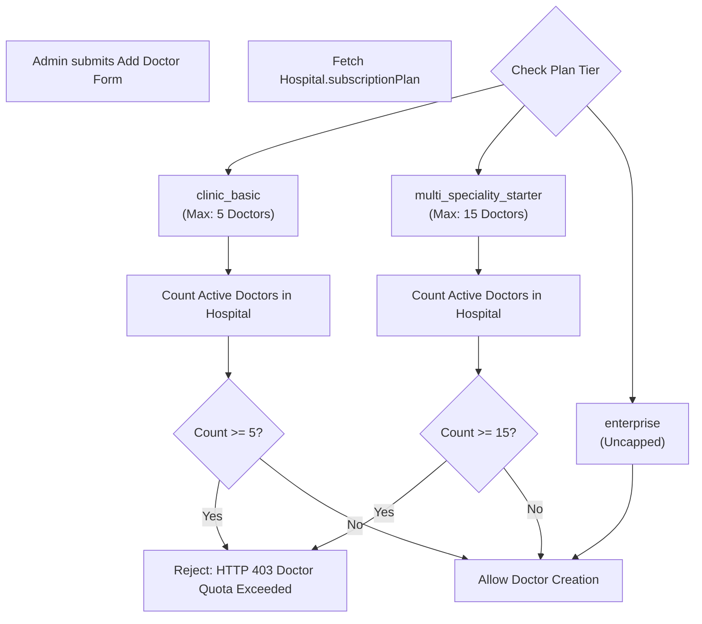

# 13 — Doctor Management & Clinical Practice Architecture

## 1. Overview & Doctor Persona in Medical365

In Medical365, the **Doctor** entity is the primary driver of clinical workflows, outpatient consultations, diagnostic test orders, surgery planning, and electronic prescriptions. 

Unlike generic staff members, a Doctor in Medical365 possesses a dual identity:
1. **User Identity (`server/src/models/user.model.js`)**: Handles authentication, passwords, JWT issuance, and RBAC permissions (`role: 'doctor'`).
2. **Clinical Practitioner Identity (`server/src/models/doctor.model.js`)**: Tracks medical qualifications, clinical specialties, department mappings, day-wise availability schedules, consultation fees, and appointment capacity.

---

## 2. Doctor Creation Form Specifications (`client/src/pages/admin/AdminDoctors.jsx`)

Doctors are onboarded exclusively through the Doctor Management interface (`/admin/doctors`):

| Form Field Name | Input Type | Required? | Validation Rules | Target Schema Property | Operational Impact |
| :--- | :--- | :---: | :--- | :--- | :--- |
| `name` | Text | **Yes** | String, minlength 2 | `Doctor.name` | Displayed on prescription pads, appointment slots, bills |
| `email` | Email | **Yes** | Valid email, unique per hospital | `Doctor.email`, `User.email` | Doctor login ID & OTP target |
| `password` | Password | **Yes** | `validatePassword()` rules | `User.password` (bcrypt hash) | Doctor portal authentication credential |
| `phone` | Text | **Yes** | Exactly 10 digits (`/^\d{10}$/`) | `Doctor.phone`, `User.phone` | Patient SMS communication |
| `departments` | Multi-Select | **Yes** | Selected from hospital departments | `Doctor.departments` | Maps doctor to OPD queues and fee structures |
| `specialty` | Text | **Yes** | Alphanumeric (e.g. "Interventional Cardiology") | `Doctor.specialty` | Displayed on public booking pages & doctor lists |
| `education` | Text | Optional | Degree string (e.g. "MBBS, MD, DM") | `Doctor.education` | Rendered on official prescription headers |
| `experience` | Text | Optional | String (e.g. "12 Years") | `Doctor.experience` | Profile information |
| `consultationFee` | Number | **Yes** | Positive number (INR) | `Doctor.consultationFee` | Applied during patient appointment booking & billing |
| `age` | Number | Optional | Integer (min: 1) | `Doctor.age` | Demographic record |
| `aadhaarNumber` | Text | Optional | Exactly 12 digits | `Doctor.aadhaarNumber` | Medical council KYC compliance |
| `availability` | Day/Time Pickers| Optional | Day-wise `{ startTime, endTime, available }` | `Doctor.availability` | Dictates appointment slot generator |
| `bio` | Textarea | Optional | Clinical background text | `Doctor.bio` | Displayed on patient self-booking portal |

---

## 3. Subscription Quota Enforcement on Doctors

Before allowing doctor creation, the system evaluates the hospital's active subscription plan (`AdminDoctors.jsx:340-355` and `server/src/routes/doctor.routes.js`):

---

## 4. End-to-End Doctor Creation Pipeline

When Hospital Admin submits the Doctor Form (`POST /api/doctors`):
1. **Quota Validation**: Server counts active doctors for `hospitalId` against plan limits.
2. **Dual Document Creation**:
   - Generates a `User` account with `role: 'doctor'`, `email`, hashed `password`, and `hospitalId`.
   - Generates a `Doctor` document with `doctorId` (e.g. `DOC-108`), linking `userId: user._id`.
3. **Department Mapping**: Updates the doctor's departments array (`Doctor.departments`).
4. **Welcome Dispatch**: Asynchronously dispatches a welcome email with portal credentials.

---

## 5. Doctor Clinical Workflows in Medical365

Once authenticated, doctors operate within specialized clinical environments:

### 5.1 Outpatient (OPD) Patient Queue (`/doctor/patients`)
- Displays live list of registered patients awaiting consultation.
- Shows triage vitals recorded by the intake nurse (Blood Pressure, Heart Rate, SpO2, Temperature, Blood Glucose).
- Shows answered intake questionnaire from the **Question Library**.

### 5.2 Clinical Examination & Electronic Prescription Generator
- **Diagnosis Entry**: Records primary and secondary clinical diagnoses with ICD-10 search support.
- **Medication Prescribing**: Pulls active pharmaceuticals directly from the hospital's **Pharmacy Inventory** (`inventory.model.js`), ensuring prescribed medicines exist in stock. Configures dosage, frequency (OD, BD, TID), duration, and instructions.
- **Diagnostic Orders**: Directly orders laboratory tests (`LabTest`) or radiology investigations, instantly queuing requests in the **Laboratory Dashboard**.
- **Digital Prescription**: Generates a branded digital prescription with the hospital's white-label header, doctor's registration number, and clinical summary.

### 5.3 Clinical AI Assistant & Voice Scribe (`/doctor/ai-assistant`)
- **Voice Scribe**: Doctor clicks "Record Consultation", and the system records audio, sends base64 audio to Google Gemini, and automatically extracts structured SOAP clinical notes (Subjective, Objective, Assessment, Plan).
- **Report Explainer**: Doctor uploads complex diagnostic scans or laboratory reports; Gemini analyzes findings and flags critical abnormal observations.
- **Quota Accounting**: Costs are seamlessly deducted in real-time from the hospital's **AI Wallet** without interrupting the consultation.

### 5.4 Surgical Referrals & OT Planning (`/doctor/surgeries`)
- If an outpatient requires surgery, the doctor initiates a **Surgery Plan** directly from the consultation screen.
- Selects procedure name, surgical specialty, estimated duration, and target date.
- Forwards the plan to the **Operation Theatre Hub** (`OTDashboard.jsx`) for room scheduling and anesthesia evaluation.

