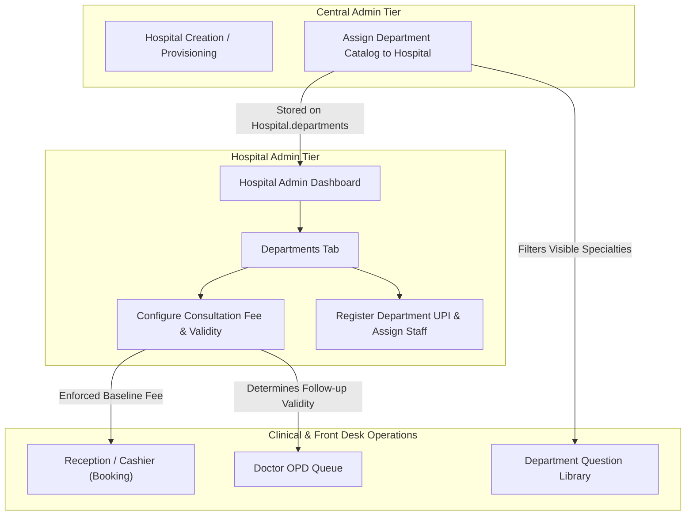

# Phase 14 — Hospital Overview & Department Management

## 1. Module Overview

The **Hospital Overview and Department Management** module provides hospital administrators with centralized governance over institutional metadata, operational departments, consultation fee structures, follow-up validity intervals, and decentralized financial collection channels (Department UPIs).

In Medical365, departments serve as the structural anchor linking:
1. **Clinical Specializations**: Doctors belong to one or more departments (`assignedDepartment` or `departments: [String]`).
2. **Clinical Questionnaires**: The Question Library adapts dynamically to clinical departments provisioned on the hospital record.
3. **Outpatient Consultation Pricing**: Baseline outpatient consultation fees are configured on a per-department basis with validity periods for complimentary or discounted follow-ups.
4. **Point-of-Sale (POS) QR Collection**: Decentralized UPI accounts map to specific staff roles across departments (e.g., Reception, Pharmacy, Billing Counters).

---

## 2. Architecture & Data Flow



---

## 3. Data Models & Schemas

### 3.1 Department Model (`server/src/models/department.model.js`)

In addition to the string array on the Hospital model, an explicit `Department` entity exists for granular metadata and edge synchronization:

```javascript
const departmentSchema = new mongoose.Schema({
    hospitalId: {
        type: mongoose.Schema.Types.ObjectId,
        ref: 'Hospital',
        index: true
    },
    name: {
        type: String,
        required: true,
        trim: true
    },
    description: {
        type: String,
        trim: true
    },
    isActive: {
        type: Boolean,
        default: true
    }
}, { timestamps: true });

// Cloud -> Local Sync Plugin
departmentSchema.plugin(syncModelPlugin, { entityType: 'Department' });
```

### 3.2 Hospital Department Configuration (`server/src/models/hospital.model.js`)

The `Hospital` model stores the active department array, fee maps, and validity maps directly:

| Field | Type | Description |
| :--- | :--- | :--- |
| `departments` | `[String]` | Array of active department names assigned to this hospital (e.g., `['General', 'Cardiology', 'Orthopedics']`). |
| `departmentFees` | `Map of Number` / `Object` | Key-value dictionary mapping department name to consultation fee in INR (e.g., `{"General": 500, "Cardiology": 800}`). |
| `departmentValidity` | `Map of Number` / `Object` | Key-value dictionary mapping department name to follow-up validity days (e.g., `{"General": 5, "Cardiology": 7}`). |

### 3.3 Department UPI Model (`server/src/models/departmentUpi.model.js`)

Manages counter-specific UPI collection accounts:

```javascript
const departmentUpiSchema = new mongoose.Schema({
    hospitalId: {
        type: mongoose.Schema.Types.ObjectId,
        ref: 'Hospital',
        required: true,
        index: true
    },
    staffUserId: {
        type: mongoose.Schema.Types.ObjectId,
        ref: 'User',
        required: true
    },
    staffRoleName: {
        type: String,
        required: true,
        trim: true
    },
    upiId: {
        type: String,
        required: true,
        trim: true
    },
    label: {
        type: String,
        required: true,
        trim: true
    },
    isActive: {
        type: Boolean,
        default: true
    },
    createdBy: {
        type: mongoose.Schema.Types.ObjectId,
        ref: 'User',
        default: null
    }
}, { timestamps: true });
```

**Indexes & Uniqueness Constraints**:
- `{ hospitalId: 1, staffUserId: 1 }` (Unique): A single staff member can only hold one UPI counter mapping per hospital.
- `{ hospitalId: 1, upiId: 1 }` (Unique): Prevents duplicate UPI virtual payment addresses within the same hospital.
- `{ hospitalId: 1, staffRoleName: 1 }`: Fast lookup during bill settlement based on user role (e.g., Pharmacy counter vs. Reception counter).

---

## 4. Consultation Fee & Validity Engine

### 4.1 Fee Resolution Hierarchy

During outpatient appointment creation or spot billing, Medical365 evaluates consultation charges using a structured precedence waterfall:

1. **Doctor-Specific Override**: If the assigned doctor has a custom `consultationFee` defined in their profile (`doctorDoc.consultationFee > 0`), that fee takes precedence.
2. **Department Standard Fee**: If no doctor-specific fee is specified, the system queries `hospital.departmentFees[departmentName]`.
3. **System Default Fallback**: If neither is configured, the system falls back to the default baseline of **₹500**.

```javascript
// Fee Resolution in server/src/routes/appointment.routes.js
const determinedAmount = amount || doctorDoc.consultationFee || hospital.departmentFees?.[department] || 500;
```

### 4.2 Follow-up Validity Verification

When a patient visits within the active `departmentValidity` window (default: 5 days) for the same clinical department and doctor, the appointment engine flags the visit as a follow-up, preventing duplicate billing if hospital policy permits complimentary re-evaluations.

---

## 5. API Endpoints

### 5.1 Hospital Department Endpoints (`server/src/routes/hospital.routes.js`)

| Method | Endpoint | Access Role | Description |
| :--- | :--- | :--- | :--- |
| `GET` | `/api/hospitals/my-hospital` | Hospital Staff | Retrieves hospital profile including assigned departments, fees, and validity maps. |
| `PUT` | `/api/hospitals/my-hospital/department-fees` | `hospitaladmin` | Updates consultation fees and validity windows across all departments. |
| `GET` | `/api/hospitals/department-upis` | `hospitaladmin`, `receptionist`, `cashier` | Lists all configured department UPI accounts for the current hospital. |
| `POST` | `/api/hospitals/department-upis` | `hospitaladmin` | Creates a new UPI counter mapping bound to a staff member. |
| `PUT` | `/api/hospitals/department-upis/:id` | `hospitaladmin` | Toggles status (`isActive: true/false`) or edits counter label. |
| `DELETE` | `/api/hospitals/department-upis/:id` | `hospitaladmin` | Permanently deletes a department UPI configuration. |
| `GET` | `/api/hospitals/staff-for-upi` | `hospitaladmin` | Returns staff members eligible for UPI counter assignment (who do not currently hold an active UPI mapping). |

---

## 6. Frontend UI: Departments Tab

Located in `client/src/pages/hospitaladmin/HospitalAdminDashboard.jsx`:

1. **Department Consultation Fees Table**:
   - Lists all departments assigned to the hospital by Central Admin.
   - For each department:
     - **Consultation Fee (₹)**: Number input (min: 0, default: 500).
     - **Consultation Validity (Days)**: Number input (min: 1, default: 5).
   - "Save All Fees" button batch-updates `departmentFees` and `departmentValidity` via `PUT /api/hospitals/my-hospital/department-fees`.
   - **Immutability Enforcement**: Receptionists and Cashiers cannot arbitrarily alter department consultation fees during the booking workflow.

2. **Department UPI QR Management**:
   - Displays all registered UPI accounts with status pills (`Active` / `Inactive`).
   - Modal to add new counter UPI:
     - Select Staff Member (filtered to users with unassigned UPI).
     - UPI ID (e.g., `hospital.reception@okhdfcbank`).
     - Label (e.g., "Counter 1 - Emergency Reception", "Pharmacy Billing Window").
   - Action controls: Toggle Active Status, Delete UPI mapping.

---

## 7. Edge & Local Sync Integration

Departments participate in the edge synchronization mesh via `syncModelPlugin`:
- Department additions or name changes trigger an outgoing sync event (`entityType: 'Department'`).
- The on-premise Local Agent downloads the department list to support local edge billing during network partitions or cloud connectivity outages.

