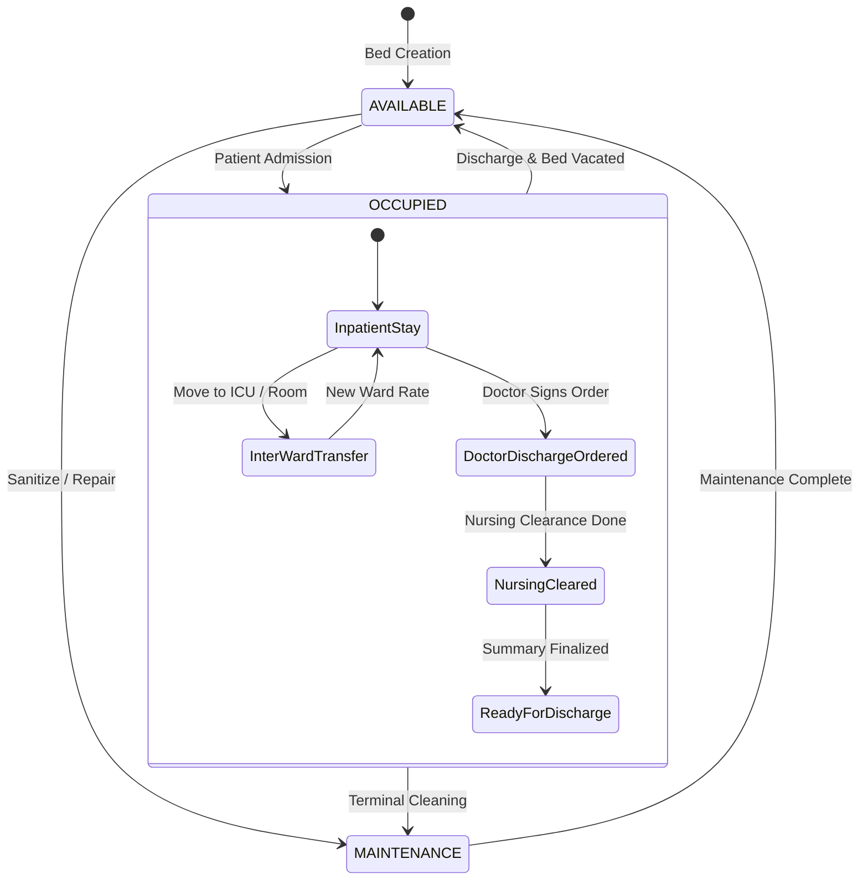
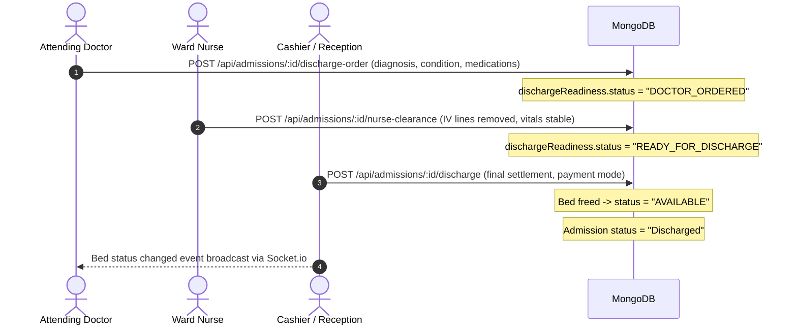

# Phase 15 — Bed, Room & ICU Management

## 1. Module Overview

The **Bed, Room & ICU Management** module governs the physical and operational inpatient infrastructure of the hospital. It handles bed inventory, ward zoning, real-time occupancy monitoring, patient admission lifecycles, inter-ward transfers, segmented facility billing, multi-shift nursing assignments, and multi-stage discharge clearance.

### Key Capabilities
- **Zoned Bed Inventory**: Granular categorization across General Wards, Semi-Private Rooms, Private Rooms, and Intensive Care Units (ICU).
- **Real-Time Occupancy Broadcasts**: Socket.io push notifications (`bed_status_changed`) dispatch instantly to ward stations upon admission, transfer, maintenance, or discharge.
- **Precision Time-Based Inpatient Billing**: Dynamic hourly vs. daily rate calculations with pro-rata stay accounting.
- **Inter-Ward Transfers**: Historical logging of patient movements with automatic segment billing per ward tariff.
- **Discharge Readiness Workflow**: Multi-role checklist ensuring both doctor sign-off and nursing clearance prior to financial billing settlement.

---

## 2. Inpatient Architecture & Lifecycle



---

## 3. Data Models & Schemas

### 3.1 Bed Model (`server/src/models/bed.model.js`)

```javascript
const bedSchema = new mongoose.Schema({
    hospitalId: { type: mongoose.Schema.Types.ObjectId, required: true },
    bedNumber: { type: String, required: true, trim: true },
    ward: { type: String, required: true, trim: true },
    bedType: { 
        type: String, 
        enum: ['General', 'ICU', 'Private', 'Semi-Private', 'Other'], 
        default: 'General' 
    },
    status: { 
        type: String, 
        enum: ['AVAILABLE', 'OCCUPIED', 'MAINTENANCE'], 
        default: 'AVAILABLE' 
    },
    currentPatient: { type: mongoose.Schema.Types.ObjectId, ref: 'User', default: null },
    currentAdmission: { type: mongoose.Schema.Types.ObjectId, ref: 'Admission', default: null }
}, { timestamps: true });

// Prevent duplicate bed numbers within the same hospital ward
bedSchema.index({ hospitalId: 1, ward: 1, bedNumber: 1 }, { unique: true });

// Cloud -> Local Sync Plugin
bedSchema.plugin(syncModelPlugin, { entityType: 'Bed' });
```

### 3.2 Admission Model (`server/src/models/admission.model.js`)

The `Admission` model orchestrates inpatient billing, clinical transfers, and discharge protocols:

```javascript
const admissionSchema = new mongoose.Schema({
    hospitalId: { type: mongoose.Schema.Types.ObjectId, required: true, index: true },
    patientId: { type: mongoose.Schema.Types.ObjectId, ref: 'User', required: true, index: true },
    appointmentId: { type: mongoose.Schema.Types.ObjectId, ref: 'Appointment' },
    doctorId: { type: mongoose.Schema.Types.ObjectId, ref: 'User' },
    admittedBy: { type: mongoose.Schema.Types.ObjectId, ref: 'User' },
    admissionDate: { type: Date, default: Date.now },
    admissionTime: { type: String, default: '' },
    dischargeDate: Date,
    dischargeTime: { type: String, default: '' },
    status: { type: String, enum: ['Admitted', 'Discharged'], default: 'Admitted' },
    ward: { type: String, default: 'IPD Ward' },
    bedNumber: { type: String, default: 'Pending Allocation' },
    bedId: { type: mongoose.Schema.Types.ObjectId, ref: 'Bed', required: false },
    wardRatePerDay: { type: Number, default: 0 },
    wardHourlyRate: { type: Number, default: 0 },
    
    // Audit of inter-ward movements
    transferHistory: [transferRecordSchema],
    
    // Nurse shifts and assignments
    assignedNurses: [nurseAssignmentSchema],
    
    // Multi-stage discharge checklist
    dischargeReadiness: {
        doctorDischargeOrdered: { type: Boolean, default: false },
        doctorDischargeDate: { type: Date },
        doctorDischargeDoctorId: { type: mongoose.Schema.Types.ObjectId, ref: 'User' },
        doctorDischargeNotes: { type: String, default: '' },
        nursingClearance: { type: Boolean, default: false },
        nursingClearedAt: { type: Date },
        nursingClearedBy: { type: mongoose.Schema.Types.ObjectId, ref: 'User' },
        nursingNotes: { type: String, default: '' },
        status: {
            type: String,
            enum: ['NOT_READY', 'DOCTOR_ORDERED', 'NURSING_CLEARED', 'READY_FOR_DISCHARGE'],
            default: 'NOT_READY'
        }
    },
    
    // Medical Discharge Summary
    dischargeSummary: dischargeSummarySchema,
    
    // Facility and room charges
    selectedFacilities: [{
        facilityName: { type: String, required: true },
        pricePerDay: { type: Number, required: true },
        hourlyRate: { type: Number, default: 0 },
        days: { type: Number, default: 0 },
        hours: { type: Number, default: 0 },
        durationText: { type: String, default: '' },
        totalAmount: { type: Number, required: true }
    }],
    totalAmount: { type: Number, default: 0 },
    paymentStatus: { type: String, enum: ['Pending', 'Paid'], default: 'Pending' },
    splitPayments: [{
        method: { type: String },
        amount: { type: Number, default: 0 }
    }],
    notes: String
}, { timestamps: true });
```

---

## 4. Inpatient Stay & Segment Billing Engine

### 4.1 Time Calculation Algorithm (`calculateStayAndAmount`)

Located in `server/src/routes/admission.routes.js`, this function accurately bills patient stays:

```javascript
const calculateStayAndAmount = (startDateTime, endDateTime, dailyRate) => {
    const start = new Date(startDateTime).getTime();
    const end = new Date(endDateTime).getTime();
    const diffMs = Math.max(0, end - start);
    
    // Compute total hours (minimum 0.5 hour)
    const totalHoursRaw = diffMs / (1000 * 60 * 60);
    const totalHours = Math.max(0.5, Math.round(totalHoursRaw * 10) / 10);
    
    const ratePerDay = Number(dailyRate) || 0;
    const hourlyRate = Math.round((ratePerDay / 24) * 100) / 100;
    
    const fullDays = Math.floor(totalHours / 24);
    const remainingHours = Math.round((totalHours % 24) * 10) / 10;
    
    let durationText = '';
    let amount = 0;

    if (totalHours < 24) {
        // Less than 24 hours: billed by exact hours
        const billedHrs = Math.max(1, Math.round(totalHours));
        durationText = `${billedHrs} Hour${billedHrs > 1 ? 's' : ''}`;
        amount = Math.round(billedHrs * (ratePerDay / 24));
    } else {
        // 24 hours or more: billed by full days + remaining hours
        if (remainingHours >= 0.5) {
            const remHrsRound = Math.round(remainingHours);
            durationText = `${fullDays} Day${fullDays > 1 ? 's' : ''} ${remHrsRound} Hr${remHrsRound > 1 ? 's' : ''}`;
            amount = Math.round((fullDays * ratePerDay) + (remHrsRound * (ratePerDay / 24)));
        } else {
            durationText = `${fullDays} Day${fullDays > 1 ? 's' : ''}`;
            amount = Math.round(fullDays * ratePerDay);
        }
    }

    return { totalHours, fullDays, remainingHours, durationText, amount, hourlyRate };
};
```

### 4.2 Inter-Ward Transfer Segment Accounting

When a patient moves (e.g., from General Ward to ICU):
1. **Closing Previous Ward Segment**: The duration stayed in the origin ward is calculated using `calculateStayAndAmount`.
2. **Transfer Record Appended**: Stored in `transferHistory` with `durationHours`, `durationDays`, `segmentAmount`, and `transferredBy`.
3. **Bed State Swapping**:
   - Origin bed reverts to `AVAILABLE` (or `MAINTENANCE` for sanitization).
   - Target bed transitions to `OCCUPIED` with `currentPatient` and `currentAdmission` linked.
4. **Current Admission Updated**: `ward`, `bedNumber`, `bedId`, `wardRatePerDay`, and `admissionDate` are updated to reflect the new ward stay start time.

---

## 5. Multi-Stage Discharge Protocol



### 5.1 Discharge Summary Document Schema

The doctor authors the clinical discharge record directly in the system (`dischargeSummarySchema`):
- `diagnosis`: Primary admitting and discharge diagnoses.
- `admissionReason` & `hospitalCourse`: Progression of illness during hospitalization.
- `proceduresSummary` & `keyInvestigationsSummary`: Diagnostic findings, imaging, surgeries performed.
- `conditionAtDischarge`: `['STABLE', 'IMPROVED', 'RECOVERED', 'CRITICAL', 'TRANSFERRED', 'LAMA', 'EXPIRED']`.
- `dischargeMedications`: Structured medication schedule (Drug, Dosage, Route, Frequency, Duration, Instructions).
- `followUpDate` & `followUpInstructions`.
- `status`: `DRAFT` or `FINALIZED` (digitally signed by Doctor).

---

## 6. API Endpoints Catalog

### 6.1 Bed Endpoints (`server/src/routes/bed.routes.js`)

| Method | Endpoint | Authorization | Description |
| :--- | :--- | :--- | :--- |
| `GET` | `/api/beds` | Staff (`verifyToken`) | Lists all beds for hospital; supports `?ward=` and `?status=` filters. |
| `POST` | `/api/beds` | Admin / OT Staff | Provisions a new bed (`bedNumber`, `ward`, `bedType`). |
| `PUT` | `/api/beds/:id` | Admin / OT Staff | Updates bed properties or sets status to `MAINTENANCE`. |
| `DELETE` | `/api/beds/:id` | Admin / OT Staff | Deletes an unassigned bed (Blocked if `status === 'OCCUPIED'`). |

### 6.2 Admission & IPD Endpoints (`server/src/routes/admission.routes.js`)

| Method | Endpoint | Authorization | Description |
| :--- | :--- | :--- | :--- |
| `GET` | `/api/admissions` | IPD Staff | Fetches hospital admissions with patient and bed population. |
| `POST` | `/api/admissions` | Reception / Admin | Admits a patient, assigns bed, updates bed status to `OCCUPIED`. |
| `POST` | `/api/admissions/:id/transfer` | Reception / Nurse | Transfers patient to a new bed/ward, records segment cost. |
| `POST` | `/api/admissions/:id/nurse-assign` | Head Nurse / Admin | Assigns staff nurse to patient admission for specified shift. |
| `POST` | `/api/admissions/:id/discharge-order` | Doctor | Records physician discharge order and draft discharge summary. |
| `POST` | `/api/admissions/:id/nurse-clearance` | Nurse | Records nursing clearance checklist. |
| `POST` | `/api/admissions/:id/discharge` | Reception / Cashier | Finalizes billing, settles charges, vacates bed, marks `Discharged`. |

---

## 7. Real-Time WebSockets Integration

Whenever a bed is created, updated, allocated, or vacated:
```javascript
const io = req.app.get('io');
if (io) {
    io.to(`hospital_${hospitalId}`).emit('bed_status_changed', {
        bedId: bed._id,
        status: bed.status,
        ward: bed.ward,
        bedNumber: bed.bedNumber,
        timestamp: new Date()
    });
}
```
All connected ward monitoring consoles update immediately without requiring manual browser reloads.

