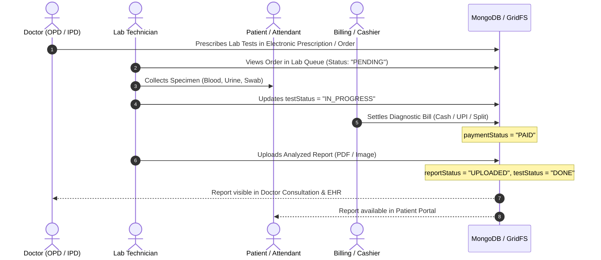

# Phase 16 — Laboratory Management

## 1. Module Overview

The **Laboratory Management** module handles diagnostic order intake, global and hospital-scoped test catalogs, pricing overrides, specimen processing lifecycles, digital report document generation and storage, and billing reconciliation.

### Core Capabilities
- **Hybrid Test Catalog**: Master standard diagnostic test catalog (Central Admin managed) combined with hospital-specific custom test creation.
- **Dynamic Price Overrides**: Hospitals can override the default prices of global tests without modifying the global master catalog.
- **Diagnostic Workflow Lifecycle**: End-to-end status tracking from doctor order to specimen collection, analysis, report upload, and patient notification.
- **Digital Document Archival**: Storage of lab reports with secure cloud URLs and direct integration into patient electronic health records (EHR).
- **Flexible POS Lab Billing**: Full payment handling including Cash, Card, UPI, and Split Payment modes.

---

## 2. Laboratory Workflow Lifecycle



---

## 3. Data Models & Schemas

### 3.1 Lab Center Model (`server/src/models/lab.model.js`)

Defines physical laboratory facilities and operating hours:

```javascript
const labSchema = new mongoose.Schema({
  userId: { type: mongoose.Schema.Types.ObjectId, ref: 'User', index: true },
  hospitalId: { type: mongoose.Schema.Types.ObjectId, ref: 'Hospital', index: true },
  name: { type: String, required: [true, 'Lab name is required'] },
  email: { type: String, required: true, lowercase: true, trim: true },
  phone: { type: String, required: true },
  address: { type: String, default: '' },
  services: [{ type: String }],
  availability: {
    monday: { available: Boolean, startTime: String, endTime: String },
    tuesday: { available: Boolean, startTime: String, endTime: String },
    wednesday: { available: Boolean, startTime: String, endTime: String },
    thursday: { available: Boolean, startTime: String, endTime: String },
    friday: { available: Boolean, startTime: String, endTime: String },
    saturday: { available: Boolean, startTime: String, endTime: String },
    sunday: { available: Boolean, startTime: String, endTime: String }
  },
  description: { type: String, default: '' },
  facilities: [{ type: String }]
}, { timestamps: true });
```

### 3.2 Diagnostic Test Catalog Model (`server/src/models/labTest.model.js`)

Governs diagnostic test metadata, codes, standard pricing, and tenant-level overrides:

```javascript
const labTestSchema = new mongoose.Schema({
    name: { type: String, required: true, trim: true },
    hospitalId: {
        type: mongoose.Schema.Types.ObjectId,
        ref: 'Hospital',
        default: null // null indicates Global Master Catalog Test
    },
    code: { type: String, trim: true, default: '' },
    description: { type: String, default: '' },
    price: { type: Number, default: 0 },
    category: { type: String, default: 'General' },
    isActive: { type: Boolean, default: true },
    hospitalPrices: {
        type: Map,
        of: Number,
        default: {} // Key: Hospital ObjectId string, Value: Customized Price
    }
}, { timestamps: true });
```

### 3.3 Diagnostic Report Order Model (`server/src/models/labReport.model.js`)

Manages individual patient diagnostic orders, execution milestones, and file attachments:

```javascript
const labReportSchema = new mongoose.Schema({
  appointmentId: { type: mongoose.Schema.Types.ObjectId, ref: 'Appointment', required: true, index: true },
  patientId: { type: String, required: true }, // Formatted ID e.g. P-101
  userId: { type: mongoose.Schema.Types.Mixed, ref: 'User', required: true },
  doctorId: { type: mongoose.Schema.Types.ObjectId, ref: 'User', required: true },
  hospitalId: { type: mongoose.Schema.Types.ObjectId, ref: 'Hospital', index: true },
  labId: { type: mongoose.Schema.Types.ObjectId, ref: 'Lab' },
  testNames: [{ type: String, required: true }],
  testStatus: {
    type: String,
    enum: ['PENDING', 'IN_PROGRESS', 'DONE'],
    default: 'PENDING',
    index: true
  },
  reportStatus: {
    type: String,
    enum: ['PENDING', 'UPLOADED'],
    default: 'PENDING'
  },
  paymentStatus: {
    type: String,
    enum: ['PENDING', 'PAID'],
    default: 'PENDING',
    index: true
  },
  splitPayments: [{
    method: { type: String },
    amount: { type: Number, default: 0 }
  }],
  paymentMode: {
    type: String,
    enum: ['CASH', 'ONLINE', 'UPI', 'CARD', 'NONE'],
    default: 'NONE'
  },
  amount: { type: Number, default: 0 },
  reportFile: {
    url: String,
    fileId: String,
    name: String,
    uploadedAt: Date
  },
  notes: { type: String, default: '' }
}, { timestamps: true });

// Performance indexes
labReportSchema.index({ hospitalId: 1, userId: 1, createdAt: -1 });
labReportSchema.index({ hospitalId: 1, testStatus: 1, createdAt: -1 });
labReportSchema.index({ hospitalId: 1, paymentStatus: 1 });
```

---

## 4. Price Resolution Engine

When lab tests are retrieved by staff or displayed during order entry:

```javascript
// Effective Price Calculation in server/src/routes/labTest.routes.js
if (hospitalId) {
    const hid = hospitalId.toString();
    labTests.forEach(test => {
        const hospitalPrice = test.hospitalPrices && test.hospitalPrices[hid];
        test.effectivePrice = hospitalPrice !== undefined ? hospitalPrice : test.price;
    });
} else {
    labTests.forEach(test => {
        test.effectivePrice = test.price;
    });
}
```

1. **Custom Hospital Test**: If `hospitalId === currentHospitalId`, the test's `price` is used.
2. **Master Test with Hospital Override**: If `hospitalId === null` and `test.hospitalPrices[hospitalId]` is defined, the custom override takes precedence.
3. **Master Test Standard Price**: If no override exists, the baseline `test.price` applies.

---

## 5. API Endpoints Catalog

### 5.1 Lab Test Catalog Endpoints (`server/src/routes/labTest.routes.js`)

| Method | Endpoint | Authorization | Description |
| :--- | :--- | :--- | :--- |
| `GET` | `/api/lab-tests` | Authenticated Staff | Fetches tests (merges global tests + hospital-specific tests, computes `effectivePrice`). |
| `POST` | `/api/lab-tests` | Admin / Super Admin | Adds new test. Global if created by Super Admin; hospital-scoped if created by Hospital Admin. |
| `PUT` | `/api/lab-tests/:id` | Admin / Super Admin | Updates test properties or updates hospital price override in `hospitalPrices`. |
| `DELETE` | `/api/lab-tests/:id` | Admin / Super Admin | Deletes hospital custom test or deactivates global test. |

### 5.2 Diagnostic Report Endpoints (`server/src/routes/lab.routes.js`)

| Method | Endpoint | Authorization | Description |
| :--- | :--- | :--- | :--- |
| `GET` | `/api/labs/reports` | Lab Tech / Doctor / Admin | Lists diagnostic report orders; supports filtering by `testStatus` and `paymentStatus`. |
| `POST` | `/api/labs/reports` | Doctor / Reception | Creates a lab test order linked to an appointment and patient. |
| `PUT` | `/api/labs/reports/:id/status` | Lab Tech | Transitions status from `PENDING` to `IN_PROGRESS` or `DONE`. |
| `POST` | `/api/labs/reports/:id/upload` | Lab Tech | Uploads analyzed report document (PDF/Image) to cloud storage and links metadata. |
| `POST` | `/api/labs/reports/:id/payment` | Cashier / Reception | Records diagnostic fee collection and updates `paymentStatus` to `PAID`. |
| `GET` | `/api/labs/reports/patient/:patientId` | Doctor / Patient | Returns historical lab investigations for a specific patient. |

---

## 6. Doctor & AI Clinical Integration

1. **Electronic Prescriptions**: When doctors order lab investigations in the OPD Consultation interface, diagnostic line items automatically appear in the laboratory queue.
2. **AI Report Extraction**: Uploaded lab reports (scans, PDFs) can be passed directly to the **AI Module** (`extractReportText` and `generateReportSummary`), which automatically reads abnormal biomarker values (e.g., Hemoglobin, HbA1c, Creatinine) and flags clinical anomalies for the attending physician.

