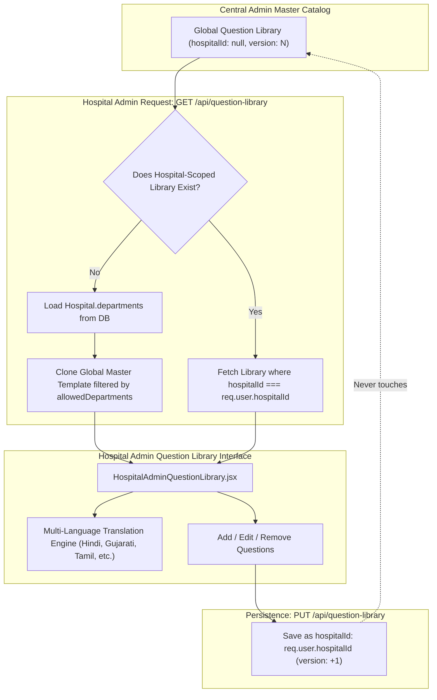
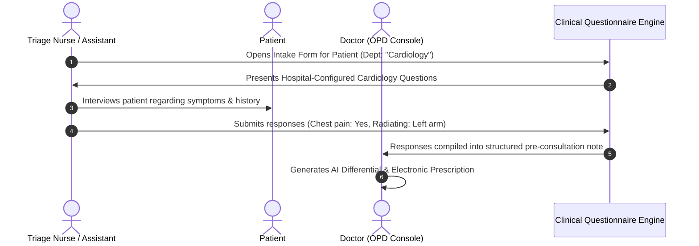

# Phase 17 — Hospital Question Library

## 1. Module Overview

The **Hospital Question Library** module provides hospital administrators with the ability to tailor clinical intake forms, pre-consultation questionnaires, and department-specific assessments to their institution's unique diagnostic standards.

While Central Admin maintains the **Global Master Question Library** (documented in Phase 3), the hospital-level module operates under strict tenant isolation:
- **Specialty Scoping**: A hospital admin can only view and manage question templates for departments actively assigned to their facility (`Hospital.departments`).
- **Copy-on-Write Tenant Isolation**: Modifications made by a hospital admin never alter the global template. Instead, they are persisted to a hospital-scoped record (`hospitalId: req.user.hospitalId`).
- **Clinical Integration**: Doctor assistants and triage nurses utilize these questionnaires during outpatient intake, instantly structuring the patient's chief complaints into the doctor's consultation view.

---

## 2. Architecture & Tenant Scoping Workflow



---

## 3. Data Schema & Question Topology

Question structures follow a nested department-and-category hierarchy stored within the `QuestionLibrary` model:

```typescript
interface QuestionItem {
    q: string;                        // Clinical query text
    type: 'text' | 'textarea' | 'yes-no' | 'select' | 'checkbox-group';
    options?: string;                 // Comma-separated options for select / checkbox
    extra?: string;                   // Placeholder or clinical helper note
    parentQ?: string;                 // Parent question trigger for conditional visibility
    condition?: string;               // Conditional matching value (e.g. "Yes")
}

interface HospitalQuestionLibraryData {
    [departmentName: string]: {
        [categoryName: string]: QuestionItem[];
    };
}
```

### 3.1 Conditional Branching Logic
Questions support conditional dependency:
- A secondary question can define `parentQ: "Do you have a history of diabetes?"` and `condition: "Yes"`.
- During patient intake, the secondary input (e.g., "Duration in years & current insulin dosage") remains hidden until the parent question evaluates to "Yes".

---

## 4. Backend Isolation Logic (`server/src/routes/questionLibrary.routes.js`)

```javascript
// Fetch Library with Hospital-Specific Isolation
router.get('/', verifyToken, async (req, res) => {
    try {
        const hospitalId = req.user.hospitalId || null;
        let library = null;

        if (hospitalId) {
            // 1. Search for hospital-specific custom library
            library = await QuestionLibrary.findOne({ hospitalId }).sort({ version: -1 });
        }

        let allowedDepartments = null;
        if (hospitalId) {
            const hospital = await Hospital.findById(hospitalId);
            if (hospital && hospital.departments && hospital.departments.length > 0) {
                allowedDepartments = hospital.departments;
            } else {
                allowedDepartments = ['General'];
            }
        }

        // 2. If no hospital library exists, fallback to Global Master Template
        if (!library) {
            library = await QuestionLibrary.findOne({ hospitalId: null }).sort({ version: -1 });
        }

        // 3. Filter departments strictly to allowedDepartments for hospital staff
        if (hospitalId && library && library.data) {
            const targetDepts = (allowedDepartments && allowedDepartments.length > 0)
                ? allowedDepartments
                : ['General'];

            const filteredData = {};
            targetDepts.forEach(dept => {
                if (library.data[dept]) {
                    filteredData[dept] = library.data[dept];
                } else {
                    filteredData[dept] = { "General Intake": [] };
                }
            });
            library = { ...library.toObject(), data: filteredData };
        }

        res.json({ success: true, data: library, allowedDepartments });
    } catch (err) {
        res.status(500).json({ success: false, message: 'Error retrieving question library' });
    }
});
```

---

## 5. Frontend Features (`HospitalAdminQuestionLibrary.jsx`)

1. **In-Memory Zero-Lag Caching**:
   - Uses module-level cached variables (`cachedQuestionLibraryData`, `cachedAllowedDepartments`) to eliminate reload delays when switching between dashboard tabs.
2. **Department Filtering Tabs**:
   - Automatically renders tabs for all `allowedDepartments` (e.g., General, ENT, Cardiology, Pediatrics, Ophthalmology).
3. **Multi-Language Support**:
   - Integrates `LanguageSelector` and `questionLibraryI18n.js` providing instant UI and questionnaire localization across Indian regional languages (Hindi, Bengali, Marathi, Gujarati, Tamil, Telugu, Kannada, Malayalam, Odia, Punjabi).
4. **Live Intake Preview**:
   - Administrators can test the questionnaire in an interactive preview modal (`showPreview`) that mirrors the real-time doctor assistant intake workflow.

---

## 6. Doctor Assistant & Clinical Workflow



This ensures clinical documentation is standardized across the hospital while respecting department-specific requirements.

