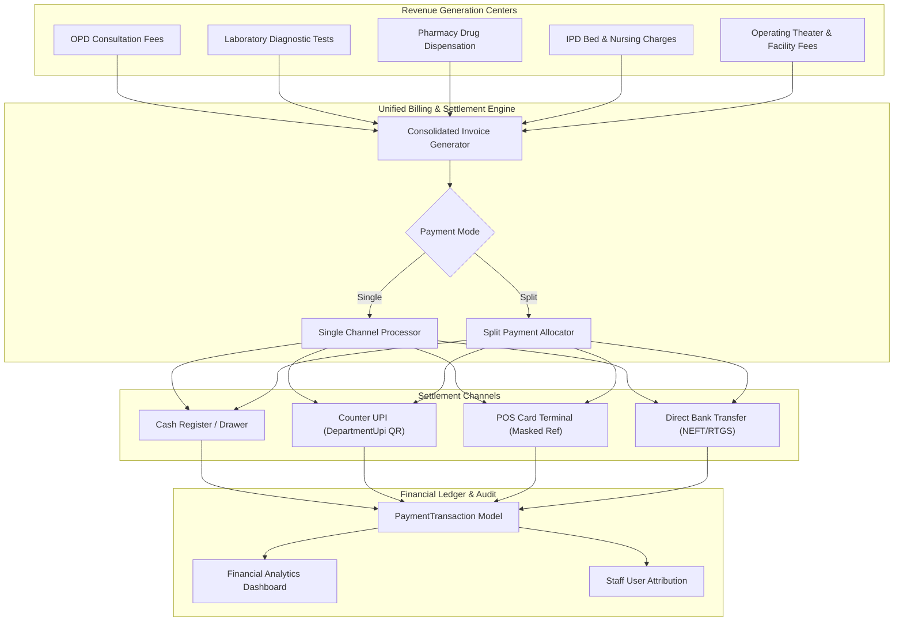

# Phase 18 — Accounts & Payment Management

## 1. Module Overview

The **Accounts and Payment Management** module unifies financial tracking, point-of-sale (POS) billing, multi-tender transactions, counter-specific digital collections, and revenue analytics across all hospital operational units.

### Core Capabilities
- **Multi-Tender & Split Payments**: Patients can settle single invoices using mixed payment channels (e.g., ₹2,000 Cash + ₹3,000 UPI).
- **Decentralized Department UPI Collections**: Dedicated UPI IDs and dynamic QR codes assigned to specific cashier desks, receptionists, or pharmacy counters.
- **Unified Billing Profile**: Aggregates all outpatient consultations, laboratory tests, pharmacy orders, bed occupancy, and facility charges into a consolidated patient statement.
- **Financial Analytics Dashboard**: Real-time monitoring of gross revenue, department collections, medicine profit margins, and pending dues.
- **Strict Role-Based Auditing**: Immutable audit trails identifying the exact staff member, workstation, and timestamp for every collected payment.

---

## 2. Financial Architecture & Payment Flow



---

## 3. Data Models & Schemas

### 3.1 Payment Transaction Model (`server/src/models/paymentTransaction.model.js`)

```javascript
const paymentTransactionSchema = new mongoose.Schema({
    hospitalId: { type: mongoose.Schema.Types.ObjectId, ref: 'Hospital', index: true },
    patientId: { type: mongoose.Schema.Types.ObjectId, ref: 'User', required: true, index: true },
    paymentMode: { type: String, default: 'Cash' }, // 'Cash', 'UPI', 'Card', 'Split'
    paymentStatus: { 
        type: String, 
        enum: ['Pending', 'Paid', 'Failed', 'Refunded'], 
        default: 'Paid' 
    },
    amount: { type: Number, required: true, default: 0 },
    
    // Multi-Tender Split Payments
    splitPayments: [{
        method: { type: String }, // e.g. "Cash", "UPI", "Card"
        amount: { type: Number, default: 0 }
    }],
    
    // Settlement Metadata
    transactionId: { type: String, default: '' },
    upiId: { type: String, default: '' },
    cardDetails: { type: String, default: '' }, // Masked (e.g. "VISA-****-1234")
    bankReference: { type: String, default: '' },
    paymentDate: { type: Date, default: Date.now },
    appointmentTime: { type: String, default: '' },
    
    // Digital Proof / Receipt Slip
    proofUrl: { type: String, default: '' },
    proofFileId: { type: String, default: '' },
    
    // Itemized Cross-Module Billing References
    description: { type: String, default: '' },
    billedItems: {
        appointments: [{ type: mongoose.Schema.Types.ObjectId, ref: 'Appointment' }],
        labReports: [{ type: mongoose.Schema.Types.ObjectId, ref: 'LabReport' }],
        pharmacyOrders: [{ type: mongoose.Schema.Types.ObjectId, ref: 'PharmacyOrder' }],
        facilityCharges: [{ type: mongoose.Schema.Types.ObjectId, ref: 'FacilityCharge' }],
        admissions: [{ type: mongoose.Schema.Types.ObjectId, ref: 'Admission' }]
    },
    
    addedBy: { type: mongoose.Schema.Types.ObjectId, ref: 'User' }
}, { timestamps: true });
```

### 3.2 Department UPI Model (`server/src/models/departmentUpi.model.js`)

Manages counter-specific digital collection points:

```javascript
const departmentUpiSchema = new mongoose.Schema({
    hospitalId: { type: mongoose.Schema.Types.ObjectId, ref: 'Hospital', required: true, index: true },
    staffUserId: { type: mongoose.Schema.Types.ObjectId, ref: 'User', required: true },
    staffRoleName: { type: String, required: true, trim: true }, // e.g. "Reception", "Pharmacy"
    upiId: { type: String, required: true, trim: true },        // e.g. "hospital.desk1@icici"
    label: { type: String, required: true, trim: true },        // e.g. "OPD Desk 1 QR"
    isActive: { type: Boolean, default: true },
    createdBy: { type: mongoose.Schema.Types.ObjectId, ref: 'User', default: null }
}, { timestamps: true });

// Enforce single active UPI per staff member per hospital
departmentUpiSchema.index({ hospitalId: 1, staffUserId: 1 }, { unique: true });
departmentUpiSchema.index({ hospitalId: 1, upiId: 1 }, { unique: true });
```

---

## 4. Financial Dashboard & Revenue Analytics

### 4.1 Analytics Aggregator (`server/src/routes/finance.routes.js`)

The financial analytics engine aggregates performance metrics across all billing units:

```javascript
router.get('/dashboard', verifyFinanceAccess, async (req, res) => {
    // 1. Enforce strict hospital isolation for non-superadmin callers
    let targetHospitalId = req.user.hospitalId?.toString();
    if (['superadmin', 'centraladmin'].includes(req.user.role?.toLowerCase())) {
        targetHospitalId = req.query.hospitalId || targetHospitalId;
    }

    // 2. Parallel aggregation across Revenue Streams
    const [consultationStats, labStats, pharmacyStats] = await Promise.all([
        // Consultations: Count and sum of paid appointments
        Appointment.aggregate([
            { $match: { hospitalId: targetHospitalId, paymentStatus: 'Paid', ...dateFilter } },
            { $group: { _id: null, total: { $sum: '$amount' }, count: { $sum: 1 } } }
        ]),
        // Laboratory: Count and sum of paid diagnostic reports
        LabReport.aggregate([
            { $match: { hospitalId: targetHospitalId, paymentStatus: 'PAID', ...dateFilter } },
            { $group: { _id: null, total: { $sum: '$amount' }, count: { $sum: 1 } } }
        ]),
        // Pharmacy: Drug sales, COGS (Cost of Goods Sold), and Gross Profit Margin
        PharmacyOrder.aggregate([
            { $match: { hospitalId: targetHospitalId, paymentStatus: 'Paid', ...dateFilter } },
            { $group: { 
                _id: null, 
                revenue: { $sum: '$totalAmount' }, 
                cost: { $sum: '$totalCost' }, 
                profit: { $sum: { $subtract: ['$totalAmount', '$totalCost'] } } 
            }}
        ])
    ]);

    res.json({
        success: true,
        data: {
            totalRevenue: (consultationStats[0]?.total || 0) + (labStats[0]?.total || 0) + (pharmacyStats[0]?.revenue || 0),
            consultations: consultationStats[0] || { count: 0, revenue: 0 },
            labTests: labStats[0] || { count: 0, revenue: 0 },
            medicines: pharmacyStats[0] || { count: 0, revenue: 0, cost: 0, profit: 0 }
        }
    });
});
```

---

## 5. API Endpoints Catalog

### 5.1 Payment & Settlement Endpoints

| Method | Endpoint | Authorization | Description |
| :--- | :--- | :--- | :--- |
| `POST` | `/api/finance/payments` | Cashier / Reception | Records a new payment transaction with single or split tender. |
| `GET` | `/api/finance/payments/patient/:id` | Cashier / Accountant | Fetches complete transaction history for a specific patient. |
| `GET` | `/api/finance/dashboard` | Accountant / Admin | Returns aggregated financial KPIs, revenue breakdown, and profit figures. |
| `GET` | `/api/hospitals/department-upis` | Cashier / Reception | Retrieves active department UPI IDs to dynamically render counter QR codes. |
| `POST` | `/api/hospitals/department-upis` | `hospitaladmin` | Adds a new staff-linked UPI collection account. |
| `PUT` | `/api/hospitals/department-upis/:id` | `hospitaladmin` | Activates or deactivates a counter UPI. |
| `DELETE` | `/api/hospitals/department-upis/:id` | `hospitaladmin` | Deletes a counter UPI mapping. |

---

## 6. Patient Billing Profile & Invoice Generation

In the frontend (`client/src/pages/billing/PatientBillingProfile.jsx`), staff can generate branded, printable hospital bills:
- **Header**: Hospital White-Label Logo, Name, Address, GSTIN, and Registration Numbers.
- **Patient Banner**: MRN, Patient Name, Age, Gender, Contact Number, Attending Doctor.
- **Itemized Ledger**: Consultations, Prescribed Medicines, Diagnostic Tests, Bed Days, and Procedures listed with unit rates and quantities.
- **Settlement Summary**: Subtotal, Package Discounts, Taxes, Total Payable, Total Paid, and Outstanding Balance.
- **Payment Breakdown**: Displays split details (e.g., "Cash: ₹500, UPI Ref 402939102: ₹1,500").

