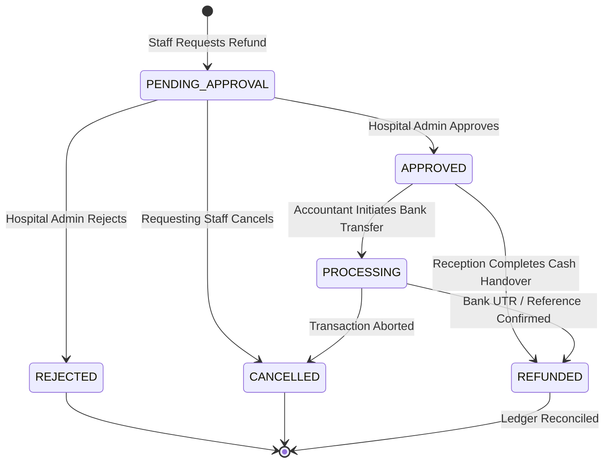
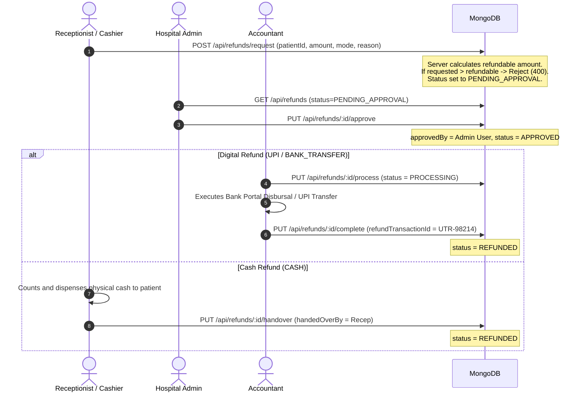

# Phase 20 — Refund Management

## 1. Module Overview

The **Refund Management** module provides an auditable, multi-stage financial return mechanism designed to prevent duplicate disbursements, enforce strict role segregation, and maintain institutional ledger integrity.

### Core Safeguards
- **Strict Financial Invariant**: Refunds are programmatically restricted to unconsumed credit:
  $$\text{Refundable Amount} = \text{Total Paid} - \text{Total Consumed Charges} - \text{Already Refunded}$$
  The server calculates this value directly; client-submitted refundable balances are never trusted.
- **Role Segregation (Separation of Duties)**:
  - **Initiation**: Receptionists or Cashiers request a refund.
  - **Approval**: Only the **Hospital Administrator** can approve or reject refund requests.
  - **Execution (UPI / Bank)**: Only the **Accountant** can disburse digital refunds and record bank reference / UTR numbers.
  - **Execution (Cash)**: Only **Reception / Cashier** can record cash handover.
- **Race Condition Prevention**: Optimistic concurrency control via Mongoose version keys (`__v`) guarantees that simultaneous processing attempts fail safely.

---

## 2. Refund Request Lifecycle State Machine



---

## 3. Data Model (`server/src/models/refundRequest.model.js`)

```javascript
const refundRequestSchema = new mongoose.Schema({
    hospitalId: { type: mongoose.Schema.Types.ObjectId, ref: 'Hospital', required: true, index: true },
    patientId: { type: mongoose.Schema.Types.ObjectId, ref: 'User', required: true, index: true },
    patientName: { type: String, default: '' },
    patientMRN: { type: String, default: '' },

    // Server-verified financial snapshot
    originalPaymentId: { type: mongoose.Schema.Types.ObjectId, ref: 'PaymentTransaction', default: null },
    originalPaymentAmount: { type: Number, default: 0 },
    totalCharges: { type: Number, default: 0 },
    totalPaid: { type: Number, default: 0 },
    alreadyRefunded: { type: Number, default: 0 },
    refundableAmount: { type: Number, default: 0 },

    // Refund specifics
    refundAmount: {
        type: Number,
        required: true,
        min: [0.01, 'Refund amount must be positive']
    },
    refundMode: {
        type: String,
        required: true,
        enum: ['CASH', 'UPI', 'BANK_TRANSFER']
    },
    reason: { type: String, default: '' },

    // Status lifecycle
    status: {
        type: String,
        enum: ['PENDING_APPROVAL', 'APPROVED', 'PROCESSING', 'REFUNDED', 'REJECTED', 'CANCELLED'],
        default: 'PENDING_APPROVAL',
        index: true
    },

    // Transaction reconciliation references
    originalTransactionId: { type: String, default: '' },
    refundTransactionId: { type: String, default: '' }, // UTR / Bank reference
    processingNotes: { type: String, default: '' },

    // Comprehensive multi-role audit trail
    requestedBy: { type: mongoose.Schema.Types.ObjectId, ref: 'User', required: true },
    requestedByName: { type: String, default: '' },
    requestedAt: { type: Date, default: Date.now },

    approvedBy: { type: mongoose.Schema.Types.ObjectId, ref: 'User', default: null },
    approvedByName: { type: String, default: '' },
    approvedAt: { type: Date, default: null },

    rejectedBy: { type: mongoose.Schema.Types.ObjectId, ref: 'User', default: null },
    rejectedByName: { type: String, default: '' },
    rejectedAt: { type: Date, default: null },
    rejectionReason: { type: String, default: '' },

    processedBy: { type: mongoose.Schema.Types.ObjectId, ref: 'User', default: null },
    processedByName: { type: String, default: '' },
    processedAt: { type: Date, default: null },

    handedOverBy: { type: mongoose.Schema.Types.ObjectId, ref: 'User', default: null },
    handedOverByName: { type: String, default: '' },
    handedOverAt: { type: Date, default: null },

    cancelledBy: { type: mongoose.Schema.Types.ObjectId, ref: 'User', default: null },
    cancelledAt: { type: Date, default: null },
    cancellationReason: { type: String, default: '' }
}, {
    timestamps: true,
    optimisticConcurrency: true // Enforce __v locking against double-spending
});
```

---

## 4. End-to-End Processing Workflow



---

## 5. API Endpoints Catalog (`server/src/routes/refund.routes.js`)

| Method | Endpoint | Authorization | Description |
| :--- | :--- | :--- | :--- |
| `POST` | `/api/refunds/request` | Reception / Accountant / Admin | Initiates a refund request; validates available balance. |
| `GET` | `/api/refunds` | Reception / Accountant / Admin | Lists refund requests with optional filters (`status`, `patientId`). |
| `GET` | `/api/refunds/patient/:patientId/balance` | Reception / Accountant | Queries true server-calculated refundable amount for a patient. |
| `PUT` | `/api/refunds/:id/approve` | `hospitaladmin` | Approves pending refund request. |
| `PUT` | `/api/refunds/:id/reject` | `hospitaladmin` | Rejects refund request with reason note. |
| `PUT` | `/api/refunds/:id/process` | Accountant | Marks digital refund as in-progress. |
| `PUT` | `/api/refunds/:id/complete` | Accountant | Finalizes digital refund with UTR/bank reference. |
| `PUT` | `/api/refunds/:id/handover` | Reception / Cashier | Finalizes cash refund upon physical currency delivery. |
| `PUT` | `/api/refunds/:id/cancel` | Initiating User / Admin | Cancels pre-refunded request. |

---

## 6. Audit Trail & Integrity Assurances

1. **Anti-Tampering Immutability**:
   Once a refund transitions to `REFUNDED`, its status and financial amounts are permanently locked.
2. **Double-Spend Protection**:
   `optimisticConcurrency: true` ensures that if two accountants concurrently attempt to finalize the same refund, one transaction succeeds while the second fails with a version conflict error.
3. **Ledger Consistency**:
   Finalized refunds automatically update the patient's billing profile, deducting the refunded amount from the overall paid ledger.

