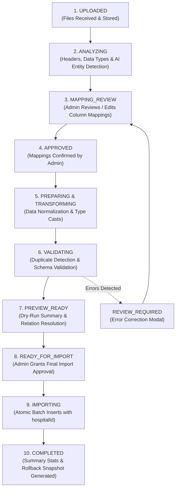

# Phase 22 — Data Migration & Legacy Import Engine

## 1. Module Overview

The **Data Migration & Legacy Import Engine** provides hospital implementation teams with an enterprise-grade ingestion pipeline for migrating legacy Electronic Medical Record (EMR) and Hospital Information System (HIS) data into Medical365.

### Key Capabilities
- **Multi-Format Ingestion**: Supports `.csv`, `.xls`, `.xlsx`, and `.json` source files up to hundreds of thousands of records.
- **AI-Assisted Entity Detection**: Automatically analyzes column headers and data distributions to identify target entity types (Patients, Doctors, Staff, Lab Tests, Medicines, Appointments).
- **Intelligent Field Mapping**: Proposes automated column mappings with confidence ratings (`HIGH`, `MEDIUM`, `LOW`), supporting Direct, Combined (e.g., First Name + Last Name), and Custom Field mappings.
- **Duplicate & Anomaly Detection**: Identifies prospective duplicates using multi-attribute fingerprinting (Phone, Email, Government ID / Aadhaar, Patient MRN).
- **Relational Dependency Resolution**: Resolves foreign-key relationships across separate imported files (e.g., matching legacy Doctor Name in an appointments file with the imported Doctor User ID).
- **Dry-Run Validation & Rollback**: Comprehensive preview simulation and one-click rollback mechanism preventing partial or corrupted data imports.

---

## 2. Ingestion Pipeline & State Machine



---

## 3. Data Model (`server/src/models/migrationSession.model.js`)

```javascript
const migrationSessionSchema = new mongoose.Schema({
    migrationId: { type: String, required: true, trim: true, index: true },
    hospitalId: { type: mongoose.Schema.Types.ObjectId, ref: 'Hospital', required: true, index: true },
    createdBy: { type: mongoose.Schema.Types.ObjectId, ref: 'User', required: true },
    createdByName: { type: String, default: 'Hospital Admin' },
    status: {
        type: String,
        enum: [
            'UPLOADED', 'ANALYZING', 'MAPPING_REVIEW', 'APPROVED',
            'PREPARING', 'TRANSFORMING', 'VALIDATING',
            'PREVIEW_READY', 'REVIEW_REQUIRED', 'READY_FOR_IMPORT',
            'IMPORTING', 'VERIFYING', 'COMPLETED', 'COMPLETED_WITH_WARNINGS', 'FAILED'
        ],
        default: 'UPLOADED',
        index: true
    },
    files: [fileMetaSchema],
    detectedEntities: [{ type: String }],
    mappings: [mappingItemSchema],
    customFields: [customFieldSchema],
    summary: {
        totalFiles: { type: Number, default: 0 },
        totalEntities: { type: Number, default: 0 },
        totalFields: { type: Number, default: 0 },
        mappedFields: { type: Number, default: 0 },
        needsReviewFields: { type: Number, default: 0 },
        customFields: { type: Number, default: 0 },
        ignoredFields: { type: Number, default: 0 },
        warningsCount: { type: Number, default: 0 },
        errorsCount: { type: Number, default: 0 }
    },
    previewSummary: {
        totalRecords: { type: Number, default: 0 },
        validRecords: { type: Number, default: 0 },
        warningRecords: { type: Number, default: 0 },
        errorRecords: { type: Number, default: 0 },
        duplicateRecords: { type: Number, default: 0 },
        skippedRecords: { type: Number, default: 0 },
        entitiesBreakdown: [{
            entity: { type: String },
            totalRecords: { type: Number, default: 0 },
            valid: { type: Number, default: 0 },
            warnings: { type: Number, default: 0 },
            errors: { type: Number, default: 0 },
            duplicates: { type: Number, default: 0 },
            skipped: { type: Number, default: 0 }
        }],
        relationshipsSummary: {
            totalReferences: { type: Number, default: 0 },
            resolvedReferences: { type: Number, default: 0 },
            brokenReferences: { type: Number, default: 0 }
        }
    }
}, { timestamps: true });
```

---

## 4. Pipeline Stages & Execution Logic

### 4.1 AI-Driven Entity & Field Detection
Upon upload, the migration engine reads the first 100 sample rows of each file:
- Analyzes header nomenclature (e.g., `PatientName`, `DOB`, `BloodGroup`, `MRN_No`).
- Calculates entropy and regex pattern matches on column samples.
- Assigns entity probabilities (e.g., 98% confidence `Patient`, 94% confidence `Inventory`).
- Generates field mapping recommendations:
  - `DIRECT`: Exact or high-confidence match (e.g., `Phone` $\rightarrow$ `phone`).
  - `COMBINED`: Combines multiple legacy fields (e.g., `FNAME` + `LNAME` $\rightarrow$ `name`).
  - `TRANSFORM`: Date formatting, currency parsing, or gender canonicalization (`M` $\rightarrow$ `Male`).
  - `CUSTOM_FIELD`: Dynamic attributes stored in the patient's custom metadata schema.

### 4.2 Relational Dependency Resolution
Healthcare data is heavily relational. The engine builds a directed dependency graph:
$$\text{Department} \longrightarrow \text{Doctor / Staff} \longrightarrow \text{Patient} \longrightarrow \text{Appointment / Admission} \longrightarrow \text{Billing}$$
1. Master entities (Departments, Wards, Service Catalogs) are imported first.
2. Practitioners and Staff are imported second, establishing primary keys.
3. Patients are imported third, with unique Medical Record Numbers (MRNs).
4. Appointments and Clinical Records are imported last, linking previously resolved IDs.

### 4.3 Deduplication Engine
Prevents populating the database with duplicate clinical profiles:
- **Exact Match**: Matching existing `hospitalId` + `phone` or `hospitalId` + `email`.
- **Government Identifier Match**: Matching national Aadhaar / Health ID / SSN numbers.
- **Handling Strategy Options**:
  - `SKIP`: Exclude legacy duplicate, keeping current cloud record.
  - `UPDATE`: Merge legacy attributes into current record.
  - `CREATE_NEW`: Generate a distinct record with suffix (e.g., `MRN-101-DUP`).

---

## 5. API Endpoints Catalog (`server/src/routes/migration.routes.js`)

| Method | Endpoint | Authorization | Description |
| :--- | :--- | :--- | :--- |
| `POST` | `/api/migration/upload` | `hospitaladmin` | Uploads migration files; creates a new `MigrationSession`. |
| `GET` | `/api/migration/sessions/:id` | `hospitaladmin` | Queries real-time migration status and summary progress. |
| `PUT` | `/api/migration/sessions/:id/mappings` | `hospitaladmin` | Updates column-to-field mapping definitions. |
| `POST` | `/api/migration/sessions/:id/validate` | `hospitaladmin` | Executes dry-run transformation, validation, and relationship resolution. |
| `GET` | `/api/migration/sessions/:id/preview` | `hospitaladmin` | Retrieves dry-run preview statistics, error breakdowns, and duplicates. |
| `POST` | `/api/migration/sessions/:id/execute` | `hospitaladmin` | Commences live batch insertion into tenant database. |
| `POST` | `/api/migration/sessions/:id/rollback` | `hospitaladmin` | Reverses an imported session, purging created records cleanly. |

