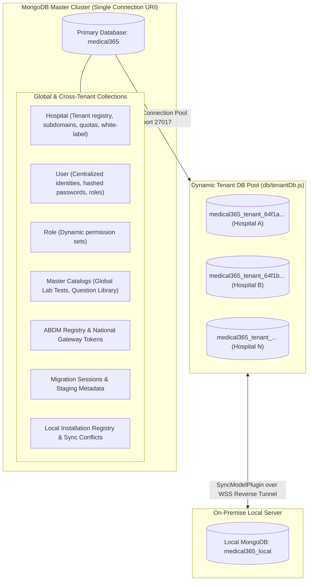

# Phase 24 — Database & API Architecture Reference

## 1. Database Architecture & Multi-Tenant Topology

Medical365 utilizes a **hybrid dual-layer MongoDB topology** designed to balance high-speed global lookups with strict tenant isolation and on-premise edge synchronization.

---

## 2. Complete Mongoose Model Catalog (80+ Schemas)

### 2.1 Core Identity, Security & Tenancy

| Model File | Collection Name | Tenant Key | Key Fields & Indexes |
| :--- | :--- | :--- | :--- |
| `hospital.model.js` | `hospitals` | `_id` | `slug` (unique), `customDomain` (sparse unique), `name`, `departments`, `departmentFees`, `subscriptionPlan`, `tier`, `whiteLabelEnabled`, `brandingSchema`. |
| `user.model.js` | `users` | `hospitalId` | `email` + `hospitalId` (unique), `phone`, `role`, `_roleData`, `password` (bcrypt), `patientId` / `mrn`, `isActive`. |
| `role.model.js` | `roles` | `hospitalId` | `name`, `hospitalId`, `permissions` (18 standard bitwise/string flags), `isSystemRole`. Unique index: `{ hospitalId: 1, name: 1 }`. |
| `session.model.js` | `sessions` | `hospitalId` | `userId`, `tokenHash`, `deviceInfo`, `ipAddress`, `lastActive`, `isActive`. Enforces single active session per user. |
| `tokenBlacklist.model.js`| `tokenblacklists`| None | `tokenHash`, `expiresAt` (TTL index). Blocks revoked JWTs instantly. |
| `loginOtp.model.js` | `loginotps` | `hospitalId` | `userId`, `email`, `otpHash` (SHA-256), `expiresAt` (10-minute TTL), `verified`. |
| `auditLog.model.js` | `auditlogs` | `hospitalId` | `userId`, `action`, `resource`, `ipAddress`, `payloadBefore`, `payloadAfter`, `timestamp`. |

### 2.2 Clinical Operations & Outpatient (OPD)

| Model File | Collection Name | Tenant Key | Key Fields & Indexes |
| :--- | :--- | :--- | :--- |
| `doctor.model.js` | `doctors` | `hospitalId` | `userId`, `name`, `specialization`, `assignedDepartment`, `consultationFee`, `roomNumber`, `availability`. |
| `appointment.model.js` | `appointments` | `hospitalId` | `userId`, `patientId`, `doctorId`, `appointmentDate`, `appointmentTime`, `tokenNumber`, `amount`, `status`, `paymentStatus`. |
| `clinicalVisit.model.js` | `clinicalvisits` | `hospitalId` | `appointmentId`, `patientId`, `doctorId`, `symptoms`, `diagnosis`, `vitals`, `clinicalNotes`. |
| `doctorAssistantPreparation.model.js` | `doctorassistantpreparations` | `hospitalId` | `appointmentId`, `triageVitals`, `chiefComplaints`, `questionnaireAnswers`, `preparedBy`. |
| `surgeryPlan.model.js` | `surgeryplans` | `hospitalId` | `patientId`, `surgeonId`, `otRoomId`, `surgeryDate`, `procedureName`, `anesthesiaType`, `status`. |
| `treatmentPlan.model.js` | `treatmentplans` | `hospitalId` | `patientId`, `doctorId`, `goals`, `phases`, `estimatedCost`, `startDate`, `status`. |

### 2.3 Inpatient (IPD), Wards & Intensive Care (ICU)

| Model File | Collection Name | Tenant Key | Key Fields & Indexes |
| :--- | :--- | :--- | :--- |
| `bed.model.js` | `beds` | `hospitalId` | `bedNumber`, `ward`, `bedType` (General, ICU, Private), `status` (AVAILABLE, OCCUPIED, MAINTENANCE), `currentPatient`, `currentAdmission`. Unique index: `{ hospitalId: 1, ward: 1, bedNumber: 1 }`. |
| `admission.model.js` | `admissions` | `hospitalId` | `patientId`, `ward`, `bedNumber`, `wardRatePerDay`, `wardHourlyRate`, `transferHistory`, `assignedNurses`, `dischargeReadiness`, `dischargeSummary`, `totalAmount`, `paymentStatus`. |
| `ipdVitals.model.js` | `ipdvitals` | `hospitalId` | `admissionId`, `patientId`, `pulse`, `bpSystolic`, `bpDiastolic`, `temperature`, `spo2`, `respiratoryRate`, `recordedBy`. |
| `ipdIntakeOutput.model.js` | `ipdintakeoutputs` | `hospitalId` | `admissionId`, `oralIntake`, `ivFluids`, `urineOutput`, `drainOutput`, `balanceMl`, `recordedAt`. |
| `ipdLine.model.js` | `ipdlines` | `hospitalId` | `admissionId`, `lineType` (IV Cannula, Central Line, PICC), `insertionSite`, `insertedAt`, `removedAt`. |
| `ipdCatheter.model.js` | `ipdcatheters` | `hospitalId` | `admissionId`, `catheterType` (Foley, Ryle's Tube), `sizeFr`, `insertedAt`, `removalDueAt`. |
| `ipdWoundCare.model.js` | `ipdwoundcares` | `hospitalId` | `admissionId`, `woundSite`, `woundCondition`, `dressingType`, `performedBy`, `nextDressingDue`. |
| `marRecord.model.js` | `marrecords` | `hospitalId` | `admissionId`, `medicineName`, `dosage`, `route`, `scheduledTime`, `administeredTime`, `administeredBy`, `status` (GIVEN, OMITTED, REFUSED). |
| `nursingNote.model.js` | `nursingnotes` | `hospitalId` | `admissionId`, `shift` (Morning, Evening, Night), `observation`, `actionTaken`, `nurseId`. |
| `nurseHandover.model.js` | `nursehandovers` | `hospitalId` | `ward`, `shiftFrom`, `shiftTo`, `outgoingNurseId`, `incomingNurseId`, `patientSummaries`. |

### 2.4 Diagnostic Laboratory & Blood Specimen Bank

| Model File | Collection Name | Tenant Key | Key Fields & Indexes |
| :--- | :--- | :--- | :--- |
| `lab.model.js` | `labs` | `hospitalId` | `name`, `email`, `phone`, `services`, `availability`, `facilities`. |
| `labTest.model.js` | `labtests` | `hospitalId` (null = global) | `name`, `code`, `price`, `hospitalPrices` (Map of Number overrides), `category`, `isActive`. |
| `labReport.model.js` | `labreports` | `hospitalId` | `appointmentId`, `patientId`, `userId`, `doctorId`, `testNames`, `testStatus`, `reportFile` (`url`, `fileId`), `paymentStatus`, `splitPayments`. |
| `vial.model.js` | `vials` | `hospitalId` | `vialId` (unique), `patientId`, `sampleType`, `storageLocation` (`room`, `unit`, `rack`, `box`, `position`), `status` (Stored, Moved, Retrieved, Returned, Discarded), `history`. |

### 2.5 Pharmacy, Supply Chain & Inventory

| Model File | Collection Name | Tenant Key | Key Fields & Indexes |
| :--- | :--- | :--- | :--- |
| `medicine.model.js` | `medicines` | `hospitalId` | `name`, `genericName`, `dosageForm`, `manufacturer`, `hsnCode`, `composition`. |
| `inventory.model.js` | `inventories` | `hospitalId` | `medicineId`, `batchNumber`, `expiryDate`, `quantity`, `costPrice`, `sellingPrice`, `reorderLevel`. |
| `pharmacyOrder.model.js` | `pharmacyorders` | `hospitalId` | `patientId`, `prescribedBy`, `medicines` (`medicineId`, `quantity`, `unitPrice`), `totalAmount`, `paymentStatus`. |
| `departmentStock.model.js` | `departmentstocks` | `hospitalId` | `department`, `medicineId`, `quantityOnHand`, `allocatedQuota`. |
| `departmentTransfer.model.js` | `departmenttransfers`| `hospitalId` | `fromDepartment`, `toDepartment`, `items`, `transferredBy`, `status`. |
| `purchaseInvoice.model.js` | `purchaseinvoices` | `hospitalId` | `vendorId`, `invoiceNumber`, `invoiceDate`, `subtotal`, `taxAmount`, `totalAmount`. |
| `vendor.model.js` | `vendors` | `hospitalId` | `name`, `contactPerson`, `phone`, `email`, `gstin`, `dlNumber`, `creditPeriodDays`. |

### 2.6 Financials, Packages, Refunds & AI

| Model File | Collection Name | Tenant Key | Key Fields & Indexes |
| :--- | :--- | :--- | :--- |
| `paymentTransaction.model.js` | `paymenttransactions` | `hospitalId` | `patientId`, `paymentMode` (Cash, UPI, Card, Split), `amount`, `splitPayments`, `transactionId`, `billedItems`. |
| `departmentUpi.model.js` | `departmentupis` | `hospitalId` | `staffUserId`, `staffRoleName`, `upiId`, `label`, `isActive`. Unique index: `{ hospitalId: 1, staffUserId: 1 }`. |
| `refundRequest.model.js` | `refundrequests` | `hospitalId` | `patientId`, `originalPaymentAmount`, `totalCharges`, `totalPaid`, `refundableAmount`, `refundAmount`, `refundMode`, `status`, `requestedBy`, `approvedBy`, `processedBy`. |
| `hospitalPackage.model.js` | `hospitalpackages` | `hospitalId` | `name`, `code`, `services` (`serviceName`, `includedQuantity`, `extraChargePerUnit`), `totalPrice`, `validityDays`. |
| `patientPackageAssignment.model.js` | `patientpackageassignments` | `hospitalId` | `patientId`, `packageId`, `snapshotServices`, `usageLog`, `totalPackageAmount`, `status` (ACTIVE, COMPLETED). |
| `aiWallet.model.js` | `aiwallets` | `hospitalId` (unique) | `balanceInr` (default: ₹2000), `totalConsumedInr`, `totalTokensUsed`, `byDoctor` (Map of consumption), `warningThresholdInr` (200). |
| `aiUsageLog.model.js` | `aiusagelogs` | `hospitalId` | `operation`, `userId`, `patientId`, `promptTokens`, `candidateTokens`, `totalCostInr`, `status`. |

### 2.7 Edge Sync & Data Migration

| Model File | Collection Name | Tenant Key | Key Fields & Indexes |
| :--- | :--- | :--- | :--- |
| `localInstallation.model.js` | `localinstallations` | `hospitalId` | `installationId` (unique), `pairingToken`, `agentTokenHash`, `status` (ONLINE, OFFLINE), `syncStatus`, `localHealth`. |
| `syncConflict.model.js` | `syncconflicts` | `hospitalId` | `conflictId` (unique), `entityType`, `entityId`, `localVersion`, `cloudVersion`, `localPayload`, `cloudPayload`, `status`, `resolutionType`. |
| `syncEvent.model.js` | `syncevents` | `hospitalId` | `entityType`, `entityId`, `operation` (INSERT, UPDATE, DELETE), `payload`, `version`, `syncedAt`. |
| `migrationSession.model.js` | `migrationsessions` | `hospitalId` | `migrationId` (unique), `status` (15 stages), `files`, `mappings`, `customFields`, `previewSummary`. |

---

## 3. Comprehensive REST API Route Catalog (51 Route Handlers)

### 3.1 Authentication & Central Governance

| Route File | Base Path | Key Endpoints | Auth Guard | Purpose |
| :--- | :--- | :--- | :--- | :--- |
| `auth.routes.js` | `/api/auth` | `POST /login`, `POST /refresh`, `POST /logout` | Public / Token | Central authentication, JWT issuance, token blacklisting. |
| `emailOtp.routes.js` | `/api/email-otp` | `POST /send`, `POST /verify` | Public | Two-step passwordless OTP authentication for hospital staff. |
| `hospital.routes.js` | `/api/hospitals` | `GET /`, `POST /`, `GET /:id`, `PUT /:id` | Central Admin | Hospital lifecycle, multi-tenant provisioning, white-label settings. |
| `superadmin.build.routes.js` | `/api/superadmin/build` | `POST /trigger`, `GET /status`, `GET /artifacts` | Central Admin | Automated Android APK/AAB builds via GitHub Actions workflow dispatch. |

### 3.2 Clinical Operations & Front Desk

| Route File | Base Path | Key Endpoints | Auth Guard | Purpose |
| :--- | :--- | :--- | :--- | :--- |
| `appointment.routes.js` | `/api/appointments` | `GET /`, `POST /`, `PUT /:id/status`, `GET /next-token` | Staff / Patient | OPD bookings, token generation, queue management. |
| `clinical.routes.js` | `/api/clinical` | `GET /visits`, `POST /visits`, `GET /patient/:id/history` | Doctor / Nurse | Clinical diagnoses, SOAP notes, vital observations. |
| `assistant.routes.js` | `/api/assistant` | `GET /queue`, `POST /triage-prep` | Doctor Assistant | Clinical assistant triage, questionnaire pre-filling. |
| `reception.routes.js` | `/api/reception` | `GET /today-tokens`, `POST /walk-in` | Receptionist | Front desk walk-in queue, token ticket printing. |

### 3.3 Inpatient (IPD), Wards & Nursing

| Route File | Base Path | Key Endpoints | Auth Guard | Purpose |
| :--- | :--- | :--- | :--- | :--- |
| `bed.routes.js` | `/api/beds` | `GET /`, `POST /`, `PUT /:id`, `DELETE /:id` | IPD Staff / Admin | Real-time bed inventory, ward management, maintenance states. |
| `admission.routes.js` | `/api/admissions` | `GET /`, `POST /`, `POST /:id/transfer`, `POST /:id/discharge` | IPD Staff | Inpatient admissions, inter-ward transfers, discharge readiness. |
| `ipdNursing.routes.js` | `/api/ipd/nursing` | `POST /vitals`, `POST /mar`, `POST /intake-output` | Ward Nurse | Shift vitals, Medication Administration Records (MAR), fluid charts. |
| `ot.routes.js` | `/api/ot` | `GET /rooms`, `POST /schedule-surgery` | OT Staff / Surgeon | Operating theater scheduling, surgical prep checklists. |

### 3.4 Diagnostic Laboratory & Bio-Repository

| Route File | Base Path | Key Endpoints | Auth Guard | Purpose |
| :--- | :--- | :--- | :--- | :--- |
| `labTest.routes.js` | `/api/lab-tests` | `GET /`, `POST /`, `PUT /:id` | Staff / Admin | Master test catalog, hospital-specific test price overrides. |
| `lab.routes.js` | `/api/labs` | `GET /reports`, `POST /reports`, `POST /reports/:id/upload` | Lab Technician | Diagnostic specimen intake, test execution, report PDF uploads. |
| `vial.routes.js` | `/api/vials` | `GET /`, `POST /intake`, `PUT /:id/move`, `PUT /:id/retrieve` | Lab Tech / Biobank | Specimen tracking, cryogenic 5-tier location addressing, audit logs. |

### 3.5 Pharmacy, Finance & Packages

| Route File | Base Path | Key Endpoints | Auth Guard | Purpose |
| :--- | :--- | :--- | :--- | :--- |
| `pharmacy.routes.js` | `/api/pharmacy` | `GET /inventory`, `POST /dispense`, `POST /transfer` | Pharmacist | Drug inventory, dispensing against electronic prescriptions. |
| `finance.routes.js` | `/api/finance` | `GET /dashboard`, `POST /payments`, `GET /patient/:id` | Accountant / Cashier | POS bill settlement, multi-tender split payments, revenue analytics. |
| `refund.routes.js` | `/api/refunds` | `POST /request`, `PUT /:id/approve`, `PUT /:id/complete` | Reception / Admin / Acct | Multi-stage refund requests, invariant validation, ledger return. |
| `package.routes.js` | `/api/packages` | `GET /`, `POST /`, `POST /assign`, `POST /assignments/:id/consume` | Admin / Cashier | Bundled healthcare packages, frozen service snapshots, quota consumption. |

### 3.6 AI, Ingestion & Hybrid Edge Sync

| Route File | Base Path | Key Endpoints | Auth Guard | Purpose |
| :--- | :--- | :--- | :--- | :--- |
| `aiWallet.routes.js` | `/api/ai-wallet` | `GET /balance`, `GET /transactions`, `GET /doctor-usage` | Admin / Doctor | Token usage ledger, doctor attribution, INR wallet balance. |
| `voiceScribe.routes.js` | `/api/voice-scribe` | `POST /transcribe-and-analyze` | Doctor | Audio consultation processing, multilingual extraction, SOAP synthesis. |
| `migration.routes.js` | `/api/migration` | `POST /upload`, `POST /validate`, `POST /execute`, `POST /rollback` | Hospital Admin | Legacy EMR data onboarding, column mapping, dry-run simulation. |
| `localSync.routes.js` | `/api/local-sync` | `POST /pairing-token`, `GET /status`, `PUT /conflicts/:id/resolve`| Hospital Admin | Hybrid edge local agent monitoring, sync conflict resolution. |

