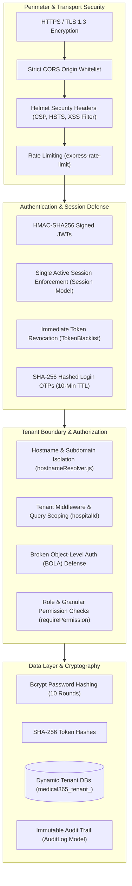

# Phase 26 — Security, Cryptography & Multi-Tenant Isolation

## 1. Security Architecture Overview

Medical365 enforces a multi-layered **Defense-in-Depth** security architecture designed to safeguard Protected Health Information (PHI) and financial transactions in accordance with Indian healthcare regulations (DISHA, Digital Personal Data Protection Act 2023, ABDM guidelines) and global standards (HIPAA).



---

## 2. Authentication & Session Security

### 2.1 Password Hashing & Master Authentication
- Passwords are encrypted using **bcrypt** with a work factor of 10 salt rounds before storage in `user.model.js`.
- Password policies (`validatePassword.js`) enforce a minimum length of 8 characters, requiring uppercase, lowercase, numbers, and special characters.

### 2.2 Two-Step Staff OTP Authentication
Hospital staff authenticate via passwordless email OTP:
1. When requested, a random 6-digit numeric token is generated.
2. The server stores only the **SHA-256 cryptographic digest** of the OTP (`otpHash`) in the `LoginOtp` collection with a strict **10-minute Time-To-Live (TTL)** index.
3. Plaintext OTPs are transmitted via encrypted SMTP and never logged in persistent production databases.
4. Brute-force protection limits verification attempts to 3 failures before invalidating the OTP session.

### 2.3 Single Active Session Enforcement (`session.model.js`)
To prevent credential sharing and unauthorized concurrent access:
- Upon successful login, a session record is created recording `userId`, `tokenHash`, `ipAddress`, and `deviceInfo`.
- If a user logs in from a second browser or device, prior sessions are immediately deactivated.
- Incoming API requests query the active session; if invalidated, the token is rejected with `401 Unauthorized`.

### 2.4 Immediate Token Revocation (`tokenBlacklist.model.js`)
Unlike standard stateless JWT implementations that remain valid until natural expiration:
- When a user logs out or is deactivated by an administrator, the token's cryptographic signature hash is inserted into `TokenBlacklist`.
- The blacklist features an automated MongoDB TTL index set to the remaining validity of the token.
- `verifyToken` checks incoming tokens against this blacklist in memory and DB, ensuring immediate session termination.

---

## 3. Multi-Tenant Isolation & BOLA Defense

### 3.1 Subdomain & Domain Resolution (`hostnameResolver.js`)
Tenancy is identified at the network boundary:
- Requests arriving at `apollo.medical365.com` or custom domains (e.g., `hms.cityhospital.in`) are resolved against the `Hospital` registry.
- The resolved `hospitalId` is stamped onto the execution context (`req.hospitalId`).

### 3.2 Automated Query Scoping
Every operational database query is strictly scoped to the authenticated tenant:
```javascript
// Example: Strict Tenant Scoping in Controller
const admissions = await Admission.find({
    hospitalId: req.user.hospitalId,
    status: 'Admitted'
});
```
Hospital administrators and staff can never query or mutate records belonging to another tenant.

### 3.3 Broken Object-Level Authorization (BOLA) Prevention
Attackers cannot access records from other hospitals simply by guessing MongoDB ObjectIds:
- When fetching a specific record (`/api/admissions/:id` or `/api/labs/reports/:id`), the backend validates both `_id: req.params.id` **AND** `hospitalId: req.user.hospitalId`.
- If an ObjectId exists but belongs to another hospital, the API returns `404 Not Found` (rather than `403 Forbidden`) to prevent resource enumeration.

---

## 4. Injection, Transport & File Upload Defenses

### 4.1 NoSQL Injection Protection
- Mongoose strict schema mode is enabled globally (`strict: true`), preventing arbitrary property injection.
- Unsanitized `$where`, `$regex`, or raw JSON objects passed in query parameters are rejected by schema validators.

### 4.2 Rate Limiting
Configured via `express-rate-limit`:
- **Auth Endpoints (`/api/auth`, `/api/email-otp`)**: Limited to 10 requests per 15-minute window per IP to eliminate brute-force password and OTP guessing.
- **AI Endpoints (`/api/ai/*`)**: Limited to prevent wallet exhaustion and external API rate limit penalties.
- **General API**: Global baseline limiting protecting against volumetric Denial-of-Service (DoS) attacks.

### 4.3 Secure File Uploads (`mediaValidator.js`)
- Uploaded diagnostic images, `.docx` consent forms, and lab reports are inspected using **magic byte file signatures** rather than trusting client-supplied file extensions.
- Maximum payload sizes are capped (10MB for PDFs/images, 25MB for audio files).
- Uploaded files are stored in MongoDB GridFS or encrypted cloud buckets with cryptographically generated UUIDs, mitigating path traversal attacks (`../../etc/passwd`).

---

## 5. Audit Logging & Regulatory Compliance (`auditLog.model.js`)

All critical administrative, financial, and clinical actions generate immutable audit log entries:
- **Actor Identity**: `userId`, `userRole`, `userName`.
- **Target Context**: `hospitalId`, `patientId`, `resource` (e.g., "PatientAdmission", "RefundRequest").
- **Mutation Delta**: `payloadBefore` and `payloadAfter` snapshots.
- **Network Footprint**: Client IP address and User-Agent string.
- **Timestamp**: High-precision UTC timestamp.

These logs cannot be updated or deleted through the application interface, fulfilling regulatory non-repudiation mandates.

