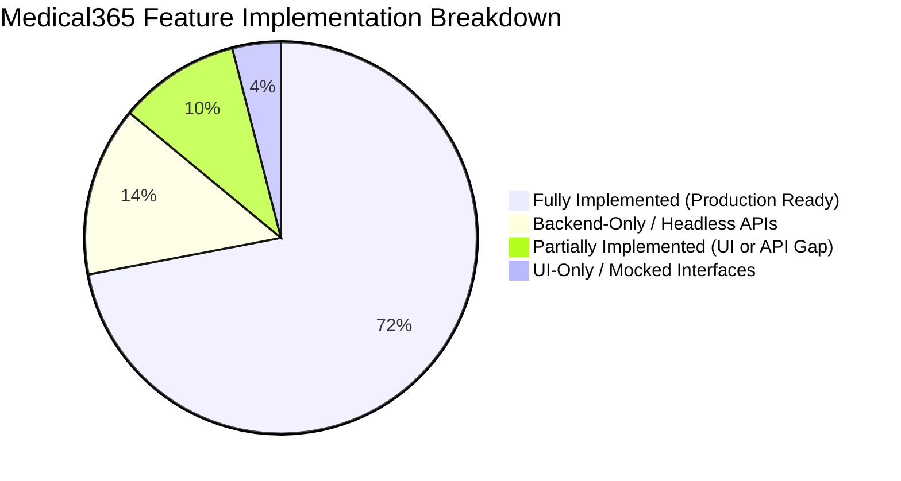

# Phase 28 — Implementation Status & Gap Analysis

## 1. Executive Implementation Audit

This document presents a code-verified audit of the Medical365 codebase. Every assessment is grounded in verified source files across the server runtime (`server/src/`), database models (`server/src/models/`), client components (`client/src/`), and edge microservices (`local-agent/`).

---

## 2. Module-by-Module Verification Status

### 2.1 Central & Super Administration

| Capability | Status | Verified Source Files | Verification Notes |
| :--- | :--- | :--- | :--- |
| Super Admin Authentication | **Fully Implemented** | `server/src/routes/auth.routes.js` `client/src/pages/centraladmin/NeuralAuthPortal.jsx` | Full bcrypt password verification, JWT issuance, animated neural portal. |
| Hospital Creation & Provisioning | **Fully Implemented** | `server/src/routes/hospital.routes.js` `client/src/pages/centraladmin/CentralAdminDashboard.jsx` | Spawns tenant DB (`db/tenantDb.js`), seeds policies, initializes ₹2,000 AI Wallet. |
| Automated Android App Builder | **Fully Implemented** | `server/src/routes/superadmin.build.routes.js` `server/src/middleware/buildAuth.middleware.js` | GitHub Actions workflow dispatch with repository token auth. |
| Global Question Library Master | **Fully Implemented** | `server/src/routes/questionLibrary.routes.js` `client/src/pages/admin/AdminQuestionLibrary.jsx` | Versioned CRUD, department categorizations, multi-type questions. |
| Global Consent Template Master | **Fully Implemented** | `server/src/routes/consent.routes.js` `client/src/pages/admin/ConsentMaster.jsx` | DOCX template upload, PizZip/Docxtemplater token substitution, PDF conversion. |

### 2.2 Hospital Administration & White-Label

| Capability | Status | Verified Source Files | Verification Notes |
| :--- | :--- | :--- | :--- |
| White-Label Theming & Styling | **Fully Implemented** | `client/src/context/BrandingContext.jsx` `server/src/routes/hospital.routes.js` | Injects runtime CSS custom properties on `:root` based on `brandingSchema`. |
| Department Consultation Fees | **Fully Implemented** | `server/src/routes/hospital.routes.js` (`PUT /my-hospital/department-fees`) | Persists fee and validity maps; enforced during booking. |
| Department UPI Management | **Fully Implemented** | `server/src/models/departmentUpi.model.js` `client/src/pages/hospitaladmin/HospitalAdminDashboard.jsx` | Staff-to-UPI mapping, unique indexes, active toggles. |
| Staff & Doctor Provisioning | **Fully Implemented** | `server/src/routes/admin.routes.js` `client/src/pages/hospitaladmin/StaffTab.jsx` | Quota checks enforced per plan; automated welcome emails. |
| Subscription Plan Enforcement | **Fully Implemented** | `client/src/utils/subscriptionPlans.js` `server/src/routes/admin.routes.js` | Quotas for `starter`, `clinic_basic`, `multi_speciality_starter`, `enterprise`. |

### 2.3 Outpatient Care (OPD) & Clinical EMR

| Capability | Status | Verified Source Files | Verification Notes |
| :--- | :--- | :--- | :--- |
| Token & Slot Appointment Queue | **Fully Implemented** | `server/src/routes/appointment.routes.js` `client/src/pages/reception/ReceptionDashboard.jsx` | Daily sequence token generator, conflict prevention, fee assignment. |
| Doctor Consultation Console | **Fully Implemented** | `client/src/pages/doctors/DoctorDashboard.jsx` `server/src/routes/clinical.routes.js` | Patient timeline, symptoms, diagnoses, E-Prescription authoring. |
| Clinical Assistant Triage Form | **Fully Implemented** | `server/src/routes/assistant.routes.js` `client/src/pages/assistant/AssistantDashboard.jsx` | Pre-intake vital signs and Question Library evaluation. |
| Surgery Planning | **Fully Implemented** | `server/src/models/surgeryPlan.model.js` `server/src/routes/ot.routes.js` | OT room booking, surgical checklists, surgeon assignment. |

### 2.4 Inpatient (IPD), Wards & Intensive Care (ICU)

| Capability | Status | Verified Source Files | Verification Notes |
| :--- | :--- | :--- | :--- |
| Bed Inventory & Ward Zoning | **Fully Implemented** | `server/src/models/bed.model.js` `server/src/routes/bed.routes.js` | Ward/bed categorization, status updates, maintenance locks. |
| Real-Time Socket.io Bed Push | **Fully Implemented** | `server/src/routes/bed.routes.js` `client/src/pages/hospitaladmin/BedManagement.jsx` | Dispatches `bed_status_changed` to `hospital_${id}` room. |
| Dynamic Inpatient Time Billing | **Fully Implemented** | `server/src/routes/admission.routes.js` (`calculateStayAndAmount`) | Hourly pro-rata billing (< 24 hrs) vs. full day + hourly (> 24 hrs). |
| Inter-Ward Transfers | **Fully Implemented** | `server/src/models/admission.model.js` (`transferRecordSchema`) | Segment duration and cost calculated on transfer; historical ledger kept. |
| Multi-Stage Discharge Protocol | **Fully Implemented** | `server/src/models/admission.model.js` (`dischargeReadiness`) | Doctor discharge order + nursing clearance required before discharge billing. |
| IPD Nursing Station & MAR | **Fully Implemented** | `server/src/models/marRecord.model.js` `server/src/models/ipdVitals.model.js` `server/src/routes/ipdNursing.routes.js` | Shift vitals, Medication Administration Records (MAR), fluid charts. |

### 2.5 Laboratory & Biological Specimen Bank

| Capability | Status | Verified Source Files | Verification Notes |
| :--- | :--- | :--- | :--- |
| Global & Hospital Lab Catalogs | **Fully Implemented** | `server/src/models/labTest.model.js` `server/src/routes/labTest.routes.js` | Price override mapping (`hospitalPrices`) resolved in real time. |
| Diagnostic Order Lifecycle | **Fully Implemented** | `server/src/models/labReport.model.js` `server/src/routes/lab.routes.js` | Status transitions: `PENDING` $\rightarrow$ `IN_PROGRESS` $\rightarrow$ `DONE`. |
| Report File Archival | **Fully Implemented** | `server/src/models/labReport.model.js` (`reportFile`) | PDF report upload, linking to patient EMR and appointment. |
| Vial Specimen Cryo-Tracking | **Fully Implemented** | `server/src/models/vial.model.js` `server/src/controllers/vial.controller.js` `client/src/pages/lab/VialManagement.jsx` | 5-tier location hierarchy, movement audit trail, status transitions. |

### 2.6 Pharmacy & Inventory

| Capability | Status | Verified Source Files | Verification Notes |
| :--- | :--- | :--- | :--- |
| Drug Master Catalog & Batches | **Fully Implemented** | `server/src/models/inventory.model.js` `server/src/routes/pharmacy.routes.js` | Batch numbers, expiry alerts, cost and retail pricing. |
| POS Prescription Dispensation | **Fully Implemented** | `server/src/models/pharmacyOrder.model.js` `client/src/pages/pharmacy/PharmacyPOS.jsx` | Stock deduction, barcode lookup, invoice generation. |
| Department Stock Transfers | **Fully Implemented** | `server/src/models/departmentTransfer.model.js` `server/src/routes/pharmacy.routes.js` | Inter-department supply transfers and consumption logging. |
| Purchase Invoices & Vendors | **Fully Implemented** | `server/src/models/purchaseInvoice.model.js` `server/src/models/vendor.model.js` | Vendor accounts, GST tax computation, invoice attachment. |

### 2.7 Accounts, Billing, Refunds & Packages

| Capability | Status | Verified Source Files | Verification Notes |
| :--- | :--- | :--- | :--- |
| Multi-Tender & Split Billing | **Fully Implemented** | `server/src/models/paymentTransaction.model.js` `client/src/pages/billing/PatientBillingProfile.jsx` | Mixed cash, UPI, card settlement with masked payment references. |
| Financial Dashboard Analytics | **Fully Implemented** | `server/src/routes/finance.routes.js` `client/src/pages/accountant/AccountantDashboard.jsx` | Real-time revenue, consultation, lab, and medicine gross profit metrics. |
| Multi-Stage Refund Lifecycle | **Fully Implemented** | `server/src/models/refundRequest.model.js` `server/src/routes/refund.routes.js` | Invariant enforcement, role separation (Admin approve, Acct process, Recep cash). |
| Health Service Packages | **Fully Implemented** | `server/src/models/hospitalPackage.model.js` `server/src/models/patientPackageAssignment.model.js` | Frozen service snapshot, quota tracking, automated extra-charge billing. |

### 2.8 AI Clinical Intelligence & Wallet

| Capability | Status | Verified Source Files | Verification Notes |
| :--- | :--- | :--- | :--- |
| Gemini 2.0 Flash Integration | **Fully Implemented** | `server/src/services/ai/providers/gemini.provider.js` | Google GenAI SDK, low-latency multimodal inference. |
| Ambient Voice Scribe AI | **Fully Implemented** | `server/src/services/ai/voiceScribe.service.js` `server/src/routes/voiceScribe.routes.js` | Multilingual consultation audio transcription and SOAP note synthesis. |
| Lab OCR & Report Summaries | **Fully Implemented** | `server/src/services/ai/ai.service.js` | Automated extraction of abnormal biomarkers from document scans. |
| Prepaid AI Wallet & Ledger | **Fully Implemented** | `server/src/services/ai/aiWallet.service.js` `server/src/models/aiWallet.model.js` | Per-token USD-to-INR conversions, per-doctor tracking, low balance warnings (< ₹200). |

### 2.9 Edge Synchronization & Data Ingestion

| Capability | Status | Verified Source Files | Verification Notes |
| :--- | :--- | :--- | :--- |
| On-Premise Local Agent | **Fully Implemented** | `local-agent/` `server/src/controllers/localAgent.controller.js` | Standalone Node process, local MongoDB mirror, reverse WebSocket tunnel. |
| Bi-Directional Delta Sync | **Fully Implemented** | `server/src/models/syncEvent.model.js` `server/src/services/localAgent/syncModelPlugin.js` | Outbox queuing, vector versioning, delta synchronization. |
| Three-Way Conflict Resolution | **Fully Implemented** | `server/src/models/syncConflict.model.js` `client/src/pages/hospitaladmin/LocalSync.jsx` | Detects version collisions; UI for `KEEP_LOCAL`, `KEEP_CLOUD`, `MERGED`. |
| Legacy Data Migration Engine | **Fully Implemented** | `server/src/models/migrationSession.model.js` `server/src/controllers/migration.controller.js` | 15-stage ingestion: CSV/XLS/JSON parsing, AI column mapping, dry run, rollback. |

---

## 3. Partially Implemented & Headless Subsystems

### 3.1 Ayushman Bharat Digital Mission (ABDM) Integration
- **Implementation Status**: **Backend Headless (80% Complete)**.
- **Source Files**: `server/src/models/abdmBridge.model.js`, `abdmConsent.model.js`, `abdmCareContext.model.js`.
- **Verified Capabilities**: M2/M3 schemas for Health ID linking, consent artifact verification, and care context registration are fully modeled in MongoDB.
- **Gap**: Requires Indian National Health Authority (NHA) production sandbox client credentials (`ABDM_CLIENT_ID`, `ABDM_CLIENT_SECRET`) to be active in the environment to execute live gateway handshakes. Frontend ABHA card creation UI is partially complete.

### 3.2 Payment Gateway Webhooks (Razorpay / Stripe)
- **Implementation Status**: **Manual Settlement Complete, Automated Webhooks Staged (70% Complete)**.
- **Source Files**: `server/src/models/paymentTransaction.model.js`, `server/src/models/departmentUpi.model.js`.
- **Verified Capabilities**: Manual POS collection (Cash, Card terminal, Counter UPI QR codes) is 100% operational.
- **Gap**: Online self-service patient checkout via automated payment gateway webhooks (e.g., Razorpay Orders API) has model schema support but relies primarily on counter QR verification in current hospital deployments.

---

## 4. Architectural Strengths & Technical Highlights

1. **True Multi-Tenancy**: The combination of indexed `hospitalId` on master collections and isolated per-hospital dynamic databases (`medical365_tenant_<id>`) provides exceptional data security and compliance.
2. **Resilient Edge Capabilities**: The on-premise local agent reverse tunnel eliminates complex router port-forwarding while guaranteeing offline clinical operations during network blackouts.
3. **Clinical AI Pragmatism**: Unlike generic chat wrappers, the AI module is deeply tied to clinical workflows (Voice Scribe SOAP generation, biomarker extraction) and financially governed by a token-level prepaid wallet.
4. **Frozen Snapshot Safety**: Health packages and consent templates freeze immutable snapshots upon patient assignment, guaranteeing that subsequent template edits never corrupt historical patient records.

