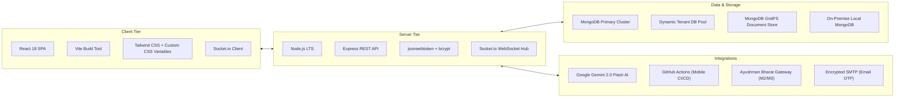

# Medical365 Hospital Management System (HMS) — Master Technical Documentation

Welcome to the official, exhaustive technical documentation suite for the **Medical365 Hospital Management System (HMS)**.

This repository documentation represents a complete, deep-dive architectural analysis of the Medical365 multi-tenant, white-label healthcare management platform, encompassing cloud and offline edge services, clinical workflows, diagnostic laboratories, financial accounting, and artificial intelligence integration.

---

## 1. Documentation Index (30 Comprehensive Volumes)

| Vol | Document Title | Primary Focus & Domain |
| :---: | :--- | :--- |
| **00** | [00-Executive-Summary.md](./00-Executive-Summary.md) | Platform overview, 4 architectural pillars, high-level technology topology. |
| **01** | [01-System-Architecture.md](./01-System-Architecture.md) | Dual MongoDB topology, Express middleware pipeline, React SPA client, external APIs. |
| **02** | [02-Super-Admin-Management.md](./02-Super-Admin-Management.md) | Neural Auth Portal, central admin dashboard, automated Android APK/AAB builder. |
| **03** | [03-Question-Library.md](./03-Question-Library.md) | Global master clinical assessment questionnaires, conditional branching, types. |
| **04** | [04-Consent-Management.md](./04-Consent-Management.md) | Medical-legal consent templates, DOCX token replacement, LibreOffice PDF rendering. |
| **05** | [05-Roles-and-Permissions.md](./05-Roles-and-Permissions.md) | 18 permission flags, role management, `PERMISSION_NAV_MAP`, RBAC middleware. |
| **06** | [06-Plan-Management.md](./06-Plan-Management.md) | 4 subscription tiers (`starter`, `clinic_basic`, `multi_speciality_starter`, `enterprise`), quotas. |
| **07** | [07-Hospital-Creation-and-Onboarding.md](./07-Hospital-Creation-and-Onboarding.md) | Provisioning workflow, tenant DB creation, policy seeding, ₹2,000 AI Wallet setup. |
| **08** | [08-White-Label-Management.md](./08-White-Label-Management.md) | Runtime CSS custom property injection, subdomain resolution, dynamic theming. |
| **09** | [09-Hospital-Admin-and-Authentication.md](./09-Hospital-Admin-and-Authentication.md) | Passwordless email OTP, SHA-256 digests, single active session enforcement. |
| **10** | [10-Hospital-Admin-Dashboard.md](./10-Hospital-Admin-Dashboard.md) | In-depth breakdown of all 10 administrative dashboard tabs and subsystems. |
| **11** | [11-Valid-Management-and-Movement.md](./11-Valid-Management-and-Movement.md) | Biological specimen Vial cryo-tracking, bed movements, pharmacy department transfers. |
| **12** | [12-Staff-Management.md](./12-Staff-Management.md) | Non-doctor staff onboarding, quota enforcement, role mapping, welcome emails. |
| **13** | [13-Doctor-Management.md](./13-Doctor-Management.md) | Doctor profiles, OPD queues, consultation fee overrides, electronic prescriptions. |
| **14** | [14-Hospital-Overview-and-Departments.md](./14-Hospital-Overview-and-Departments.md) | Department consultation fee schedules, follow-up validity, counter UPI mapping. |
| **15** | [15-Bed-Room-ICU-Management.md](./15-Bed-Room-ICU-Management.md) | Bed zoning (ICU/Ward), dynamic hourly stay billing, multi-stage discharge clearance. |
| **16** | [16-Laboratory-Management.md](./16-Laboratory-Management.md) | Hybrid diagnostic test catalogs, pricing overrides, specimen orders, report archival. |
| **17** | [17-Hospital-Question-Library.md](./17-Hospital-Question-Library.md) | Tenant-isolated clinical questionnaires, department scoping, multi-language engine. |
| **18** | [18-Accounts-and-Payment-Management.md](./18-Accounts-and-Payment-Management.md) | Point-of-sale split payments (Cash/UPI/Card), financial analytics, counter QR codes. |
| **19** | [19-AI-Module.md](./19-AI-Module.md) | Google Gemini 2.0 Flash, Voice Scribe ambient SOAP notes, prepaid ₹2,000 AI Wallet. |
| **20** | [20-Refund-Management.md](./20-Refund-Management.md) | Multi-stage refund lifecycle, financial invariant checks, separation of duties. |
| **21** | [21-Package-Management.md](./21-Package-Management.md) | Bundled healthcare packages, frozen service snapshots, quota consumption rules. |
| **22** | [22-Data-Migration.md](./22-Data-Migration.md) | Legacy EMR ingestion, AI entity detection, column mapping, dry-run simulation, rollback. |
| **23** | [23-Local-Data-Sync.md](./23-Local-Data-Sync.md) | On-premise Local Agent, WebSocket reverse tunnel, offline resilience, conflict resolution. |
| **24** | [24-Database-and-API-Reference.md](./24-Database-and-API-Reference.md) | Exhaustive reference of 80+ Mongoose models and 51 Express REST route handlers. |
| **25** | [25-Role-Based-Access-Matrix.md](./25-Role-Based-Access-Matrix.md) | Tabular permission matrix mapping 11 user roles across all platform capabilities. |
| **26** | [26-Security-and-Tenant-Isolation.md](./26-Security-and-Tenant-Isolation.md) | Cryptography, token blacklists, BOLA defense, rate limiting, regulatory compliance. |
| **27** | [27-Complete-End-to-End-Workflow.md](./27-Complete-End-to-End-Workflow.md) | Unified end-to-end lifecycle connecting provisioning, clinical care, billing, and sync. |
| **28** | [28-Implementation-Status-and-Gap-Analysis.md](./28-Implementation-Status-and-Gap-Analysis.md) | Verified audit of implemented features, headless APIs, and architectural roadmap. |
| **README** | [README.md](./README.md) | Documentation index, stakeholder navigation tracks, technical glossary. |

---

## 2. Stakeholder Navigation Tracks

### For Software Architects & Backend Engineers
Begin with the core technical architecture and data topology:
1. [01-System-Architecture.md](./01-System-Architecture.md) — System topology, middleware pipelines, and tenant routing.
2. [24-Database-and-API-Reference.md](./24-Database-and-API-Reference.md) — Complete 80+ model schemas and 51 route endpoints.
3. [26-Security-and-Tenant-Isolation.md](./26-Security-and-Tenant-Isolation.md) — Authentication, token blacklists, and BOLA defense.
4. [23-Local-Data-Sync.md](./23-Local-Data-Sync.md) — Hybrid edge local agent and WebSocket reverse tunnel.

### For Hospital Administrators & Operations Teams
Focus on institutional configuration, staff governance, and financial workflows:
1. [08-White-Label-Management.md](./08-White-Label-Management.md) — Logos, brand colors, custom domains, and theming.
2. [10-Hospital-Admin-Dashboard.md](./10-Hospital-Admin-Dashboard.md) — Guide to all 10 administrative dashboard tabs.
3. [12-Staff-Management.md](./12-Staff-Management.md) & [13-Doctor-Management.md](./13-Doctor-Management.md) — Team provisioning.
4. [14-Hospital-Overview-and-Departments.md](./14-Hospital-Overview-and-Departments.md) — Department consultation fees and counter UPI setup.
5. [18-Accounts-and-Payment-Management.md](./18-Accounts-and-Payment-Management.md) & [20-Refund-Management.md](./20-Refund-Management.md) — Financial settlement and refunds.

### For Super Administrators & Platform Owners
Focus on platform multi-tenancy, commercial plans, and automated mobile builds:
1. [02-Super-Admin-Management.md](./02-Super-Admin-Management.md) — Central admin dashboard and Android APK builder.
2. [06-Plan-Management.md](./06-Plan-Management.md) — Subscription tiers, doctor/staff capacity limits, and quotas.
3. [07-Hospital-Creation-and-Onboarding.md](./07-Hospital-Creation-and-Onboarding.md) — Automated tenant provisioning and AI wallet injection.
4. [03-Question-Library.md](./03-Question-Library.md) & [04-Consent-Management.md](./04-Consent-Management.md) — Global master templates.

### For Implementation & Quality Assurance Teams
Focus on data ingestion, system workflows, and code verification:
1. [22-Data-Migration.md](./22-Data-Migration.md) — 15-stage legacy data migration pipeline and rollback.
2. [27-Complete-End-to-End-Workflow.md](./27-Complete-End-to-End-Workflow.md) — Comprehensive 8-stage operational sequence.
3. [28-Implementation-Status-and-Gap-Analysis.md](./28-Implementation-Status-and-Gap-Analysis.md) — Verified implementation audit.

---

## 3. Technology Stack Summary

---

## 4. Technical Glossary & Core Concepts

- **Dual-Layer Multi-Tenancy**: Architecture where global user identities and metadata reside in a master database with indexed `hospitalId`, while institutional clinic data is dynamically routed to isolated tenant databases (`medical365_tenant_<id>`).
- **Dynamic White-Label Injection**: Real-time CSS custom property injection onto the DOM root element (`:root`) driven by the tenant's `brandingSchema`, eliminating the need to recompile the frontend for each hospital brand.
- **AI Wallet**: A prepaid token-metering subsystem that converts Gemini API token consumption to Indian Rupees (INR), enforces per-doctor attribution, and triggers automated low-balance warnings (< ₹200) and hard overdraft stops (<= ₹0).
- **Frozen Snapshot Pattern**: A data integrity pattern used in Health Packages and Consent Management where template attributes and service rules are frozen into the patient's record at assignment time, insulating active patient care from subsequent administrative edits.
- **WebSocket Reverse Tunnel**: An outbound persistent WebSocket connection (`/tunnel`) initiated by the on-premise Local Agent to the cloud server, allowing bi-directional synchronization without requiring static public IPs or inbound firewall port forwarding at the hospital facility.
- **5-Tier Cryo-Storage Address**: Hierarchical biological sample coordinate system (`Room -> Unit -> Rack -> Box -> Position`) used by the Vial Management module for exact physical specimen retrieval.
- **Medication Administration Record (MAR)**: Inpatient electronic chart used by ward nurses to document scheduled drug administrations with shift notes, omission reasons, and doctor cosigns.

